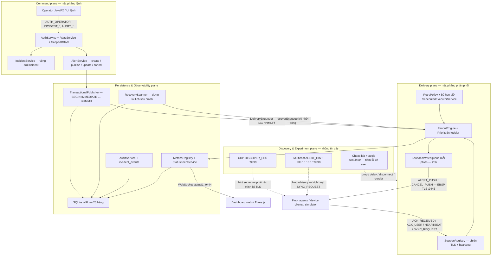
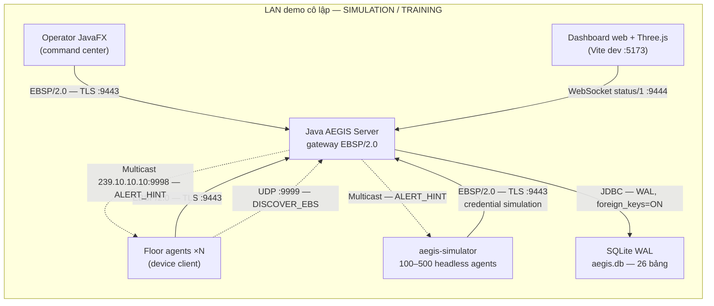
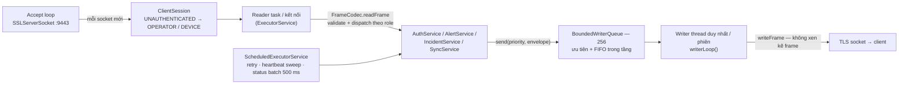
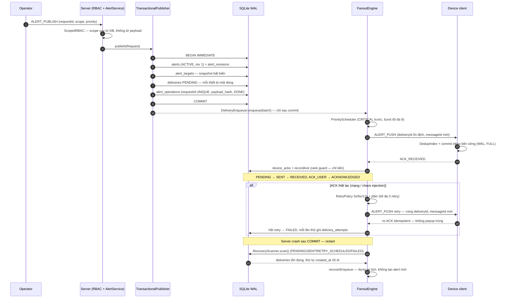

# Kiến trúc hệ thống AEGIS-EBS

**Loại tài liệu:** Mô tả kiến trúc phần mềm (Software Architecture Description) — đồ án capstone CMP180.

**Tình trạng:** Tài liệu mô tả thiết kế đã được phê duyệt trong blueprint và ánh xạ vào mã nguồn hiện hành của repository `aegis-ebs`. Hệ thống phục vụ nghiên cứu, mô phỏng và huấn luyện học thuật (**SIMULATION / TRAINING**); không thay thế hệ thống báo cháy, sơ tán hay cảnh báo an toàn sinh mạng.

**Nguồn chính:**

- `Plan/AEGIS_MASTER_BLUEPRINT.md` — §5 (máy trạng thái và bất biến), §6 (kiến trúc vật lý / logic / triển khai), §7 (giao thức EBSP/2.0), §8 (kiến trúc dữ liệu).
- Mã nguồn các module: `aegis-protocol`, `aegis-core`, `aegis-persistence`, `aegis-server`, `aegis-client`, `aegis-network-lab`, `aegis-simulator`, `aegis-dashboard`.
- Schema SQLite thật: `aegis-persistence/src/main/resources/db/001_base_schema.sql` (12 bảng) và `002_showcase_expansion.sql` (14 bảng) — tổng cộng **26 bảng**, đặc tả chi tiết trong [`docs/ERD.md`](ERD.md).
- Tài liệu liên quan: [`docs/PROTOCOL.md`](PROTOCOL.md) (wire contract EBSP/2.0), `aegis-dashboard/docs/status-contract.md` (hợp đồng feed trạng thái `status/1`).

---

## 1. Tổng quan và nguyên tắc kiến trúc

AEGIS-EBS là nền tảng **chỉ huy sự cố (incident command) + phân phối cảnh báo tin cậy (reliable distribution) + bản sao số (digital twin) + phòng thí nghiệm lỗi mạng có quan sát (observable network fault lab)**, được xây dựng theo kiểu **modular monolith** bằng Java. Trục đánh giá của môn CMP180 là **tự xây dựng giao thức tầng ứng dụng trên TCP/UDP** (Socket/ServerSocket, DatagramSocket, MulticastSocket); hệ thống không sử dụng cloud push hay message broker làm kênh truyền tải chính.

Các nguyên tắc kiến trúc xuyên suốt:

1. **Tách biệt bốn mặt phẳng (four planes):** command, delivery, persistence–observability, discovery–experiment (§2). Mỗi mặt phẳng có trách nhiệm, ranh giới tin cậy và cơ chế bảo vệ riêng.
2. **Một node server duy nhất trong LAN.** Điểm lỗi đơn (single point of failure) được thừa nhận tường minh; crash recovery trên node không tương đương high availability. Cluster / floor relay chỉ thuộc hạng mục nghiên cứu tùy chọn (P3).
3. **Durable-first (transactional outbox):** mọi trạng thái alert / target / delivery phải được commit vào SQLite **trước khi** xếp hàng phát ra mạng; hàng đợi dispatch bền vững chính là bảng `deliveries` (§6).
4. **TCP/TLS là kênh xác thực duy nhất.** UDP discovery và multicast hint là nguồn tin **không xác thực**, chỉ mang tính gợi ý (advisory); client chỉ hiển thị cảnh báo sau khi xác minh qua phiên TLS đã xác thực.
5. **Tài nguyên bị chặn (bounded) ở mọi tầng:** frame tối đa 64 KiB, hàng đợi writer mỗi phiên 256 phần tử, thread pool bị chặn, giao dịch DB ngắn, retention có giới hạn — không cấp phát bộ nhớ không giới hạn từ dữ liệu dị dạng.
6. **Hợp đồng dùng chung bất biến:** `aegis-protocol` (EBSP/2.0) và schema 26 bảng là nền tảng chung của mọi module; thay đổi wire contract đòi hỏi tăng phiên bản, thay đổi schema đòi hỏi migration additive.

### 1.1 Bản đồ module hiện hành

Blueprint §6.3 đề xuất cây package tham chiếu; repository hiện thực gộp một số module đề xuất vào `aegis-core` (logic thuần) và `aegis-server` (dịch vụ ứng dụng), và hiện thực dashboard bằng web + Three.js thay cho JavaFX thuần:

| Module | Công nghệ | Trách nhiệm chính |
|---|---|---|
| `aegis-protocol` | Java, Jackson | Hợp đồng wire EBSP/2.0: `FrameCodec`, `Envelope`, `MessageType`, `Priority`, `Role`; framing length-prefix, validation. |
| `aegis-core` | Java (thuần, không I/O) | Logic dùng chung hai phía server/client: `ScopedRBAC`, `TargetResolver`, `PriorityScheduler`, `RetryPolicy`, `DedupIndex`, `AckLedger`, `Grants`. |
| `aegis-persistence` | Java, sqlite-jdbc | `Db` (WAL + pragmas), `MigrationRunner` (001 + 002), các repo, `TransactionalPublisher`, `RecoveryScanner`, `DeliveryEnqueuer`. |
| `aegis-server` | Java, SLF4J/Logback, Argon2-jvm | Gateway TLS, `ClientSession`, `SessionRegistry`, `BoundedWriterQueue`, `FanoutEngine`, `AuthService`/`RbacService`, `AlertService`, `IncidentService`, `SyncService`, `AuditService`, `MetricsRegistry`, `StatusNotifier`, `ServerStore`. |
| `aegis-client` | Java, JavaFX, sqlite-jdbc | Device client / operator UI: `AlertClientEngine` (headless engine), `InboxStore` (inbox bền vững), `ClientApp` (JavaFX), `TlsSupport`, reconnect + ACK. |
| `aegis-simulator` | Java | Tác nhân thiết bị headless số lượng lớn (mục tiêu 100 client bắt buộc, 200–500 mở rộng) + fault injection, chạy ở chế độ simulation tường minh. |
| `aegis-network-lab` | Java | UDP discovery (`DiscoveryServer`/`DiscoveryClient`), multicast/unicast hint (`MulticastHintPublisher`/`Subscriber`, `UnicastHintPublisher`/`Subscriber`), TLS lab (`LabTlsServer`/`LabTlsClient`), benchmark (`FanoutBenchmark`). |
| `aegis-dashboard` | Node, Vite, Three.js | Digital twin web 2D/3D; client tham chiếu của feed `status/1` (`src/data.js`, `src/ws.js`); không phải backend thứ hai. |

Quan hệ phụ thuộc Maven: `protocol ← core ← {persistence, server, client, simulator}`; `server ← {protocol, core, persistence}`; `network-lab ← protocol`. Dashboard độc lập (Node), chỉ giao tiếp qua WebSocket `status/1`.

---

## 2. Mô hình bốn mặt phẳng (blueprint §6.1)

### 2.1 Command plane — mặt phẳng lệnh

Chịu trách nhiệm **điều khiển có thẩm quyền**: đăng nhập operator, xác thực danh tính và phạm vi (scope), tạo / chuyển trạng thái incident, tạo / phát / cập nhật / hủy alert. Mọi lệnh đi qua EBSP/2.0 trên TLS (`AUTH_OPERATOR`, `INCIDENT_CREATE`, `INCIDENT_TRANSITION`, `ALERT_CREATE`, `ALERT_PUBLISH`, `ALERT_UPDATE`, `ALERT_CANCEL`) và được trả lời bằng `COMMAND_RESULT` với mã lỗi typed.

Hiện thực: `AuthService` + `RbacService` (server) gọi `ScopedRBAC` (core); `IncidentService` quản lý vòng đời incident; `AlertService` điều phối publish/update/cancel trên `TransactionalPublisher`. **RBAC được thực thi trước khi dịch vụ alert chạy**; scope target suy ra từ DB (`TargetResolver`), không bao giờ từ metadata role/floor do client gửi lên. Lệnh ngoài phạm vi bị từ chối (`ACCESS_DENIED` / `INVALID_SCOPE`) và ghi audit.

### 2.2 Delivery plane — mặt phẳng phân phối

Chịu trách nhiệm **phân phối tin cậy** tới các phiên thiết bị đã xác thực: quản lý phiên (`SessionRegistry`), fanout theo ưu tiên (`FanoutEngine` + `PriorityScheduler`), hàng đợi writer bị chặn mỗi phiên (`BoundedWriterQueue`), retry có backoff (`RetryPolicy`), tiếp nhận ACK và đồng bộ lại sau reconnect (`SyncService`). Mỗi thiết bị đích có đúng một bản ghi `deliveries` cho mỗi bộ `(alertId, revision, deviceId)`; mỗi lần thử truyền dùng `messageId` mới nhưng giữ nguyên `deliveryId` logic.

### 2.3 Persistence & Observability plane — mặt phẳng lưu trữ và quan sát

Chịu trách nhiệm **nguồn sự thật bền vững và đo lường**: SQLite WAL (26 bảng), publish nguyên tử (`TransactionalPublisher`), khôi phục sau crash (`RecoveryScanner`), audit append-only (`AuditService`), nhật ký sự kiện incident (`incident_events`) cho replay chỉ đọc, metrics (`MetricsRegistry`) và cầu nối feed trạng thái dashboard (`StatusNotifier` → `StatusFeedService`, WebSocket `status/1`). Điểm nghẽn một writer của SQLite được thừa nhận và giảm thiểu bằng giao dịch ngắn, `busy_timeout` và pool worker bị chặn (§5.5).

### 2.4 Discovery & Experiment plane — mặt phẳng khám phá và thực nghiệm

Chịu trách nhiệm **khám phá server và thực nghiệm mạng có kiểm soát** trên LAN demo cô lập: UDP `DISCOVER_EBS` cổng 9999 (nonce, protocolVersion, clientType; phản hồi chứa serverId, host, tlsPort, nonce echo) và multicast `ALERT_HINT` tới nhóm `239.10.10.10:9998` (nhóm administratively-scoped). Cả hai đều **không được tin cậy**: hint chỉ kích hoạt `SYNC_REQUEST` qua TLS; client luôn xác minh danh tính server bằng truststore trước khi xác thực. Chaos lab (drop/delay ACK, duplicate, force disconnect, reorder ở tầng mô phỏng message, restart server) chạy qua simulator và các adapter của gateway, có seed để tái lập deterministically.

### 2.5 Sơ đồ tổng hợp bốn mặt phẳng

---

## 3. Mô hình triển khai (blueprint §6.2)

### 3.1 Sơ đồ triển khai

### 3.2 Bảng cổng và kênh truyền

| Cổng | Vận chuyển | Mục đích | Mức tin cậy |
|---|---|---|---|
| 9443 | TCP + TLS | EBSP/2.0: handshake, lệnh operator, ALERT_PUSH/CANCEL_PUSH, ACK, SYNC, HEARTBEAT, STATUS_SUBSCRIBE | Xác thực hai chiều qua truststore + credential; kênh chính duy nhất |
| 9444 | TCP + WebSocket | Feed `status/1` cho dashboard: `STATUS_SNAPSHOT` / `STATUS_DELTA` | Chỉ đọc; cầu nối từ trạng thái EBSP của server |
| 9999 | UDP | `DISCOVER_EBS` / phản hồi discovery (serverId, host, tlsPort, nonce echo) | Không tin cậy; chỉ là gợi ý tìm server |
| 9998 | UDP multicast, nhóm `239.10.10.10` | `ALERT_HINT {alertId, revision, serverId}` | Không tin cậy; advisory, không hiển thị trực tiếp |
| 5173 | TCP + HTTP | Vite dev server của dashboard (chỉ môi trường phát triển) | Không phải kênh nghiệp vụ |

Cấu hình mặc định của server (`ServerConfig`): `tlsPort=9443`, `wsPort=9444`, `buildingId="AEGIS-BLD-A"`, heartbeat 10 s / suspect sau 3 lần lỡ, retry nền 3 s tối đa 3 lần, hàng đợi writer 256, gom batch status 500 ms, Argon2id (iterations=2, memory=16 MiB, parallelism=1). Cổng có thể đặt 0 (ephemeral) trong kiểm thử.

### 3.3 Ghi chú triển khai

- **Một server, một file DB.** Toàn bộ trạng thái bền vững nằm trong `aegis.db` (SQLite WAL) trên cùng host server; không có backend thứ hai cho dashboard.
- **Simulator bắt buộc chạy chế độ simulation tường minh**, dùng credential phi sản xuất và định danh chỉ dành cho kiểm thử; UI và nội dung luôn hiển thị dấu SIMULATION / TRAINING. Cờ `simulation` trong payload **không phải ranh giới bảo mật** — demo mode của server và allowlist thiết bị riêng mới là kiểm soát bảo mật.
- **Multicast cần LAN thật hỗ trợ multicast** (đặt TTL/interface, rate limit, mặc định tắt ngoài lab kiểm soát); multicast qua tunnel kiểu Tailscale thường thất bại. Trên một host macOS duy nhất, dùng fallback unicast (`UnicastHintPublisher` / `UnicastHintSubscriber`) để demo hint bus.
- **Dashboard** là ứng dụng web (Vite + Three.js) render digital twin từ feed `status/1`; không mở backend riêng. Client dashboard có backoff reconnect 1 s → 15 s + jitter và chế độ MOCK sau 3 lần kết nối thất bại (badge `MOCK FEED`), tự chuyển về LIVE khi nối lại được server.
- Không điều khiển thiết bị vật lý thật (còi, thang máy, cửa, khóa); kịch bản chỉ tác động các client demo được cấp quyền.

---

## 4. Hợp đồng module (blueprint §6.4)

### 4.1 Bảng hợp đồng

Ánh xạ bảng hợp đồng nội bộ của blueprint vào module hiện hành:

| Module / thành phần | Input | Output / Contract | Phụ thuộc |
|---|---|---|---|
| Protocol (`aegis-protocol`) | bytes, envelope | Frame đã validate + typed message; framing `uint32 BE length + UTF-8 JSON`, L ∈ [1, 65536]; từ chối frame quá khổ **trước khi** cấp phát | Jackson, Java I/O |
| Gateway (`ClientSession`, accept loop) | TLS socket | Sự kiện AuthenticatedSession; mỗi phiên một reader + một writer | Protocol, Auth |
| Identity (`AuthService`, `RbacService`, `ScopedRBAC`) | credential / session | principal + scope (grants suy từ DB) | Persistence, Argon2id |
| Incident (`IncidentService`) | create / transition | Dòng sự kiện bền vững (`incident_events`) | Persistence, Policy |
| Alert (`AlertService`, `TransactionalPublisher`) | create / publish / cancel | Revision bất biến + target snapshot bất biến; bản ghi idempotency `alert_operations` | Auth, Persistence |
| Fanout (`FanoutEngine`, `TargetResolver`, `PriorityScheduler`) | target snapshot | Phần tử hàng đợi bị chặn theo thiết bị; thứ tự ưu tiên có fairness | Persistence, SessionRegistry |
| Delivery (`FanoutEngine`, `RetryPolicy`, `DeliveryRepo`) | ACK / timeout | Cập nhật trạng thái chỉ tiến (rank guard), retry task, `delivery_attempts` | Persistence, Fanout |
| Presence (`SessionRegistry`) | heartbeat / connect | Trạng thái online / suspect / offline + kích hoạt sync | SessionRegistry |
| Client (`AlertClientEngine`, `InboxStore`) | frames | Commit DB cục bộ **trước** ACK + sự kiện UI + ACK; dedup, reconnect | Protocol, Core, ClientStore |
| Dashboard (`aegis-dashboard`) | Sự kiện trạng thái `status/1` | Biểu đồ, bản đồ số, lệnh operator | Auth/TLS (lệnh), WS (feed) |
| Chaos Lab (`aegis-simulator`, `aegis-network-lab`) | scenario + seed | Fault events + kết quả tái lập được | Simulator / Gateway adapters |

### 4.2 Quy tắc hợp đồng bắt buộc

1. **Một `SessionWriter` sở hữu toàn bộ ghi lên một stream.** Nhiều task executor không bao giờ được trộn byte của các frame khác nhau trên cùng một Socket; hiện thực: mỗi `ClientSession` có đúng một writer thread chạy `writerLoop()` lấy frame từ `BoundedWriterQueue`.
2. **Không thực hiện I/O mạng bên trong giao dịch DB.** Giao dịch chỉ chứa thao tác SQLite ngắn; enqueue mạng xảy ra sau COMMIT.
3. **Hàng đợi bị chặn ở mọi nơi** để chống tăng trưởng bộ nhớ không giới hạn; mỗi hàng đợi writer có chính sách slow-client tường minh (§5.2).
4. **`DeliveryEnqueuer` chỉ được gọi sau khi giao dịch publish commit** (hoặc bởi `RecoveryScanner` khi dựng lại lịch sau restart). Đây là hợp đồng then chốt của transactional outbox.
5. **Hợp đồng wire và schema là bất biến dùng chung**: không module nào tự ý đổi framing, enum, hay cột; thay đổi phải qua version bump / migration additive.

---

## 5. Mô hình đồng thời (concurrency model)

### 5.1 Accept loop + reader mỗi kết nối + writer mỗi phiên

Mô hình luồng của server theo blueprint §6.4 và hiện thực `ClientSession`:

- **Accept loop:** một luồng chấp nhận kết nối trên `SSLServerSocket` (TLS :9443). Mỗi socket được chấp nhận tạo thành một `ClientSession` (khởi đầu `UNAUTHENTICATED`), đăng ký vào `SessionRegistry` và được gán tác vụ đọc riêng.
- **Reader mỗi kết nối:** một task trong `ExecutorService` đọc tuần tự từng frame bằng `FrameCodec` (`readFully` 4 byte length rồi payload), validate UTF-8 / JSON / version / enum / quyền theo role, rồi dispatch tới dịch vụ tương ứng (Auth, Alert, Incident, Sync, Heartbeat). Một kết nối chỉ có một reader nên thứ tự frame vào được bảo toàn.
- **Writer mỗi phiên:** ngay khi tạo session, `writerExecutor.execute(this::writerLoop)` chạy **một luồng ghi duy nhất** cho phiên đó: `queue.take()` (chặn tới khi có frame hoặc queue đóng) rồi `codec.writeFrame(out, next)`. Nhờ đó frame không bao giờ xen kẽ byte, và broken pipe / lỗi codec chỉ đóng đúng kết nối đó.
- **Bộ hẹn giờ:** `ScheduledExecutorService` (`timers` trong `FanoutEngine`) lên lịch retry theo `next_retry_at`, quét heartbeat suspect, và gom batch feed trạng thái (mặc định 500 ms). Logic thời gian thuần được tiêm `Clock` để kiểm thử deterministic.

### 5.2 Hàng đợi writer bị chặn và chính sách slow-client

`BoundedWriterQueue` (mặc định 256 phần tử / phiên) hiện thực chính sách tất định:

| Kết quả `offer` | Điều kiện | Hành vi |
|---|---|---|
| `ACCEPTED` | Queue chưa đầy | Nhận frame; FIFO trong cùng tầng ưu tiên |
| `EVICTED_LOWER` | Đầy, frame mới outrank frame ưu tiên thấp nhất đang xếp | đuổi frame thấp nhất, nhận frame mới — traffic CRITICAL không bao giờ bị chặn bởi flood INFO |
| `REJECTED_SLOW` | Đầy, không thể evict | Gọi `onSlowClient` → **ngắt kết nối client chậm** (nó không drain socket); một client chậm không được làm đình trệ các client khác |

Thứ tự ưu tiên là **application-level** (`Priority` enum), không phải Java thread priority. Blueprint dành một số slot nhỏ cho thông điệp điều khiển hủy / critical; khi bão hòa, không bao giờ lặng lẽ drop job critical — đánh dấu `QUEUE_BLOCKED` và escalate lên monitoring/retry; INFO chỉ được hoãn / gộp theo chính sách ghi nhận tường minh.

### 5.3 Điều phối ưu tiên toàn cục có fairness

`PriorityScheduler` (core) dispatch theo thứ tự `CRITICAL > EMERGENCY > WARNING > INFO`, FIFO trong tầng. Quy tắc fairness: tối đa `MAX_BURST = 8` lần dispatch liên tiếp từ tầng cao nhất không rỗng, rồi một lần từ tầng thấp hơn, xoay vòng qua các tầng thấp theo thứ tự giảm dần — tầng thấp không bị bỏ đói (starvation). `FanoutEngine` áp dụng scheduler toàn cục này **trước** khi đưa frame vào hàng đợi writer mỗi phiên.

### 5.4 Đồng thời phía client

Client dùng engine headless (`AlertClientEngine`) với cùng mô hình reader/writer tách biệt; inbox cục bộ SQLite WAL (`synchronous=FULL`) commit **trước** khi gửi `ACK_RECEIVED` (durable-first). Reconnect dùng backoff mũ + jitter (`RetryPolicy`, mục tiêu NFR-007: ≤ 15 s sau khi mạng phục hồi), sau đó `SYNC_REQUEST` để nhận trạng thái authoritative. UI JavaFX cập nhật qua `Platform.runLater`, tách khỏi luồng I/O.

### 5.5 Đồng thời SQLite WAL

SQLite WAL cho phép đọc song song với ghi, nhưng **chỉ một writer commit tại một thời điểm** — điểm nghẽn được thừa nhận (blueprint §8.1). Kỷ luật hiện thực trong `Db`:

- Mỗi kết nối mở đều áp `PRAGMA foreign_keys=ON` (việc đặt trong transaction là vô hiệu), `journal_mode=WAL` (xác minh, ném lỗi nếu bị từ chối), `busy_timeout=5000`.
- Kết nối ngắn sống, try-with-resources; giao dịch ghi dùng `BEGIN IMMEDIATE` / `COMMIT` / `ROLLBACK` thủ công (autoCommit=true) để giành write-lock ngay, tránh leo thang giữa chừng.
- Giao dịch ngắn, không I/O mạng bên trong; pool worker bị chặn; mỗi repo có `static insertOn(Connection, row)` để ghi composite chia sẻ một transaction.

### 5.6 Heartbeat và presence

Heartbeat mỗi 10 s; session bị đánh dấu **suspect** sau 3 khoảng lỡ liên tiếp (`SessionRegistry`, logic thuần trên `Clock` tiêm được). Caller audit + đóng session suspect; thiết bị reconnect tạo phiên mới, `deviceOnline` thay thế kết nối cũ (đóng phiên stale). Trạng thái online / suspect / offline được feed dashboard phản ánh qua `connectivityChanged`.

---

## 6. Luồng publish → fanout → ACK → retry → recovery

### 6.1 Publish nguyên tử (transactional outbox)

Trình tự `TransactionalPublisher.publish(Request)` — tương ứng UC-01 và blueprint §8.3:

1. **Validate quyền** (RBAC + scope suy từ DB) và `requestId`; target set rỗng → lỗi rõ ràng.
2. `BEGIN IMMEDIATE`.
3. Ghi trong **một transaction**: `alerts` (ACTIVE, revision 1) + `alert_revisions` (nội dung bất biến theo revision) + `alert_targets` (snapshot đích bất biến) + `deliveries` (PENDING, mỗi thiết bị đích một dòng) + `alert_operations` (bản ghi idempotency: `request_id` UNIQUE, `payload_hash` SHA-256, state DONE).
4. `COMMIT`.
5. **Chỉ sau commit** mới gọi `DeliveryEnqueuer.enqueue(batch)` để đưa vào `FanoutEngine`.

Mọi thất bại → `ROLLBACK`, không gì được enqueue. `requestId` trùng → không tạo alert mới (trả kết quả duplicate; payload khác → `CONFLICT`). Nếu enqueuer lỗi **sau** commit, các dòng vẫn bền vững và `RecoveryScanner` dựng lại lịch khi restart — không mất alert, không phát trùng ngoài dedup.

### 6.2 Fanout

`FanoutEngine` nhận batch PENDING, xếp qua `PriorityScheduler` toàn cục rồi `ClientSession.send(priority, envelope)` vào hàng đợi writer của từng thiết bị đích. `DedupIndex` chặn **lần dispatch đầu** của delivery mới: nếu revision bằng hoặc mới hơn đã dispatch tới cùng thiết bị, push stale bị triệt tiêu (ví dụ retry revision 1 đến muộn sau khi revision 2 đã phát). Retry và delivery recovery **bypass** cổng này vì chúng tiếp tục vòng đời đã sở hữu. Mỗi frame `ALERT_PUSH` mang `deliveryId` ổn định và `messageId` mới; sự kiện `pushWritten` được báo cho `StatusNotifier`.

### 6.3 ACK và ngữ nghĩa trạng thái

- Client validate payload, kiểm tra `(alertId, revision)` bằng `DedupIndex` (seed từ inbox bền vững), **commit inbox cục bộ rồi mới gửi `ACK_RECEIVED`**; message trùng được re-ACK idempotent nhưng không popup lần hai.
- Server xác minh ACK đúng thiết bị đã xác thực, đúng alert / revision / deliveryId; ghi `device_acks` và cập nhật `deliveries` trong **một transaction** (`DeliveryRepo.recordAck`). Trạng thái chỉ tiến theo rank guard SQL: `PENDING(0) < SENT/RETRY_SCHEDULED(1) < RECEIVED(2) < ACKNOWLEDGED/FAILED(3) < EXPIRED/CANCELLED(4)` — không bao giờ thoái lui RECEIVED → SENT sau retry.
- `ACK_RECEIVED` (xác nhận lưu cục bộ) **khác** `ACK_USER` (thao tác người dùng, cần danh tính người đã xác thực nếu quy trách nhiệm); `ACK_USER` không bao giờ suy ra từ `ACK_RECEIVED`. `ACK_CANCEL` xác nhận ngữ nghĩa hủy.

### 6.4 Retry có giới hạn

Khi thiếu ACK, `RetryPolicy` lên lịch backoff mũ: **3 s / 6 s / 12 s + jitter** (jitter đều trong `[0, baseDelay)`), tối đa **3 retry sau lần gửi đầu**, rồi `FAILED`. Mỗi lần thử: `messageId` mới, `deliveryId` không đổi, một dòng `delivery_attempts` mới; delivery chuyển `RETRY_SCHEDULED` với `next_retry_at`. Bản ghi FAILED của alert còn hiệu lực có thể được lên lịch lại bằng sự kiện recovery tường minh sau reconnect; alert hết hạn / đã hủy không bao giờ được enqueue như alert active mới.

### 6.5 Recovery sau crash / restart

Khi khởi động, `RecoveryScanner.scan()` (chỉ đọc) truy vấn các delivery còn thuộc sở hữu scheduler — `PENDING / SENT / RETRY_SCHEDULED / FAILED` — theo thứ tự `created_at, id`; `FanoutEngine.recoverEnqueue(...)` dựng lại hàng đợi từ trạng thái bền vững. Chuyển trạng thái vẫn thuộc về scheduler; scanner không tự đổi state. Đây chính là **transactional outbox pattern**: bảng `deliveries` là hàng đợi dispatch bền vững, không cần bảng outbox riêng.

### 6.6 Hủy và đồng bộ lại

Hủy là **operation ngữ nghĩa riêng** (`ALERT_CANCEL` → tombstone + `CANCEL_PUSH` + `ACK_CANCEL`, operationId/revision mới, theo dõi receipt độc lập trong `operation_receipts`); retry của `ALERT_PUSH` cũ không được hồi sinh revision đã hủy. Sau reconnect, client gửi `SYNC_REQUEST {knownLatestRevisionByAlert}` và nhận `SYNC_RESULT` gồm công việc active authoritative + cancel tombstones; alert expired/cancelled/superseded không bao giờ hiển thị lại như alert mới. Đóng incident không tương đương force-ACK thiết bị; replay timeline chỉ đọc `incident_events`, không gọi Publish.

### 6.7 Sơ đồ tuần tự tổng hợp

### 6.8 Bất biến trọng yếu (blueprint §5)

- Mỗi thiết bị trong snapshot activation có **nhiều nhất một** dòng `deliveries` cho `(alertId, revision, deviceId)`.
- Mỗi lần gửi có `messageId` riêng, dùng lại `deliveryId` ổn định.
- ACK chỉ được chấp nhận đúng thiết bị đã xác thực + alert + revision + deliveryId; ACK chỉ tiến trạng thái.
- `ACK_USER` không suy ra từ `ACK_RECEIVED`.
- `requestId` của CREATE_ALERT duy nhất toàn cục theo operation được cấp quyền; payload fingerprint chặn reuse xung đột.
- Client không bao giờ tin multicast/UDP như lệnh operator.
- Alert expired/cancelled/superseded không tái hiển thị như alert active mới sau sync.
- Mỗi hàng đợi writer bị chặn có chính sách slow-client; một client chậm không làm đình trệ các client khác.
- Priority của alert và CAP `severity`/`urgency`/`certainty` là các ngữ nghĩa tách biệt.

---

## 7. Quan sát và feed trạng thái dashboard

- **`MetricsRegistry`** đo lường phía server: số kết nối, latency phân vị p50/p95/p99 (đồng hồ monotonic cho RTT/ACK cục bộ), retry count, queue depth, tài nguyên (CPU, RSS, thread, WAL size) theo NFR-014.
- **`StatusNotifier`** là giao diện hook mà `FanoutEngine` gọi để giữ feed hiện hành: `pushWritten`, `ackReceived` (lần đầu, monotonic), `deliveryFailed`, `alertsChanged`, `connectivityChanged`. `StatusFeedService` gom batch (mặc định 500 ms) và phát qua WebSocket :9444.
- **Hợp đồng `status/1`** (xem `aegis-dashboard/docs/status-contract.md`): envelope `{version:1, type, buildingId, ts}`; `STATUS_SNAPSHOT` gửi ngay khi client kết nối (và sau resync), `STATUS_DELTA` chỉ chứa phần thay đổi; `activeAlerts` thay toàn bộ danh sách khi hiện diện; delta trước snapshot bị loại bỏ. Severity zone suy theo quy tắc chuẩn tắc (offline / critical / warning / online) từ các bộ đếm delivery thật — **không dùng số client online làm mẫu số ACK**.
- **Audit append-only** (`audit_events`): actor, action, scope, outcome, correlationId; publish bị từ chối vẫn hiện trong audit view. **Replay incident** đọc `incident_events` chỉ đọc, không phát lại alert.
- Dashboard đếm funnel targeted / written / received / user-ack từ bản ghi delivery thật, không double-count sau retry (FR-025).

---

## 8. Ranh giới bảo mật (tóm tắt)

1. **TLS truststore** xác minh danh tính server (không trust-all trong default production/demo); không gửi mật khẩu / device secret tới server chưa xác minh; xác thực phiên sau TLS.
2. **Argon2id** cho password operator và credential thiết bị (`Argon2idHasher`); thiết bị disabled không thể xác thực; rotate/revoke theo yêu cầu.
3. **RBAC theo scope** (`role_grants`): SYSTEM_ADMIN mọi nơi; SECURITY_OPERATOR trong building được cấp; FLOOR_MANAGER chỉ trong floor được cấp; scope suy từ DB, không từ payload client.
4. **UDP/multicast không tin cậy**: discovery response không được tin chỉ vì đến từ LAN; hint chỉ kích hoạt sync qua TLS đã xác thực.
5. **Simulation marking** bắt buộc trên UI/nội dung; cờ `simulation` không phải ranh giới bảo mật — demo mode + allowlist thiết bị mới là kiểm soát.
6. Không secrets trong log; lỗi control plane dùng typed error code + correlationId + chi tiết đã sanitize (NFR-016/017).

---

## Tài liệu tham khảo

1. `Plan/AEGIS_MASTER_BLUEPRINT.md` — AEGIS EBS Command Center / Showcase Edition, CMP180 Capstone Blueprint v2.0 (§5–§8).
2. `docs/PROTOCOL.md` — EBSP/2.0 wire contract (framing, envelope, idempotency, retry, message catalog).
3. `aegis-dashboard/docs/status-contract.md` — hợp đồng feed trạng thái `status/1` (WebSocket :9444).
4. `aegis-persistence/src/main/resources/db/001_base_schema.sql`, `002_showcase_expansion.sql` — schema 26 bảng; đặc tả quan hệ trong [`docs/ERD.md`](ERD.md).
5. Mã nguồn tham chiếu: `ClientSession`, `BoundedWriterQueue`, `FanoutEngine`, `SessionRegistry`, `ServerConfig` (aegis-server); `PriorityScheduler`, `RetryPolicy`, `TargetResolver`, `ScopedRBAC`, `DedupIndex` (aegis-core); `TransactionalPublisher`, `RecoveryScanner`, `DeliveryRepo`, `Db`, `MigrationRunner` (aegis-persistence); `AlertClientEngine`, `InboxStore` (aegis-client); `LabDefaults`, `DiscoveryServer`, `MulticastHintPublisher` (aegis-network-lab).