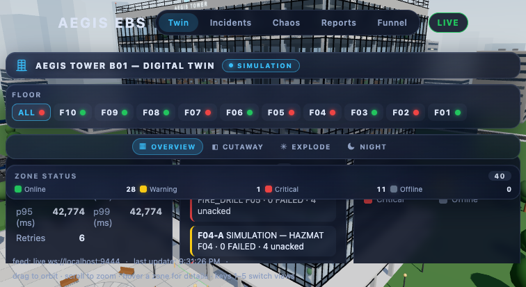

# BÁO CÁO ĐỒ ÁN HỌC PHẦN — CMP180 Lập trình mạng máy tính
## HỆ THỐNG THÔNG BÁO KHẨN CẤP CHO TÒA NHÀ VĂN PHÒNG (AEGIS — EMERGENCY BROADCAST SYSTEM)
Giảng viên hướng dẫn: ThS. Nguyễn Văn Cẩn · Nhóm: [TODO] · Thành viên/MSSV: [TODO] · Lớp: [TODO] · Năm học 2025–2026
> SIMULATION/TRAINING — không thay thế hệ thống báo cháy/sơ tán chứng nhận.

## LỜI CAM ĐOAN

Nhóm chúng tôi xin cam đoan đồ án “Hệ thống thông báo khẩn cấp cho tòa nhà văn phòng (AEGIS — Emergency Broadcast System)” là công trình do chính nhóm thực hiện dưới sự hướng dẫn của ThS. Nguyễn Văn Cẩn. Phần cơ sở lý thuyết được tổng hợp từ giáo trình học phần CMP180 [1] và các tài liệu tham khảo được trích dẫn đầy đủ; mã nguồn hệ thống do nhóm tự xây dựng và kiểm thử. Số liệu thực nghiệm trình bày ở Chương 3 được đo đạc trực tiếp trên hệ thống thật, ghi nhận trung thực kèm điều kiện đo (runId, phiên bản mã nguồn, cấu hình máy); tuyệt đối không sao chép hoặc bịa đặt số liệu. Mọi kịch bản vận hành đều được gắn nhãn SIMULATION/TRAINING và không nhằm thay thế các hệ thống báo cháy, sơ tán đã được chứng nhận. Nhóm xin chịu hoàn toàn trách nhiệm về nội dung của đồ án.

[TODO: ký tên nhóm trưởng và các thành viên; ghi rõ họ tên, MSSV]

## MỤC LỤC

[TODO: tạo mục lục tự động trong Word (References → Table of Contents) sau khi hoàn tất Chương 3–4 và đánh số trang]

Khung mục lục tĩnh của báo cáo:

- LỜI CAM ĐOAN
- DANH MỤC KÝ HIỆU VÀ CHỮ VIẾT TẮT · DANH MỤC BẢNG · DANH MỤC HÌNH
- CHƯƠNG 1. TỔNG QUAN
  - 1.1 Giới thiệu đề tài
  - 1.2 Nhiệm vụ của đồ án (1.2.1 Tính cấp thiết; 1.2.2 Ý nghĩa khoa học và thực tiễn; 1.2.3 Mục tiêu; 1.2.4 Đối tượng và phạm vi)
  - 1.3 Cấu trúc của đồ án
- CHƯƠNG 2. CƠ SỞ LÝ THUYẾT
  - 2.1 Mô hình Client–Server
  - 2.2 Giao thức TCP và lập trình Socket Java (Socket/ServerSocket)
  - 2.3 Đa tuyến: Thread, Runnable, đồng bộ hóa và ExecutorService
  - 2.4 InetAddress và quản lý địa chỉ kết nối mạng
  - 2.5 Truyền JSON và đối tượng qua luồng mạng; framing length-prefix
  - 2.6 UDP và lập trình DatagramSocket
  - 2.7 Multicast và lập trình MulticastSocket
  - 2.8 TLS với SSLSocket/SSLServerSocket
  - 2.9 RBAC và bảo mật ứng dụng
  - 2.10 Chuẩn CAP 1.2 (tham khảo)
- CHƯƠNG 3. KẾT QUẢ THỰC NGHIỆM
  - 3.1 Yêu cầu hệ thống (3.1.1 Yêu cầu chức năng; 3.1.2 Yêu cầu phi chức năng)
  - 3.2 Phân tích và thiết kế (3.2.1 Kiến trúc bốn mặt phẳng; 3.2.2 Thiết kế lớp và mô hình đồng thời; 3.2.3 ERD 26 bảng; 3.2.4 Giao thức EBSP/2.0; 3.2.5 Máy trạng thái incident/alert/delivery; 3.2.6 Quan sát và dashboard)
  - 3.3 Cài đặt (3.3.1 Môi trường; 3.3.2 Cấu trúc thư mục; 3.3.3 Mã nguồn tiêu biểu; 3.3.4 Dashboard digital twin)
  - 3.4 Hướng dẫn biên dịch và chạy
  - 3.5 Kiểm thử và kết quả thực nghiệm (3.5.1 Kiểm kê test; 3.5.2 Acceptance T-01…T-30; 3.5.3 Peer-review; 3.5.4 Chaos C01…C16; 3.5.5 Tải 100 client; 3.5.6 Benchmark fanout; 3.5.7 Dashboard; 3.5.8 Tổng hợp bằng chứng)
  - 3.6 Ưu điểm và hạn chế
- CHƯƠNG 4. KẾT LUẬN VÀ KIẾN NGHỊ
  - 4.1 Kết quả đạt được so với mục tiêu
  - 4.2 Hạn chế chính
  - 4.3 Kiến nghị và hướng phát triển
  - 4.4 Kết luận chung
- TÀI LIỆU THAM KHẢO
- PHỤ LỤC: MÃ NGUỒN CHƯƠNG TRÌNH [TODO]

## DANH MỤC KÝ HIỆU VÀ CHỮ VIẾT TẮT

| Viết tắt | Tiếng Anh | Diễn giải |
|---|---|---|
| ACK | Acknowledgement | Thông điệp xác nhận đã nhận/đã đọc cảnh báo |
| AEGIS | — | Tên hệ thống thông báo khẩn cấp của đồ án |
| API | Application Programming Interface | Giao diện lập trình ứng dụng |
| CAP | Common Alerting Protocol | Chuẩn trao đổi cảnh báo khẩn cấp của OASIS [2] |
| CSDL | — | Cơ sở dữ liệu |
| CPU | Central Processing Unit | Bộ xử lý trung tâm |
| DNS | Domain Name System | Hệ thống tên miền [1, Bài 1] |
| EBSP | Emergency Broadcast System Protocol | Giao thức ứng dụng của đồ án (phiên bản 2.0) |
| EBS | Emergency Broadcast System | Hệ thống thông báo khẩn cấp |
| FIFO | First In, First Out | Vào trước ra trước |
| FR/NFR | Functional/Non-Functional Requirement | Yêu cầu chức năng/phi chức năng |
| GUI | Graphical User Interface | Giao diện đồ họa người dùng |
| HA | High Availability | Tính sẵn sàng cao (kiến trúc nhiều nút dự phòng) |
| HTTP | HyperText Transfer Protocol | Giao thức truyền siêu văn bản |
| IANA | Internet Assigned Numbers Authority | Tổ chức cấp phát số hiệu cổng/địa chỉ Internet |
| ICMP | Internet Control Message Protocol | Giao thức thông điệp điều khiển Internet |
| IGMP | Internet Group Management Protocol | Giao thức quản lý nhóm multicast [1, Bài 8] |
| IP | Internet Protocol | Giao thức liên mạng |
| JSON | JavaScript Object Notation | Định dạng dữ liệu văn bản nhẹ, nền tảng của EBSP/2.0 |
| JSSE | Java Secure Socket Extension | Thư viện TLS/SSL của Java [3] |
| JVM | Java Virtual Machine | Máy ảo Java |
| LAN | Local Area Network | Mạng cục bộ [1, Bài 1] |
| MAC | Media Access Control | Địa chỉ vật lý tầng liên kết dữ liệu |
| MSSV | — | Mã số sinh viên |
| MTU | Maximum Transmission Unit | Đơn vị truyền tối đa của tầng liên kết (Ethernet: 1500 byte) [1, Bài 7] |
| OSI | Open Systems Interconnection | Mô hình tham chiếu phân tầng 7 lớp [1, Bài 1] |
| OWASP | Open Worldwide Application Security Project | Tổ chức bảo mật ứng dụng nguồn mở [5] |
| PIM | Protocol Independent Multicast | Giao thức định tuyến multicast [1, Bài 8] |
| PKCS | Public-Key Cryptography Standards | Bộ chuẩn mật mã khóa công khai (PKCS12: định dạng keystore) |
| RBAC | Role-Based Access Control | Kiểm soát truy cập dựa trên vai trò [5] |
| RFC | Request for Comments | Tài liệu chuẩn của IETF |
| RMI | Remote Method Invocation | Triệu gọi phương thức từ xa trong Java [1, Bài 9] |
| RPC | Remote Procedure Call | Gọi thủ tục từ xa |
| SAN | Subject Alternative Name | Trường mở rộng tên thay thế trong chứng chỉ X.509 |
| SQL | Structured Query Language | Ngôn ngữ truy vấn CSDL quan hệ |
| SSL | Secure Sockets Layer | Giao thức bảo mật tầng giao vận (tiền thân của TLS) |
| TCP | Transmission Control Protocol | Giao thức điều khiển truyền vận, hướng liên kết, tin cậy [1, Bài 1] |
| TLS | Transport Layer Security | Giao thức bảo mật kênh truyền [3] |
| TTL | Time To Live | Giới hạn số router mà gói tin được đi qua [1, Bài 7] |
| UDP | User Datagram Protocol | Giao thức datagram phi liên kết [1, Bài 1, Bài 7] |
| UTF-8 | Unicode Transformation Format 8-bit | Bảng mã Unicode độ dài biến thiên, bắt buộc trong EBSP/2.0 |
| UUID | Universally Unique Identifier | Định danh duy nhất toàn cục (khóa bản ghi của hệ thống) |
| VLAN | Virtual LAN | Mạng cục bộ ảo |
| WAL | Write-Ahead Logging | Cơ chế ghi nhật ký trước của SQLite [4] |
| WAN | Wide Area Network | Mạng diện rộng |
| WS | WebSocket | Giao thức kênh truyền hai chiều qua HTTP (cầu nối dashboard) |
| XML | eXtensible Markup Language | Ngôn ngữ đánh dấu mở rộng (định dạng gốc của CAP) |

## DANH MỤC BẢNG

[TODO: số trang tự động trong Word; bổ sung bảng của Chương 3 khi có số liệu thật]

- Bảng 2.1. So sánh hai giao thức vận chuyển TCP và UDP
- Bảng 2.2. Phân dải số hiệu cổng của TCP/UDP
- Bảng 2.3. Ma trận vai trò – quyền phát cảnh báo của AEGIS-EBS
- Bảng 2.4. Ánh xạ các trường chính của CAP 1.2 sang mô hình cảnh báo AEGIS-EBS
- Bảng 2.5. Ánh xạ nội dung giáo trình CMP180 vào các mục lý thuyết và module của hệ thống
- Bảng 3.1. Yêu cầu chức năng của hệ thống AEGIS-EBS
- Bảng 3.2. Yêu cầu phi chức năng của hệ thống AEGIS-EBS
- Bảng 3.3. Bản đồ module và trách nhiệm chính
- Bảng 3.4. Cổng và kênh truyền của hệ thống
- Bảng 3.5. Phân nhóm 26 bảng của schema AEGIS-EBS
- Bảng 3.6. Khóa duy nhất và bất biến cốt lõi của schema
- Bảng 3.7. Danh mục 28 loại thông điệp EBSP/2.0
- Bảng 3.8. Tham số giao thức và cấu hình mặc định
- Bảng 3.9. Chuyển trạng thái incident hợp lệ
- Bảng 3.10. Thứ hạng trạng thái delivery (rank guard)
- Bảng 3.11. Môi trường phát triển, kiểm thử và thư viện
- Bảng 3.12. Ngân sách thời gian fresh install (ước tính tham khảo)
- Bảng 3.13. Kiểm kê test theo module và kết quả các lần chạy gần nhất
- Bảng 3.14. Ma trận kiểm thử chấp nhận T-01…T-30
- Bảng 3.15. Kết quả peer-review độc lập
- Bảng 3.16. Ma trận chaos C01…C16 và ánh xạ kiểm thử
- Bảng 3.17. Preset kịch bản lỗi của aegis-simulator
- Bảng 3.18. Chỉ số tải 100 client [TODO: số đo chính thức]
- Bảng 3.19. Kết quả benchmark fanout thật (TCP/multicast/unicast)
- Bảng 3.20. Danh mục bằng chứng thực nghiệm

## DANH MỤC HÌNH

[TODO: số trang tự động trong Word; bổ sung ảnh dashboard 3D và biểu đồ đo của Chương 3]

- Hình 2.1. Mô hình hỏi–đáp giữa client và server (vẽ lại theo [1, Hình 5.1])
- Hình 2.2. Cấu trúc khung truyền EBSP/2.0 với tiền tố độ dài 4 byte
- Hình 2.3. Cây phân phối multicast: nhân bản gói tin trong mạng (theo [1, Hình 8.1])
- Hình 3.1. Kiến trúc bốn mặt phẳng của AEGIS-EBS
- Hình 3.2. Mô hình triển khai trong LAN
- Hình 3.3. Mô hình đồng thời của server
- Hình 3.4. ERD rút gọn: chuỗi topology, alert–delivery và operation–audit
- Hình 3.5. Máy trạng thái incident
- Hình 3.6. Máy trạng thái delivery
- Hình 3.7. Tuần tự publish → fanout → ACK → retry → recovery
- Hình 3.8. Ảnh dashboard 3D nghiệm thu [TODO: ảnh từ lần chạy thật]

## CHƯƠNG 1. TỔNG QUAN

### 1.1 Giới thiệu đề tài

Ứng dụng mạng là thành phần không thể thiếu của mạng máy tính: chúng cho phép người dùng khai thác thông tin lưu trữ trên các máy khác, trao đổi dữ liệu và huy động nhiều máy cùng giải quyết một bài toán [1, Bài 1]. Phần lớn các ứng dụng mạng hiện nay được tổ chức theo mô hình khách/chủ (client–server), trong đó máy chủ quản lý dữ liệu, cung cấp dịch vụ và máy khách chủ động thiết lập giao tiếp để khai thác dịch vụ đó [1, Bài 1, Bài 5]. Trên nền tảng Java, các ứng dụng này được xây dựng thông qua giao diện Socket của thư viện `java.net` (`Socket`, `ServerSocket`, `DatagramSocket`, `MulticastSocket`) cùng hệ thống luồng nhập/xuất `java.io` [1, Bài 1, Bài 2, Bài 5].

Trong các tòa nhà văn phòng, nhu cầu truyền thông tin khẩn cấp — chẳng hạn hướng dẫn sơ tán khi có cháy, cảnh báo sự cố an ninh, hoặc thông báo diễn tập — tới đúng người, đúng khu vực và trong thời gian ngắn nhất là một bài toán thực tế quan trọng. Bên cạnh các hệ thống báo cháy và phát thanh chuyên dụng đã được chứng nhận, hạ tầng mạng LAN sẵn có của tòa nhà mở ra khả năng xây dựng một kênh thông báo khẩn cấp bằng phần mềm: một máy chủ trung tâm tiếp nhận lệnh phát cảnh báo từ người có thẩm quyền, phân phối tới hàng loạt máy trạm (client) đặt tại các tầng/khu vực, đồng thời theo dõi trạng thái nhận tin của từng máy trạm và hiển thị bức tranh toàn cảnh cho người vận hành.

Đồ án học phần CMP180 “Lập trình mạng máy tính” xây dựng hệ thống **AEGIS-EBS (Emergency Broadcast System)** theo hướng tiếp cận trên. Hệ thống là một ứng dụng client–server hoàn chỉnh bằng Java, vận dụng tổng hợp kiến thức của chín bài trong giáo trình [1]: mô hình phân tầng OSI/TCP-IP và các giao thức vận chuyển (Bài 1); luồng nhập/xuất (Bài 2); lập trình đa tuyến (Bài 3); quản lý địa chỉ kết nối với `InetAddress`/`URL` (Bài 4); lập trình socket TCP với `Socket`/`ServerSocket` (Bài 5); kỹ thuật server đa client và tuần tự hóa đối tượng (Bài 6); lập trình UDP với `DatagramSocket` (Bài 7); lập trình multicast với `MulticastSocket` (Bài 8); và mô hình phân tán đối tượng RMI (Bài 9, được nghiên cứu để đối sánh và lựa chọn kiến trúc). Trên nền các kỹ thuật đó, đồ án bổ sung những nội dung thực hành hiện đại không có trong giáo trình như bảo mật kênh truyền TLS [3], kiểm soát truy cập theo vai trò RBAC và bảo mật ứng dụng [5], hướng dẫn sử dụng UDP an toàn theo RFC 8085 [6], lưu trữ bền vững với SQLite WAL [4], và tham khảo chuẩn cảnh báo CAP 1.2 của OASIS [2].

Về mặt tổ chức, hệ thống gồm: máy chủ trung tâm (cổng TLS 9443) quản lý cảnh báo, thiết bị, người dùng và phân phối tin; ứng dụng client JavaFX cho máy trạm; bộ mô phỏng client headless phục vụ kiểm thử tải; phòng thí nghiệm mạng (`aegis-network-lab`) minh họa UDP discovery và multicast hint; và dashboard web “digital twin” dựng tòa nhà 3D bằng Three.js [7], nhận trạng thái thời gian thực qua WebSocket (cổng 9444). Các thành phần giao tiếp bằng giao thức ứng dụng riêng **EBSP/2.0** — khung truyền JSON mã hóa UTF-8 chặt với tiền tố độ dài 4 byte — được đặc tả trong `docs/PROTOCOL.md`.

**Lưu ý phạm vi sử dụng:** AEGIS-EBS là hệ thống **SIMULATION/TRAINING** phục vụ học tập và diễn tập; không thay thế hệ thống báo cháy, cảnh báo sơ tán hay bất kỳ thiết bị an toàn nào đã được chứng nhận theo quy định.

### 1.2 Nhiệm vụ của đồ án

#### 1.2.1 Tính cấp thiết

Thông báo khẩn cấp trong tòa nhà có đặc thù khác với truyền tin thông thường: giá trị của thông điệp gắn chặt với thời điểm và độ tin cậy của việc phân phối. Một cảnh báo đến chậm, đến thiếu đối tượng, bị hiển thị trùng lặp, hoặc bị kẻ xấu giả mạo đều có thể gây hậu quả nghiêm trọng — từ hoang mang, mất niềm tin vào hệ thống, cho đến cản trở sơ tán. Trong khi đó, các cách tiếp cận ngây thơ thường gặp trong đồ án lập trình mạng bộc lộ nhiều hạn chế:

- **Phát quảng bá bằng UDP thuần túy** không đảm bảo gói tin đến đích, không đảm bảo thứ tự và có thể nhân bản thông điệp [1, Bài 7]; phía gửi không có cách nào biết máy trạm đã nhận tin hay chưa.
- **Kênh không xác thực** cho phép bất kỳ máy nào trong LAN giả mạo nguồn phát cảnh báo (UDP spoofing) hoặc nghe lén, sửa đổi nội dung; đây là lỗ hổng đã được OWASP cảnh báo đối với các hệ thống thiếu kiểm soát truy cập và bảo vệ kênh truyền [5].
- **Server đơn tuyến, không trạng thái bền vững** chỉ phục vụ được một client tại một thời điểm [1, Bài 6], và sẽ mất toàn bộ trạng thái phân phối khi tiến trình gặp sự cố (crash) hoặc máy khởi động lại.
- **Thiếu cơ chế chống trùng và chống hiển thị lại tin cũ** khiến client nhận lặp cảnh báo sau mỗi lần thử lại hoặc sau khi kết nối lại, gây nhiễu loạn thông tin trong tình huống khẩn cấp.

Vì vậy, cần một hệ thống được thiết kế bài bản ngay từ tầng giao thức: kênh truyền chính tin cậy có bảo mật (TCP/TLS), cơ chế xác nhận hai tầng phân biệt “máy đã nhận” với “người đã đọc”, thử lại lũy thừa có jitter và idempotent để không tạo bản trùng, đồng bộ trạng thái khi client kết nối lại, khôi phục sau sự cố từ CSDL bền vững, phân quyền phát tin theo vai trò và phạm vi tầng/khu vực, cùng nhật ký kiểm toán. Đồng thời, về mặt đào tạo, học phần CMP180 yêu cầu sinh viên không chỉ viết được các ví dụ socket rời rạc mà phải phân tích, thiết kế giao thức và tích hợp các kỹ thuật của Bài 1–8 thành một ứng dụng mạng hoàn chỉnh có kiểm chứng [1]. Một đồ án đáp ứng đồng thời hai yêu cầu trên là cần thiết.

#### 1.2.2 Ý nghĩa khoa học và thực tiễn

**Ý nghĩa khoa học.** Đồ án hệ thống hóa toàn bộ kiến thức lập trình mạng Java của giáo trình [1] thành một kiến trúc ứng dụng thống nhất, trong đó mỗi kỹ thuật (luồng I/O, đa tuyến, socket TCP/UDP, multicast, địa chỉ mạng) giữ một vai trò xác định. Trên nền đó, đồ án giải quyết các bài toán kinh điển của hệ phân tán ở quy mô LAN: đóng khung thông điệp trên dòng byte (framing length-prefix), định danh và chống trùng (messageId/requestId/deliveryId), máy trạng thái phân phối chỉ tiến (ACK only advances state), lập lịch ưu tiên có chống bỏ đói (starvation), và công bố nguyên tử gắn với khôi phục sau sự cố (transactional publish + recovery trên SQLite WAL [4]). Đồ án cũng xây dựng khung thực nghiệm định lượng có thể lặp lại: ma trận 30 bài kiểm thử chấp nhận (T-01…T-30) và 16 kịch bản gây lỗi có chủ đích (chaos C01…C16, seed xác định) được ánh xạ tới từng module trong `docs/TEST-PLAN.md`, làm cơ sở đo độ trễ phân phối (p50/p95/p99), tỷ lệ ACK và hành vi hệ thống dưới lỗi.

**Ý nghĩa thực tiễn.** Sản phẩm là một hệ thống mô phỏng/đào tạo trực quan: dashboard 3D phản ánh trạng thái từng tầng/khu vực theo thời gian thực [7], cho phép người học quan sát trọn vẹn vòng đời một cảnh báo — từ lúc người có thẩm quyền phát lệnh, phân phối tới client, xác nhận, thử lại khi mất ACK, cho tới đồng bộ lại sau mất kết nối và khôi phục sau khi server khởi động lại. Kiến trúc “hint qua multicast/UDP, nội dung xác thực qua TLS” của phòng thí nghiệm mạng là một mẫu hình tham khảo có giá trị cho các ứng dụng LAN một-nhiều, nơi phải đồng thời bảo đảm tốc độ lan truyền và tính xác thực. Toàn bộ giới hạn của hệ thống (một nút, chứng chỉ tự ký, multicast phạm vi LAN) được nêu trung thực, kèm định hướng phát triển, giúp kết quả đồ án có thể tái sử dụng làm nền tảng học tập và nghiên cứu tiếp.

#### 1.2.3 Mục tiêu của đồ án

**Mục tiêu tổng quát:** thiết kế và cài đặt hệ thống AEGIS-EBS theo mô hình client–server, trong đó một server trong LAN phát cảnh báo khẩn cấp tới nhiều client một cách tin cậy, có ưu tiên, có xác thực và phân quyền, có khả năng chịu lỗi và khôi phục; đồng thời đo lường định lượng độ tin cậy của quá trình phân phối.

**Mục tiêu cụ thể:**

1. Xây dựng giao thức ứng dụng EBSP/2.0 trên TCP/TLS: khung length-prefix (uint32 big-endian, độ dài 1…65536 byte), thân JSON UTF-8 chặt, phong bì `{version, type, messageId, correlationId, sentAt, payload}` và danh mục 28 loại thông điệp; kiểm tra chặt đầu vào, từ chối khung quá cỡ trước khi cấp phát bộ nhớ.
2. Phân phối một-nhiều tới các client theo mục tiêu (tòa nhà/tầng/zone) với bốn mức ưu tiên INFO < WARNING < EMERGENCY < CRITICAL; lập lịch ưu tiên nghiêm ngặt kèm luật công bằng chống bỏ đói luồng mức thấp.
3. Hiện thực ACK hai tầng: `ACK_RECEIVED` (máy trạm đã nhận và lưu bền vững) tách biệt với `ACK_USER` (người dùng đã xác nhận đọc); trạng thái phân phối chỉ tiến, không lùi.
4. Thử lại idempotent: mỗi lần thử mang messageId mới nhưng deliveryId/alertId/revision ổn định; lịch thử lại 3s/6s/12s cộng jitter, tối đa 3 lần thử lại rồi chuyển FAILED; client khử trùng để không hiển thị lặp.
5. Kết nối lại và đồng bộ: heartbeat chu kỳ 10s, đánh dấu suspect sau 3 lần lỡ; client reconnect thực hiện SYNC để nhận cảnh báo đang hoạt động; bản tin hủy/hết hạn dùng tombstone chống hiển thị lại tin cũ.
6. Khôi phục sau sự cố: công bố cảnh báo nguyên tử trong một giao dịch SQLite (WAL), quét khôi phục các delivery đang PENDING/SENT/RETRY_SCHEDULED/FAILED sau khi server khởi động lại; không tuyên bố “exactly-once”.
7. Bảo mật và phân quyền: xác thực người dùng/thiết bị qua TLS; RBAC năm vai trò với phạm vi phát tin theo tòa nhà/tầng; mật khẩu băm Argon2id; nhật ký kiểm toán mọi thao tác quản trị và các lần từ chối.
8. Phòng thí nghiệm UDP/multicast: discovery tìm server bằng datagram UDP có nonce; phát `ALERT_HINT` qua nhóm multicast lớp D; chứng minh mẫu hình “hint chỉ là gợi ý — nội dung hiển thị phải được xác thực qua TLS”; đo so sánh fanout TCP với multicast và unicast UDP.
9. Đo lường tin cậy: chạy tải với 100 client mô phỏng và client thật; ghi nhận độ trễ phân phối p50/p95/p99, tỷ lệ ACK, số lần thử lại, thông lượng và tài nguyên; thực hiện 16 kịch bản chaos có seed và lưu bằng chứng.
10. Dashboard digital twin: dựng tòa nhà 10 tầng × 4 zone bằng Three.js [7], tô màu theo trạng thái thiết bị/phân phối, nhận `STATUS_SNAPSHOT`/`STATUS_DELTA` qua WebSocket và hiển thị chỉ số đo.

#### 1.2.4 Đối tượng và phạm vi nghiên cứu

**Đối tượng nghiên cứu:** (i) các kỹ thuật lập trình mạng Java trong giáo trình CMP180 [1] — mô hình client–server, luồng nhập/xuất, đa tuyến và đồng bộ, `InetAddress`, socket TCP (`Socket`/`ServerSocket`), server đa client và tuần tự hóa đối tượng, UDP (`DatagramPacket`/`DatagramSocket`), multicast (`MulticastSocket`), RMI (đối sánh); (ii) bài toán phân phối cảnh báo khẩn cấp tin cậy, có bảo mật và có thể kiểm chứng trong mạng LAN tòa nhà.

**Phạm vi triển khai:**

- **Kiến trúc:** một server trung tâm trong LAN (single-node), không cụm dự phòng, không HA; các client kết nối tới server qua TCP/TLS cổng 9443; dashboard nhận cầu nối WebSocket cổng 9444.
- **Thành phần:** client JavaFX (JavaFX 24) có hộp thư bền vững phía client; simulator headless tạo tải 100 client và chaos có seed; dashboard web (Node.js ≥ 20.19, Vite, Three.js [7]); phòng thí nghiệm mạng UDP/multicast.
- **Dữ liệu:** SQLite với 26 bảng (WAL, khóa ngoại bật, giao dịch BEGIN IMMEDIATE) [4]; migration idempotent; bản ghi định danh UUID, thời gian UTC ISO-8601.
- **Bảo mật:** TLS với chứng chỉ tự ký (RSA 2048, SAN localhost/127.0.0.1) và truststore ghim (pinning) phía client — phù hợp môi trường lab, không phải hạ tầng khóa công khai production; RBAC + audit trong phạm vi một tòa nhà.
- **Multicast:** nhóm lớp D dành cho quản trị 239.10.10.10, cổng 9998, TTL = 1 (chỉ trong liên kết LAN); discovery UDP cổng 9999; datagram ≤ 1024 byte để không phân mảnh IP; có phương án dự phòng unicast khi mạng không hỗ trợ multicast.
- **Môi trường phát triển:** JDK 24 (Maven `release=24`), Maven đa module, JUnit 5, Jackson 2.17, sqlite-jdbc 3.46, argon2-jvm; dashboard phát triển trên Node 26.

**Ngoài phạm vi:** thay thế hệ thống báo cháy/sơ tán chứng nhận; triển khai WAN/Internet và đi qua NAT/firewall phức tạp; kiến trúc nhiều server (HA, replication); ứng dụng di động và push notification thương mại; xuất bản tin CAP XML đầy đủ theo [2] (mới tham khảo metadata, định hướng phát triển ở Chương 4); đánh giá an toàn mật mã hình thức.

### 1.3 Cấu trúc của đồ án

Báo cáo được tổ chức thành bốn chương theo mẫu báo cáo môn học của HUTECH (MauBCMH):

- **Chương 1 — Tổng quan:** giới thiệu đề tài, tính cấp thiết, ý nghĩa khoa học/thực tiễn, mục tiêu, đối tượng và phạm vi nghiên cứu, cấu trúc báo cáo.
- **Chương 2 — Cơ sở lý thuyết:** trình bày nền tảng lý thuyết của hệ thống dựa trên giáo trình CMP180 [1] (Bài 1–9) và các nguồn bổ sung [2]–[7]: mô hình client–server; TCP và socket Java; đa tuyến và ExecutorService; InetAddress; truyền JSON/đối tượng qua mạng và framing length-prefix; UDP; multicast; TLS; RBAC và bảo mật; chuẩn CAP 1.2. Mỗi mục đều liên hệ trực tiếp với cách kỹ thuật đó được áp dụng trong AEGIS-EBS.
- **Chương 3 — Kết quả thực nghiệm:** yêu cầu hệ thống (FR/NFR), phân tích và thiết kế (kiến trúc, sơ đồ module, thiết kế lớp, ERD 26 bảng, giao thức EBSP/2.0, máy trạng thái), cài đặt, hướng dẫn biên dịch/chạy, kiểm thử và số liệu đo thật (bảng test, chaos C01–C16, p50/p95/p99, tỷ lệ ACK, ảnh dashboard), ưu điểm/hạn chế. [TODO — chờ số liệu thực nghiệm thật]
- **Chương 4 — Kết luận và kiến nghị:** đối chiếu kết quả với mục tiêu, tổng kết hạn chế và đề xuất hướng phát triển. [TODO]

Phần Tài liệu tham khảo liệt kê bảy nguồn [1]–[7] được trích dẫn trong toàn báo cáo; Phụ lục trích mã nguồn các module chính.

## CHƯƠNG 2. CƠ SỞ LÝ THUYẾT

Chương này trình bày cơ sở lý thuyết của hệ thống AEGIS-EBS. Nguồn chủ đạo là giáo trình CMP180 [1] gồm chín bài; các nội dung ngoài giáo trình (TLS, ExecutorService, RBAC, hướng dẫn UDP, CAP, SQLite WAL, Three.js) được tham khảo từ [2]–[7] và ghi chú rõ. Mỗi mục kết thúc bằng phần liên hệ với cách kỹ thuật được vận dụng trong hệ thống. Quy ước trích dẫn: [1, Bài n] chỉ bài n của giáo trình; các bảng/hình của giáo trình được dẫn theo số hiệu gốc.

### 2.1 Mô hình Client–Server

Theo [1, Bài 1], hầu hết chương trình mạng hiện nay hoạt động theo mô hình khách/chủ: chương trình server quản lý một lượng dữ liệu lớn và cung cấp dịch vụ; chương trình client khai thác dữ liệu/dịch vụ đó. Client chủ động thiết lập cuộc giao tiếp, còn server lắng nghe yêu cầu thiết lập từ client rồi phục vụ. Quá trình trao đổi gồm ba bước: truyền yêu cầu từ client tới server, server xử lý, truyền đáp ứng về client [1, Bài 5]. Mô hình hỏi–đáp này đồng bộ hóa hai thông điệp: sau khi gửi yêu cầu, client chuyển sang trạng thái chờ cho tới khi nhận đáp ứng (Hình 2.1, vẽ lại theo [1, Hình 5.1]).

```
Client                                    Server (đang lắng nghe)
  |-------------- Request (yêu cầu) --------->|
  |   [chờ]                        [xử lý yêu cầu]
  |<------------- Reply (đáp ứng) ------------|
```

**Hình 2.1.** Mô hình hỏi–đáp giữa client và server (vẽ lại theo [1, Hình 5.1]).

Server đơn tuyến chỉ phục vụ một liên kết tại một thời điểm; khi khối lượng xử lý lớn hoặc không biết trước thời điểm hoàn thành, mô hình này không chấp nhận được. Khắc phục bằng **server tương tranh (concurrent server)**: mỗi phiên client được giao một thread riêng xử lý, còn server tiếp tục lắng nghe các liên kết mới [1, Bài 6]. Đây là nền tảng để một server phục vụ đồng thời hàng trăm client.

Một mô hình phân tán khác được giáo trình trình bày là **RMI (Remote Method Invocation)** — cho phép đối tượng trên JVM này gọi phương thức của đối tượng trên JVM khác thông qua lớp trung gian stub/skeleton và trình đăng ký `rmiregistry` [1, Bài 9]. RMI che giấu chi tiết mạng, truyền tham số là đối tượng `Serializable` bằng tuần tự hóa (marshalling/unmarshalling) trên socket TCP. Tuy nhiên RMI chỉ hỗ trợ Java–Java, gắn chặt với cơ chế tuần tự hóa đối tượng của Java và khó kiểm soát tường minh khuôn dạng dữ liệu trên đường truyền. (Ghi chú thực hành hiện đại: công cụ `rmic` và skeleton tĩnh đã lỗi thời trong Java mới; mô hình stub/skeleton trong [1, Bài 9] là mô hình giáo khoa.) Vì AEGIS-EBS cần một hợp đồng truyền thông tường minh, kiểm soát chặt từng byte (framing, xác thực, phiên bản) và có thể kiểm thử độc lập, đồ án **không dùng RMI** mà chọn giao thức thông điệp EBSP/2.0 trên socket TCP — vẫn thuần túy client–server theo [1, Bài 5].

**Liên hệ với AEGIS-EBS.** Hệ thống gồm một server trung tâm và nhiều client (máy trạm JavaFX, client mô phỏng, dashboard). Client chủ động mở kết nối TLS tới server và xác thực (`HELLO`/`AUTH_DEVICE`/`AUTH_OPERATOR`); sau đó kết nối được giữ sống lâu dài để server **đẩy** cảnh báo (`ALERT_PUSH`) xuống client — phần mở rộng của mô hình hỏi–đáp cổ điển, nhưng vẫn đúng bản chất client–server vì client là bên khởi tạo liên kết và server là bên nắm thẩm quyền dữ liệu. Server áp dụng mô hình tương tranh [1, Bài 6]: mỗi kết nối được phục vụ bởi các thread riêng (đọc và ghi), cho phép phục vụ đồng thời 100 client mô phỏng cùng nhiều client thật. Dashboard đóng vai trò client quan sát, nhận cầu nối trạng thái `status/1` qua WebSocket.

### 2.2 Giao thức TCP và lập trình Socket Java

**Giao thức TCP.** TCP (Transmission Control Protocol) hoạt động ở tầng vận chuyển của mô hình OSI (tầng vận chuyển của TCP/IP), cung cấp dịch vụ truyền dữ liệu tin cậy, hướng liên kết giữa hai nút mạng [1, Bài 1]. TCP chia dữ liệu thành các đoạn, gắn header chứa cổng nguồn/đích, số thứ tự (Sequence Number), số xác nhận (Acknowledge Number), cửa sổ (Window), checksum và các cờ điều khiển [1, Bảng 1.1]. Nhờ số thứ tự và xác nhận, phía nhận sắp xếp lại dữ liệu đúng trình tự và phát hiện mất mát để yêu cầu truyền lại; trường Window cho phép điều khiển luồng — bên nhận thông báo lượng dữ liệu tối đa có thể nhận. Đổi lại, TCP có chi phí thiết lập/giải phóng liên kết và độ trễ truyền lại khi lỗi [1, Bài 5]. Header TCP tối thiểu 20 byte, so với 8 byte của UDP [1, Bài 7]. Bảng 2.1 tóm tắt khác biệt hai giao thức theo [1, Bảng 7.2].

**Bảng 2.1.** So sánh hai giao thức vận chuyển TCP và UDP (theo [1, Bảng 7.2], bổ sung kích thước header từ [1, Bài 7]).

| Đặc trưng | UDP | TCP |
|---|---|---|
| Hướng liên kết | Không | Có |
| Sử dụng phiên | Không | Có |
| Độ tin cậy (đảm bảo đến đích) | Không | Có |
| Xác nhận (ACK) | Không | Có |
| Đánh thứ tự | Không | Có |
| Điều khiển luồng | Không | Có |
| Kích thước header tối thiểu | 8 byte | 20 byte |
| Kiểu truyền hỗ trợ | unicast, broadcast, multicast | unicast |

**Số hiệu cổng.** TCP và UDP dùng cổng 16 bit (0…65535) để ánh xạ dữ liệu tới đúng tiến trình. Cổng chia ba dải: cổng hệ thống 0–1023 (dành cho tiến trình đặc quyền, các dịch vụ nổi tiếng), cổng người dùng/đã đăng ký 1024–49151 (ứng dụng server có thể chọn hoặc đăng ký với IANA), cổng động/riêng 49152–65535 (client thường được cấp phát tự động) [1, Bài 1] (Bảng 2.2).

**Bảng 2.2.** Phân dải số hiệu cổng của TCP/UDP [1, Bài 1].

| Dải cổng | Tên gọi | Mục đích điển hình |
|---|---|---|
| 0–1023 | Cổng hệ thống (well-known) | Dịch vụ chuẩn, cần đặc quyền để gán |
| 1024–49151 | Cổng người dùng (registered) | Ứng dụng server tự chọn/đăng ký |
| 49152–65535 | Cổng động/riêng (dynamic) | Cổng tạm phía client, chọn tự do |

**Khái niệm Socket.** Socket là trừu tượng hóa cơ chế kết nối giữa hai ứng dụng qua mạng, kết hợp địa chỉ IP và số hiệu cổng; khái niệm do Đại học UC Berkeley đưa ra, cho phép xem liên kết mạng như một luồng đọc/ghi được, che giấu chi tiết mức thấp (kích thước gói, truyền lại, định tuyến) [1, Bài 1, Bài 5]. Một socket hỗ trợ bảy thao tác cơ bản: kết nối tới máy ở xa; gửi dữ liệu; nhận dữ liệu; ngắt liên kết; gán cổng; nghe dữ liệu đến; chấp nhận liên kết từ xa trên cổng đã gán [1, Bài 5]. Với chồng TCP/IP có hai kiểu socket chính: **stream socket** (TCP, tin cậy) và **datagram socket** (UDP, đơn giản). Java hiện thực stream socket bằng `Socket`/`ServerSocket`, datagram socket bằng `DatagramPacket`/`DatagramSocket` [1, Bài 5].

**Lớp Socket (phía client và đầu mối giao tiếp).** Các hàm khởi tạo thông dụng: `Socket(String host, int port)` và `Socket(InetAddress host, int port)` — tạo socket TCP và kết nối ngay tới đích; dạng bốn tham số còn cho phép chọn giao tiếp mạng cục bộ và cổng cục bộ (localPort = 0 để hệ thống tự chọn) [1, Bảng 5.1]. Sau khi kết nối, `getInputStream()` và `getOutputStream()` trả về luồng nhập/xuất của liên kết song công (full-duplex): hai phía có thể gửi và nhận đồng thời; ý nghĩa dữ liệu do giao thức ứng dụng quy định [1, Bài 5]. Các phương thức thông tin: `getInetAddress()`, `getPort()` (đích), `getLocalAddress()`, `getLocalPort()` (cục bộ). Đóng liên kết bằng `close()`, hoặc đóng từng chiều bằng `shutdownInput()`/`shutdownOutput()`; không nên trông chờ hệ thống tự đóng socket, đặc biệt với chương trình chạy vô hạn [1, Bài 5]. Ba tùy chọn quan trọng [1, Bài 5.3.4]:

- `setTcpNoDelay(true)`: vô hiệu hóa thuật toán Nagle — gửi gói nhỏ ngay thay vì gom chờ xác nhận, giảm độ trễ cho thông điệp điều khiển khẩn cấp.
- `setSoLinger(on, seconds)`: quy định hành vi với dữ liệu chưa gửi khi `close()`; linger = 0 hủy phần chưa gửi, linger > 0 chờ gửi nốt trong thời hạn.
- `setSoTimeout(milliseconds)`: giới hạn thời gian phong tỏa của thao tác đọc; hết hạn sẽ ném ngoại lệ thay vì chờ vô hạn — cần cho các vòng đọc có kiểm soát.

**Lớp ServerSocket (phía server).** Vòng đời server gồm: tạo `ServerSocket` trên cổng xác định; gọi `accept()` (phong tỏa tới khi có client kết nối, trả về `Socket` của liên kết); lấy luồng nhập/xuất từ socket đó; tương tác theo giao thức tới khi ngắt liên kết; đóng socket phiên; quay lại `accept()` chờ liên kết kế tiếp [1, Bài 5.4]. Hàm khởi tạo `ServerSocket(int port)` (port = 0 để hệ thống chọn cổng ngẫu nhiên — không hữu ích cho server vì client cần biết trước cổng) và `ServerSocket(int port, int queueLength, InetAddress bindAddress)` — đặt chiều dài hàng đợi liên kết chờ và ràng buộc địa chỉ cục bộ trên máy nhiều IP [1, Bảng 5.3]. `IOException` phát sinh khi cổng đã bị chiếm hoặc không đủ quyền gán cổng 0–1023. Thông tin cổng đang nghe lấy bằng `getLocalPort()`.

**Liên hệ với AEGIS-EBS.** Kênh phân phối chính của hệ thống là stream socket TCP sống lâu dài trên cổng 9443 (bọc TLS, xem 2.8). Server lắng nghe bằng `SSLServerSocket` (lớp con của `ServerSocket`), mỗi liên kết được chấp nhận tạo thành một `ClientSession` với luồng đọc riêng và một thread ghi riêng; client JavaFX dùng `SSLSocket` (lớp con của `Socket`) kết nối tới host/cổng cấu hình. Vì TCP đảm bảo tin cậy và thứ tự ở tầng vận chuyển [1, Bài 1], tầng giao thức EBSP/2.0 không phải lo truyền lại đoạn hay sắp xếp gói, mà tập trung vào ranh giới thông điệp (2.5), ngữ nghĩa phân phối và chống trùng ở tầng ứng dụng. Các cổng dịch vụ của hệ thống (9443 TLS, 9444 WS, 9999 discovery UDP, 9998 multicast) đều thuộc dải cổng người dùng 1024–49151 theo Bảng 2.2.

### 2.3 Đa tuyến: Thread, Runnable, đồng bộ hóa và ExecutorService

**Đơn tiến trình và đa tiến trình.** Chương trình đơn tiến trình thực thi tuần tự: lệnh trước chưa xong thì lệnh sau chưa chạy. Chương trình đa tiến trình cho phép nhiều luồng điều khiển thực hiện “cùng lúc”: trên máy đa nhân là song song thật, trên đơn nhân là xoay vòng — hệ điều hành cấp mỗi tiến trình một CPU ảo và luân phiên phân phối thời gian xử lý [1, Bài 3]. Ứng dụng mạng bắt buộc phải đa tuyến: server phải đáp ứng nhiều client đồng thời, client vừa nhận dữ liệu mạng vừa cập nhật giao diện [1, Bài 3].

**Lớp Thread và giao diện Runnable.** Hai cách tạo thread [1, Bài 3]: (i) kế thừa `Thread` và override `run()`; (ii) hiện thực giao diện `Runnable` (chỉ có `void run()`) rồi liên kết với `Thread` qua constructor `Thread(Runnable target)` — dùng khi lớp đã kế thừa lớp khác. Kích hoạt bằng `start()` (JVM tạo thread mới và gọi `run()` trong đó); gọi trực tiếp `run()` chỉ chạy tuần tự trên thread hiện tại. Gọi `start()` lần hai trên cùng thread ném `IllegalThreadStateException`. Thread có 10 mức ưu tiên (1…10, mặc định 5, hằng `MIN_PRIORITY`/`MAX_PRIORITY`), chỉnh bằng `setPriority(int)` (giá trị ngoài khoảng ném `IllegalArgumentException`); cần lưu ý ưu tiên chỉ là gợi ý cho bộ lập lịch và phụ thuộc nền tảng. Dừng thread bằng `interrupt()` — nếu thread đang `sleep()` sẽ ném `InterruptedException`; các phương thức hỗ trợ gồm `sleep(ms)`, `yield()`, và bộ `wait()/notify()/notifyAll()` (kế thừa từ `Object`) để phối hợp chờ–đánh thức giữa các thread [1, Bài 3].

**Đồng bộ hóa.** Khi nhiều thread cùng truy cập vùng nhớ chia sẻ, lỗi tương tranh (race condition) xảy ra — ví dụ kinh điển trong [1, Bài 3.4]: nhiều thread cùng giảm biến đếm `x` không đồng bộ khiến `x` xuống âm. Từ khóa `synchronized` bảo đảm tại một thời điểm chỉ một thread thực thi phương thức hoặc khối lệnh trên cùng đối tượng khóa: `synchronized` trên phương thức, hoặc khối `synchronized(expr){...}` lấy khóa của đối tượng `expr`. Kết hợp `wait()/notifyAll()` xây dựng được các cấu trúc phối hợp như hàng đợi producer–consumer. Trao đổi dữ liệu giữa hai thread còn có thể dùng cặp luồng ống `PipedOutputStream`/`PipedInputStream` (nối bằng `connect()`); đọc khi ống rỗng sẽ phong tỏa tới khi có dữ liệu hoặc ống đóng [1, Bài 3.5].

**Server tương tranh và giới hạn của thread-per-connection.** [1, Bài 6] cài đặt server đa client bằng cách tạo một thread mới cho mỗi `Socket` chấp nhận được. Cách này đơn giản nhưng không giới hạn số thread: mỗi thread tốn bộ nhớ ngăn xếp và chi phí lập lịch; hàng nghìn kết nối đồng thời có thể làm kiệt tài nguyên. (Ghi chú thực hành hiện đại, ngoài giáo trình:) thực tế production dùng **thread pool** qua `ExecutorService` (`java.util.concurrent`) [3]: tập thread được tái sử dụng, tác vụ nộp qua `execute(Runnable)`/`submit(Callable)`, có `shutdown()`/`awaitTermination()` để dừng trật tự; `ScheduledExecutorService` hỗ trợ tác vụ định kỳ (heartbeat, retry). Kết hợp hàng đợi bị chặn (bounded queue) giữa các thread cho phép quan sát và xử lý quá tải thay vì phình bộ nhớ vô hạn.

**Liên hệ với AEGIS-EBS.** Mỗi `ClientSession` phía server có một thread ghi chạy qua `Executor` (`writerExecutor.execute(this::writerLoop)`), lấy khung từ `BoundedWriterQueue` (sức chứa mặc định 256) và ghi ra luồng xuất — bảo đảm các khung không đan xen nhau trên cùng socket. Hàng đợi này hiện thực chính sách client chậm tất định: đầy hàng đợi thì khung ưu tiên cao hơn được thay chỗ khung thấp nhất (EVICTED_LOWER); không thay được thì từ chối (REJECTED_SLOW) và ngắt kết nối client chậm — nhờ vậy lũ thông điệp INFO không bao giờ chặn khung điều khiển CRITICAL. Toàn cục, `PriorityScheduler` lập lịch bốn mức ưu tiên theo nguyên tắc ưu tiên nghiêm ngặt + công bằng: tối đa 8 lần phát liên tiếp (MAX_BURST) từ tầng cao nhất rồi nhường một lượt cho tầng thấp hơn còn hàng, xoay vòng để không tầng nào bị bỏ đói. Trạng thái chia sẻ được bảo vệ đúng kỹ thuật của [1, Bài 3]: `AckLedger` dùng phương thức `synchronized` (sổ ACK chỉ tiến), `ClientSession` dùng `volatile`/`AtomicBoolean` cho trạng thái phiên và đóng một lần; các vòng nhận UDP/multicast trong `aegis-network-lab` chạy trên thread daemon riêng, lỗi listener không được phép giết vòng nhận.

### 2.4 InetAddress và quản lý địa chỉ kết nối mạng

**Địa chỉ IP và DNS.** Mỗi nút mạng TCP/IP được định danh bằng địa chỉ IP (IPv4: 32 bit, dạng x.x.x.x; IPv6: 128 bit) gồm phần mạng và phần host; các lớp A/B/C dành cho unicast, lớp D (bắt đầu `1110`) dành cho multicast, dải riêng 10/8, 172.16/12, 192.168/16 dùng trong mạng nội bộ, 127.0.0.1 là loopback [1, Bài 1]. Vì địa chỉ số khó nhớ, hệ thống tên miền DNS ánh xạ tên (hostname) sang địa chỉ IP: máy khách hỏi DNS cục bộ, nếu không phân giải được sẽ hỏi ngược lên DNS gốc [1, Bài 1.2.5].

**Lớp InetAddress.** `java.net.InetAddress` biểu diễn địa chỉ Internet với hai thuộc tính cơ bản hostname và address. Lớp **không có constructor công khai**; thay vào đó có ba phương thức tĩnh tạo đối tượng [1, Bảng 4.1]:

- `getByName(String hostname)`: phân giải tên (hoặc chuỗi IP) thành một `InetAddress`;
- `getAllByName(String hostname)`: trả về tất cả địa chỉ của tên miền;
- `getLocalHost()`: địa chỉ của máy đang chạy chương trình.

Các phương thức truy xuất: `getHostName()` (trả tên, hoặc chuỗi IP nếu không có tên), `getAddress()` (mảng byte địa chỉ IP) [1, Bảng 4.2]. Nhóm kiểm tra tính chất địa chỉ [1, Bảng 4.3]: `isReachable(timeout)` (thăm dò bằng ICMP ECHO hoặc kết nối TCP tới cổng 7/Echo; lưu ý firewall có thể chặn), `isMulticastAddress()` (có thuộc lớp D không), `isLoopbackAddress()`, `isSiteLocalAddress()` (địa chỉ cục bộ — tiện cho định tuyến nội bộ).

**Lớp URL và URLConnection.** `URL` định vị tài nguyên qua giao thức/host/cổng/đường dẫn, với bốn constructor (ném `MalformedURLException` khi sai khuôn dạng); `openStream()` trả luồng nhập dữ liệu thô, `openConnection()` trả đối tượng `URLConnection` — liên kết mở cho phép cả đọc lẫn ghi tới tài nguyên [1, Bài 4.2–4.3]. Đây là nền tảng cho các giao tiếp mức ứng dụng chuẩn (HTTP/WS) của thành phần web.

**Liên hệ với AEGIS-EBS.** `MulticastConfig` của phòng thí nghiệm mạng phân giải nhóm bằng `InetAddress.getByName(group)` và **bắt buộc** `isMulticastAddress()` trả true — loại ngay địa chỉ không thuộc lớp D trước khi mở socket; cổng và TTL cũng được kiểm tra miền giá trị (1…65535, 0…255). Client cấu hình server bằng host/cổng; giao thức discovery UDP trả về `serverHost`/`tlsPort` để client chuyển sang kênh TLS đã ghim chứng chỉ (2.6). Dashboard kết nối bằng URL dạng `ws://host:9444` — đúng vai trò định vị tài nguyên của URL trong [1, Bài 4].

### 2.5 Truyền JSON và đối tượng qua luồng mạng; framing length-prefix

**Hệ thống luồng java.io.** Truyền/nhận dữ liệu mạng trong Java thực chất là đọc/ghi luồng [1, Bài 2]. Theo loại dữ liệu, luồng chia thành luồng byte (`InputStream`/`OutputStream`) và luồng ký tự (`Reader`/`Writer`); theo thao tác, chia thành nhập và xuất. `InputStream.read()` trả về -1 khi hết luồng; `read(byte[])` trả về số byte **thực sự** đọc được — có thể nhỏ hơn sức chứa bộ đệm, nên một lời gọi đọc không đảm bảo lấy đủ số byte yêu cầu [1, Bảng 2.2]. Luồng lọc (`FilterInputStream`/`FilterOutputStream` và các lớp con) bọc lên luồng cơ bản tạo thành dây chuyền xử lý, ví dụ `DataInputStream(BufferedInputStream(FileInputStream))` [1, Bài 2.4]; luồng đệm giảm số thao tác đọc/ghi vật lý nhưng tăng rủi ro mất dữ liệu chưa flush khi chương trình dừng đột ngột [1, Bài 2.5]. `DataInputStream`/`DataOutputStream` đọc/ghi giá trị định kiểu (int, boolean, UTF…); phải đọc đúng thứ tự đã ghi [1, Bảng 2.6]. Đặc biệt, `DataInputStream.readFully(byte[])` phong tỏa tới khi đọc **đủ** số byte yêu cầu (hoặc ném ngoại lệ nếu hết luồng giữa chừng) — công cụ then chốt để đọc khung trên dòng byte.

**Tuần tự hóa đối tượng.** [1, Bài 6] trình bày object serialization: biến đối tượng thành dãy byte để lưu trữ hoặc truyền đi; chỉ cần hiện thực `Serializable`, thuộc tính đánh dấu `transient` bị bỏ qua. `ObjectOutputStream.writeObject(obj)` ghi đối tượng, `ObjectInputStream.readObject()` phục hồi (ném `ClassNotFoundException` nếu thiếu lớp); hai luồng này phải bọc trên luồng byte của socket. Truyền đối tượng qua mạng nhờ đó rất gọn: `oos.writeObject(obj); oos.flush();` phía gửi và `(Kieu) ois.readObject();` phía nhận [1, Bài 6.2].

**Vì sao không dùng tuần tự hóa Java cho EBSP.** Tuần tự hóa Java gắn chặt hai phía với Java và với phiên bản lớp (`serialVersionUID`), khó kiểm soát khuôn dạng trên đường truyền, và giải tuần tự hóa dữ liệu không tin cậy là bề mặt tấn công đã được cảnh báo rộng rãi trong thực hành bảo mật [5]. AEGIS-EBS chọn **JSON UTF-8 chặt** (thư viện Jackson) làm thân thông điệp: văn bản đọc được, độc lập ngôn ngữ, dễ kiểm thử bằng fixture, dễ validate từng trường. Đổi lại, phải tự giải quyết bài toán ranh giới thông điệp.

**Bài toán framing trên dòng byte TCP.** TCP cung cấp dòng byte tin cậy, có thứ tự nhưng **không có ranh giới thông điệp**: một thông điệp có thể bị tách thành nhiều lần đọc (fragmentation), hoặc nhiều thông điệp đến dính trong một lần đọc (coalescing) [1, Bài 5] (bản chất dòng byte của stream socket). Giao thức ứng dụng vì thế phải tự đóng khung. Kỹ thuật **length-prefix** đặt trước mỗi thân thông điệp một trường độ dài cố định: phía đọc đọc đủ 4 byte tiền tố, diễn giải độ dài L, rồi đọc đúng L byte thân — không đọc thừa (để dành khung kế tiếp trong luồng), không đọc thiếu.

**Đặc tả khung EBSP/2.0.** Mỗi khung gồm: `uint32 big-endian L` (L ∈ 1…65536) + `L byte JSON UTF-8 chặt` (Hình 2.2). Phong bì: `{version: 2, type, messageId, correlationId?, sentAt (UTC ISO-8601), payload}`; `type` thuộc danh mục 28 loại thông điệp (`HELLO`, `AUTH_*`, `ALERT_CREATE/PUBLISH/UPDATE/CANCEL`, `ALERT_PUSH`, `ACK_RECEIVED`, `ACK_USER`, `SYNC_*`, `HEARTBEAT`, `STATUS_*`…).

```
 byte 0   byte 1   byte 2   byte 3   byte 4 ................ byte 4+L-1
+--------+--------+--------+--------+-----------------------------+
|     Độ dài L (uint32, big-endian) |   L byte JSON (UTF-8 chặt)    |
+--------+--------+--------+--------+-----------------------------+
 L ∈ [1, 65536]; JSON = {version:2, type, messageId, correlationId?, sentAt, payload}
```

**Hình 2.2.** Cấu trúc khung truyền EBSP/2.0 với tiền tố độ dài 4 byte.

Thứ tự kiểm tra khi nhận (cài đặt trong `FrameCodecImpl.readFrame`): (1) `readFully` 4 byte tiền tố — chịu được trường hợp header về làm nhiều mẩu nhỏ; (2) kiểm tra L ∈ 1…65536 và **từ chối khung quá cỡ trước khi cấp phát** bộ đệm thân (chống tấn công cạn kiệt bộ nhớ bằng độ dài giả); (3) `readFully` đúng L byte thân — xử lý đọc thiếu và không đụng khung đã dính kế tiếp; (4) giải mã UTF-8 ở chế độ REPORT (ném lỗi với byte dị dạng, không thay thế âm thầm); (5) phân tích JSON: phải là một object duy nhất, không token thừa sau object; (6) kiểm tra `version == 2`, `type` thuộc enum, các trường bắt buộc không rỗng, `payload` hiện diện. Mọi vi phạm ném `FrameException` và kết nối bị xử lý theo chính sách — không bao giờ “cố hiểu” dữ liệu lỗi.

**Định danh, idempotency và ACK hai tầng.** Trên nền khung tin cậy, ngữ nghĩa phân phối được thiết kế chống trùng: lệnh `ALERT_CREATE` mang `requestId` duy nhất (công bố trùng requestId bị rollback tất định); mỗi delivery có `deliveryId` + `alertId` + `revision` ổn định qua mọi lần thử; mỗi lần thử vận chuyển dùng `messageId` mới để phân biệt attempt. Client khử trùng theo bộ định danh này và lưu hộp thư bền vững, nên `ACK_RECEIVED` (máy đã nhận, đã lưu) tách biệt với `ACK_USER` (thao tác xác nhận của con người). ACK chỉ làm trạng thái **tiến lên** (PENDING → SENT/RETRY_SCHEDULED → RECEIVED → ACK/FAILED → EXPIRED/CANCELLED), không bao giờ lùi; hủy/hết hạn để lại tombstone ngăn hiển thị lại tin cũ sau SYNC.

**Bền vững và khôi phục.** Trạng thái phân phối được lưu trong SQLite 26 bảng với WAL [4]: mỗi lần mở kết nối bật `foreign_keys`, đặt `busy_timeout`; lệnh phát cảnh báo chạy trong một giao dịch BEGIN IMMEDIATE — ghi alert + revision + target snapshot + deliveries + operations (requestId UNIQUE, hash payload) rồi COMMIT; chỉ **sau commit** mới xếp hàng gửi. Nhờ đó server gặp sự cố giữa chừng không để lại trạng thái nửa vời, và `RecoveryScanner` xây dựng lại hàng đợi gửi từ các delivery chưa hoàn tất sau khi khởi động lại — hiện thực nguyên tắc “không tuyên bố exactly-once, chỉ at-least-once + khử trùng phía nhận”.

**Liên hệ với AEGIS-EBS.** Toàn bộ mục này là đặc tả trực tiếp của module `aegis-protocol` (`FrameCodec`, `FrameCodecImpl`, `Envelope`, `Protocol`, `MessageType`) và `aegis-persistence` (`TransactionalPublisher`, `RecoveryScanner`, `DeliveryRepo`), được kiểm thử bằng các bộ test framing fragment/coalesce/oversize/invalid (T-01…T-04) và idempotency/recovery (T-09, T-10, T-18, T-19) trong `docs/TEST-PLAN.md`.

### 2.6 UDP và lập trình DatagramSocket

**Đặc trưng giao thức UDP.** UDP (User Datagram Protocol) là giao thức tầng giao vận, phía trên IP, **phi liên kết** và best-effort [1, Bài 7]. Mỗi datagram là gói độc lập, tự chứa đủ thông tin định tuyến; UDP chỉ thêm header 8 byte (cổng nguồn, cổng đích, độ dài, checksum) rồi để IP chuyển đi [1, Bài 1, Bài 7]. UDP không bắt tay, không phiên, không đảm bảo đến đích, không đảm bảo thứ tự, không chống nhân bản, không điều khiển luồng [1, Bài 7.1.3]. Ưu điểm: không trễ thiết lập liên kết, tốc độ nhanh, header nhỏ, và hỗ trợ truyền một-nhiều (broadcast/multicast) — điều TCP không làm được vì TCP chỉ unicast và lượng ACK từ nhiều nút sẽ làm quá tải nguồn [1, Bài 1, Bài 7.1.4].

**MTU, TTL và kích thước datagram.** MTU là số byte dữ liệu tối đa một khung tầng liên kết truyền được (Ethernet: 1500 byte); datagram UDP lớn hơn MTU sẽ bị IP phân mảnh, và chỉ cần mất một mảnh là mất cả datagram [1, Bài 7.1.1]. Về lý thuyết, tải UDP tối đa của IPv4 là 65535 − 20 (header IP) − 8 (header UDP) = 65507 byte, nhưng thực hành tốt là giữ datagram nhỏ dưới MTU để tránh phân mảnh. TTL giới hạn số router gói được đi qua, ngăn vòng lặp định tuyến; mỗi router giảm TTL một đơn vị, về 0 thì gói bị loại [1, Bài 7.1.1]. Theo RFC 8085 [6], ứng dụng UDP phải tự đảm nhận các trách nhiệm mà TCP vốn lo: kiểm soát tắc nghẽn (không phát tràn tốc độ đường truyền), giới hạn kích thước thông điệp, bật checksum, và cân nhắc middlebox; trong môi trường kiểm soát (LAN lab) các yêu cầu có thể nhẹ hơn nhưng vẫn phải ý thức đầy đủ.

**Lớp DatagramPacket.** Biểu diễn một datagram [1, Bài 7.2]. Constructor phía nhận: `DatagramPacket(byte[] buf, int length)` và `DatagramPacket(byte[] buf, int offset, int length)` — dữ liệu nhận được chép vào bộ đệm, chiều dài vượt bộ đệm ném `IllegalArgumentException`. Constructor phía gửi: `DatagramPacket(byte[] buf, int length, InetAddress dest, int port)` (và biến thể offset/`SocketAddress`) — gói mang sẵn địa chỉ đích. Các phương thức chính: `getData()`, `getLength()`, `getAddress()`, `getPort()` (đọc thông tin gói nhận), `setAddress()`, `setPort()`, `setLength()` (tái sử dụng gói để gửi tiếp). Dữ liệu luôn là mảng byte; muốn xử lý như luồng, bọc `ByteArrayInputStream` trên `getData()` rồi nối `InputStreamReader`/`BufferedReader` [1, Bài 7.4.1].

**Lớp DatagramSocket.** Gắn với một cổng UDP cục bộ, dùng cho cả gửi lẫn nhận tới/nhiều host độc lập — không có khái niệm liên kết riêng như TCP [1, Bài 7.3]. `send(DatagramPacket)` gửi gói; `receive(DatagramPacket)` phong tỏa chờ gói đến và chép vào bộ đệm của gói; `setSoTimeout(ms)` đặt hạn phong tỏa cho `receive()` (hết hạn ném `SocketTimeoutException` — lưu ý giá trị 0 nghĩa là chờ vô hạn, không phải “không phong tỏa”); `close()` giải phóng cổng và đánh thức `receive()` đang chờ. Vòng nhận điển hình: tạo socket gán cổng → tạo gói rỗng với bộ đệm → lặp `receive()` → xử lý nội dung [1, Bài 7.4].

**Liên hệ với AEGIS-EBS.** Module `aegis-network-lab` dùng UDP cho **discovery**: client phát `DISCOVER_EBS {nonce, version}` tới cổng 9999; `DiscoveryServer` nhận, kiểm tra chặt bằng `LabDatagramCodec` (JSON object duy nhất, UTF-8 chặt, ≤ 1024 byte — dưới MTU Ethernet nên không phân mảnh), rồi trả `{serverHost, tlsPort, nonce, serverId}` lặp lại đúng nonce. Điểm mấu chốt về an toàn: **phúc đáp UDP là không tin cậy** — bất kỳ ai cũng có thể giả mạo (spoofing). Vì vậy `DiscoveryClient.discoverTrusted` chỉ chấp nhận server sau khi: bắt tay TLS với truststore đã ghim, trao đổi `HELLO`/`SERVER_HELLO` lặp nonce **trong phiên TLS đó**, và kiểm tra CN chứng chỉ trùng `serverId`. Datagram giả mạo cùng lắm gây một lần kết nối thử, không thể tiêm nội dung hay chuyển hướng client. Kịch bản tấn công này được kiểm thử bằng T-24/C13 (UDP forged). Ngoài ra, khi multicast không khả dụng, `FallbackHintBus` chuyển sang phát hint UDP unicast từng thuê bao — vẫn giữ nguyên tắc “hint không phải nội dung” (2.7).

### 2.7 Multicast và lập trình MulticastSocket

**Ba kiểu truyền và mục đích multicast.** Unicast gửi từ một nguồn tới một đích; broadcast gửi tới mọi nút trong phân đoạn mạng (255.255.255.255 hoặc địa chỉ broadcast subnet — router không chuyển tiếp); multicast gửi tới **một nhóm** các máy tự nguyện tham gia [1, Bài 8.1]. Nếu phát cùng nội dung cho N máy bằng unicast, nguồn phải nhân bản N lần, gây dư thừa và nghẽn trên đường truyền; multicast giải quyết bằng **cây định tuyến multicast**: tại mỗi thời điểm, trên mỗi nhánh chỉ có một gói, việc nhân bản xảy ra ở router nơi cây rẽ nhánh (Hình 2.3, theo [1, Hình 8.1]). Multicast là truyền một chiều, phi liên kết, dùng UDP chứ không dùng TCP [1, Bài 8.1].

```
          Nguồn (server)                 Trên mỗi nhánh: đúng 1 gói;
              |  1 gói                   router rẽ nhánh mới nhân bản
             R1                          (không gửi ngược về nguồn)
            /    \
          R2      R3
         /  \       \
       H1    H2      H3   ← các thành viên nhóm multicast
```

**Hình 2.3.** Cây phân phối multicast: nhân bản gói tin trong mạng (theo [1, Hình 8.1]).

**Địa chỉ multicast và quản lý nhóm.** Multicast dùng địa chỉ **lớp D**: 224.0.0.0…239.255.255.255 (4 bit đầu `1110`) [1, Bài 8.1.2]. Các không gian đáng chú ý: link-local 224.0.0.0/24 dành cho giao thức định tuyến (all-hosts 224.0.0.1, all-routers 224.0.0.2…), router không chuyển tiếp; dải quản trị 239.0.0.0/8 dùng trong vùng riêng (tương tự địa chỉ riêng RFC1918), không định tuyến liên domain; dải toàn cục 224.0.1.0…238.255.255.255 phải duy nhất nếu định tuyến Internet. Ánh xạ sang MAC Ethernet dùng tiền tố 01-00-5e và 23 bit thấp của địa chỉ IP — 5 bit bị mất khiến 32 địa chỉ multicast trùng một MAC, nên host phải lọc thêm theo IP trong frame [1, Bài 8.1.2]. Host gia nhập/rời nhóm bằng **IGMP** (v1: RFC 1112, v2: RFC 2236); các router trao đổi bằng **PIM** để dựng cây multicast không vòng lặp [1, Bài 8.1.3]. Switch L2 mặc định phát tán multicast ra mọi cổng; router/L3 chỉ chuyển khi được cấu hình định tuyến multicast — hệ quả thực tế: multicast hoạt động tốt trong LAN được cấu hình đúng, và có thể bị chặn ở mạng hội trường/VLAN lạ.

**Lớp MulticastSocket.** Là lớp con của `DatagramSocket` trong `java.net`, bổ sung các phương thức nhóm [1, Bài 8.2]: `joinGroup(InetAddress mcastGroup)` gia nhập nhóm, `leaveGroup(InetAddress)` rời nhóm, `setTimeToLive(int ttl)`/`getTimeToLive()` đặt/đọc giới hạn router gói được đi qua. Các bước gửi [1, Bài 8.3.1]: tạo `MulticastSocket` → tham gia nhóm → tạo `DatagramPacket` (đặt địa chỉ nhóm + cổng) → `send()` → rời nhóm. Các bước nhận [1, Bài 8.3.2]: tạo socket **gán đúng cổng nhóm** → `joinGroup` → tạo gói rỗng với bộ đệm → `receive()` chờ gói phân tán tới → xử lý dữ liệu (`new String(packet.getData(), 0, packet.getLength())`) → rời nhóm. (Ghi chú thực hành hiện đại, ngoài giáo trình:) API `joinGroup(InetAddress)`/`setTimeToLive` là dạng cũ; Java mới khuyến nghị `joinGroup(SocketAddress, NetworkInterface)` và đặt tùy chọn qua `StandardSocketOptions.IP_MULTICAST_TTL`, `IP_MULTICAST_IF`, `IP_MULTICAST_LOOP`; `SO_REUSEADDR` cho phép nhiều tiến trình thuê bao cùng chia sẻ cổng nhóm trên một máy (BSD/macOS).

**Liên hệ với AEGIS-EBS.** `MulticastHintPublisher`/`MulticastHintSubscriber` hiện thực đúng các bước của [1, Bài 8.3] bằng API hiện đại: nhóm **239.10.10.10** (dải quản trị 239/8), cổng **9998**, **TTL = 1** (chỉ trong liên kết), giao tiếp ra cấu hình được; publisher gửi **đúng một datagram cho mỗi hint bất kể số thuê bao** — đếm packets/bytes để chứng minh nhân bản xảy ra trong mạng chứ không ở nguồn. Nội dung hint là `ALERT_HINT {alertId, revision, serverId}` — **chỉ mang tính gợi ý (advisory), không bao giờ là lệnh tin cậy**: `VerifiedAlertSubscriber` nhận hint, bỏ qua revision cũ, rồi **tải nội dung thẩm quyền qua phiên TLS đã xác thực** và chỉ đưa nội dung đã xác minh vào kênh hiển thị; hint giả mạo cùng lắm gây một lần fetch. Trên macOS loopback (lo0), gửi multicast thành công nhưng không bao giờ giao được — `MulticastSupport.probe` phát hiện bằng phép thử gửi/nhận thật và `FallbackHintBus` tự chuyển sang unicast UDP. `FanoutBenchmark` so sánh TCP fanout với multicast và unicast fallback về số gói/byte phát tại nguồn, số bản nhận được và độ trễ đầu-cuối — bằng chứng định lượng cho lý thuyết Hình 2.3 (số liệu thật trình bày ở Chương 3). Kịch bản chặn multicast được kiểm thử bằng T-25/C14.

### 2.8 TLS với SSLSocket/SSLServerSocket

*(Nội dung ngoài giáo trình CMP180; tham khảo tài liệu Oracle JSSE [3].)*

**Vì sao cần TLS.** TCP đảm bảo tin cậy và thứ tự nhưng không đảm bảo bí mật, toàn vẹn hay xác thực nguồn gốc: dữ liệu đi dạng rõ (plaintext) trong LAN có thể bị nghe lén hoặc sửa đổi. TLS (Transport Layer Security) bọc kênh TCP bằng mã hóa, kiểm tra toàn vẹn và xác thực server bằng chứng chỉ X.509; JSSE (Java Secure Socket Extension) là khung cài đặt TLS/DTLS chuẩn của Java [3]. Với hệ thống phát cảnh báo khẩn cấp, xác thực server là yêu cầu sống còn: client phải biết chắc nội dung đến từ server thẩm quyền, không phải kẻ giả mạo trong LAN.

**Các thành phần JSSE.** `SSLContext` (khởi tạo bằng `SSLContext.getInstance("TLS")`) là nhà máy sản xuất socket bảo mật, được cấu hình bởi: `KeyManagerFactory` — nạp **keystore** chứa khóa riêng + chứng chỉ của phía server (danh tính trình ra khi bắt tay); `TrustManagerFactory` — nạp **truststore** chứa các chứng chỉ được tin (phía client dùng để xác minh chứng chỉ server); và `SecureRandom`. Từ `SSLContext` lấy `SSLSocketFactory`/`SSLServerSocketFactory` để tạo `SSLSocket`/`SSLServerSocket`. Điểm then chốt về kiến trúc: **`SSLSocket` kế thừa `Socket`, `SSLServerSocket` kế thừa `ServerSocket`** — sau bắt tay, hai phía vẫn giao tiếp bằng `getInputStream()`/`getOutputStream()` như socket thường [3]. Nhờ vậy toàn bộ tầng framing EBSP/2.0 (2.5) chạy nguyên vẹn trên TLS, không phải sửa codec. Bắt tay TLS thỏa thuận phiên bản giao thức và bộ mật mã (cipher suite, TLS 1.2/1.3), xác minh chuỗi chứng chỉ và tên máy (hostname/SAN), rồi sinh khóa phiên cho mã hóa đối xứng.

**Chứng chỉ tự ký và pinning trong lab.** Môi trường lab không có CA thương mại; hệ thống dùng chứng chỉ **tự ký** sinh bằng `keytool` (RSA 2048, CN=localhost, SAN=dns:localhost,ip:127.0.0.1, keystore PKCS12) và **ghim (pin)**: truststore phía client chứa đúng chứng chỉ server đó, `TrustManagerFactory` chỉ tin đúng các chứng chỉ trong truststore. Hệ quả: chứng chỉ giả (dù hợp lệ về hình thức) bị từ chối ngay khi bắt tay; kết nối tới máy khác giả danh server cũng bị từ chối vì tên/SAN không khớp. Đây là mô hình tin cậy tối giản phù hợp LAN một server; production cần PKI thực và quản lý vòng đời chứng chỉ (nêu ở hạn chế, Chương 4). Cần nhấn mạnh: **TLS xác thực kênh truyền, không thay thế ủy quyền** — sau bắt tay vẫn phải xác thực người dùng/thiết bị và kiểm tra RBAC (2.9).

**Liên hệ với AEGIS-EBS.** Script `scripts/gen-server-cert.sh` sinh bộ chứng chỉ demo (keystore server + truststore client). `TlsSupport.clientContext(truststore, password)` và `LabTlsContexts.server/client` hiện thực đúng quy trình `KeyStore → KeyManagerFactory/TrustManagerFactory → SSLContext.init(...)` của [3]. Server lắng nghe `SSLServerSocket` cổng 9443; mọi khung EBSP đi trong kênh TLS. Kiểm thử chấp nhận T-05 và chaos C09 (cert giả) xác minh client/server từ chối chứng chỉ không được ghim; T-28 quét log bảo đảm không lộ secret (mật khẩu, khóa). Giới hạn tự ký được ghi nhận trung thực trong phạm vi đồ án.

### 2.9 RBAC và bảo mật ứng dụng

*(Nội dung ngoài giáo trình CMP180; tham khảo OWASP [5].)*

**Xác thực và ủy quyền.** Xác thực (authentication) trả lời “bạn là ai”; ủy quyền (authorization) trả lời “bạn được làm gì”. OWASP nhấn mạnh mọi điểm vào phải kiểm tra ủy quyền phía server, mặc định từ chối (deny by default), và áp dụng đặc quyền tối thiểu (least privilege) [5]. **RBAC** (Role-Based Access Control) gán quyền cho vai trò, gán vai trò cho người dùng — thay vì gán quyền lẻ tẻ từng người; với hệ thống nhiều tầng/khu vực, RBAC cần mở rộng theo **phạm vi (scope)**: cùng vai trò nhưng chỉ được thao tác trong tòa nhà/tầng được cấp.

**Quản lý phiên và lưu trữ mật khẩu.** Sau xác thực, trạng thái phiên (danh tính, vai trò, phạm vi) phải được giữ phía server và gắn với kết nối; mọi thông điệp tiếp theo được xử lý theo danh tính đã ràng buộc, không tin danh tính client tự khai [5]. Mật khẩu không bao giờ lưu dạng rõ hay băm nhanh (MD5/SHA thuần); OWASP khuyến nghị **Argon2id** — hàm băm memory-hard chống brute-force bằng GPU/ASIC — với cấu hình tối thiểu khoảng 19 MiB bộ nhớ, 2 vòng lặp, 1 độ song song; salt tự động nằm trong chuỗi mã hóa `$argon2id$...` [5].

**Kiểm toán.** Mọi thao tác quản trị (phát/hủy cảnh báo, cấp quyền) và mọi lần **từ chối** ủy quyền phải ghi nhật ký kiểm toán: ai, làm gì, khi nào, kết quả — để truy vết sự cố và phát hiện lạm quyền [5]. Secret (mật khẩu, khóa riêng, nội dung nhạy cảm) không được xuất hiện trong log.

**Liên hệ với AEGIS-EBS.** Hệ thống định nghĩa năm vai trò (`aegis.protocol.Role`) với ma trận quyền phát cảnh báo như Bảng 2.3; logic ủy quyền là `ScopedRBAC.canPublish(role, grants, buildingId, floorId)` — thuần logic, kiểm thử độc lập được: `SYSTEM_ADMIN` phát mọi nơi; `SECURITY_OPERATOR` chỉ trong tòa nhà được cấp (mọi tầng của tòa đó); `FLOOR_MANAGER` chỉ đúng tầng được cấp của tòa được cấp; `EMPLOYEE` và `DEVICE` không bao giờ được phát. Phạm vi cấp quyền biểu diễn bằng record bất biến `Grants` (sao chép phòng thủ, accessor chỉ đọc) — sửa collection nguồn sau khi tạo không ảnh hưởng. Xác thực dùng `AUTH_OPERATOR`/`AUTH_DEVICE` trong kênh TLS; mật khẩu băm bằng `Argon2idHasher` (argon2-jvm, tham số cấu hình được; mặc định demo iterations=2, memory=16 MiB, parallelism=1 — triển khai thật cần nâng bộ nhớ ≥ 19 MiB theo [5]); mảng ký tự mật khẩu được xóa (`wipeArray`) sau khi băm/verify. Phiên gắn danh tính vào `ClientSession` (`bindOperator`/`bindDevice`), trạng thái `volatile`, đóng một lần bằng `AtomicBoolean`; `AuditService` ghi sự kiện kiểm toán, thao tác ngoài phạm vi bị DENIED kèm audit (T-07/C08). Thiết bị bị vô hiệu hóa không được xác thực (T-06).

**Bảng 2.3.** Ma trận vai trò – quyền phát cảnh báo của AEGIS-EBS (cài đặt trong `ScopedRBAC`).

| Vai trò | Quyền phát cảnh báo | Phạm vi |
|---|---|---|
| SYSTEM_ADMIN | Có | Mọi tòa nhà, mọi tầng |
| SECURITY_OPERATOR | Có | Trong tòa nhà được cấp (mọi tầng của tòa đó) |
| FLOOR_MANAGER | Có | Đúng tầng được cấp của tòa nhà được cấp |
| EMPLOYEE | Không | Chỉ nhận cảnh báo; gửi ACK_USER |
| DEVICE | Không | Máy trạm: nhận ALERT_PUSH; gửi ACK_RECEIVED/ACK_USER |

### 2.10 Chuẩn CAP 1.2 (tham khảo)

*(Nội dung ngoài giáo trình CMP180; tham khảo chuẩn OASIS [2].)*

**CAP là gì.** Common Alerting Protocol (CAP) phiên bản 1.2 là chuẩn OASIS (thông qua ngày 01/07/2010) định dạng chung để trao đổi cảnh báo khẩn cấp đa hiểm họa (all-hazard) trên mọi loại mạng [2]. Một bản tin CAP là tài liệu XML `<alert>` gồm: phần định danh/trạng thái (`identifier`, `sender`, `sent`, `status`, `msgType`, `scope`, `references`, `incidents`); một hoặc nhiều khối `<info>` mô tả sự kiện (`category`, `event`, `urgency`, `severity`, `certainty`, `headline`, `description`, `instruction`, `effective`, `onset`, `expires`…); và khối `<area>` khoanh vùng ảnh hưởng (`areaDesc`, `polygon`, `circle`, `geocode`). Ba trục phân loại mức độ của CAP — urgency (khẩn cấp về thời gian), severity (mức nghiêm trọng), certainty (độ chắc chắn) — cùng `msgType` (Alert/Update/Cancel/Ack/Error) và `status` (Actual/Exercise/Test/System/Draft) tạo nên ngữ nghĩa vòng đời cảnh báo chuẩn mực.

**Ánh xạ tham khảo vào AEGIS-EBS.** EBSP/2.0 không phải bản tin CAP XML; đồ án **tham khảo mô hình ngữ nghĩa** của CAP khi thiết kế payload cảnh báo JSON: bốn mức ưu tiên INFO/WARNING/EMERGENCY/CRITICAL lấy cảm hứng từ trục severity; vòng đời revision + `ALERT_UPDATE`/`ALERT_CANCEL`/hết hạn tương ứng `msgType` Update/Cancel và trường `expires`; mục tiêu theo tòa nhà/tầng/zone tương ứng khối `<area>`; metadata sự kiện (loại sự cố, mô tả, hướng dẫn) tương ứng `<info>`. Đặc biệt, CAP có sẵn `status = Exercise/Test` — phù hợp định vị SIMULATION/TRAINING của hệ thống: mọi bản tin demo đều mang bản chất diễn tập. Bảng 2.4 tóm tắt ánh xạ; việc xuất bản tin CAP XML chuẩn đầy đủ là hướng phát triển (Chương 4), không nằm trong phạm vi hiện tại.

**Bảng 2.4.** Ánh xạ các trường chính của CAP 1.2 [2] sang mô hình cảnh báo AEGIS-EBS (tham khảo ngữ nghĩa, không phải tương thích XML).

| CAP 1.2 | AEGIS-EBS (EBSP/2.0) | Ghi chú |
|---|---|---|
| `alert.identifier`, `sender`, `sent` | `alertId` (UUID), người phát (userId/role), `sentAt` UTC | Định danh + nguồn + thời điểm |
| `msgType` Alert/Update/Cancel | `ALERT_CREATE`/`ALERT_PUBLISH`, `ALERT_UPDATE` (revision tăng), `ALERT_CANCEL` | Vòng đời bản tin |
| `status` Exercise/Test | Nhãn SIMULATION/TRAINING toàn hệ thống | Định vị diễn tập |
| `info.severity`/`urgency` | `Priority` INFO/WARNING/EMERGENCY/CRITICAL | Bốn mức, lấy cảm hứng severity |
| `info.event`, `description`, `instruction` | Payload metadata sự cố + nội dung/hướng dẫn hiển thị | Nội dung cho người dùng |
| `info.expires`, `references` | Tombstone hết hạn/hủy; `correlationId`, chuỗi revision | Chống hiển thị tin cũ |
| `area.areaDesc`, `geocode` | Target snapshot: tòa nhà/tầng/zone (`AlertTarget`) | Khoanh vùng nhận tin |

**Tóm tắt Chương 2.** Chương này đã trình bày mười nhóm lý thuyết nền tảng: mô hình client–server và lựa chọn kiến trúc (2.1); TCP và socket Java (2.2); đa tuyến, đồng bộ và thread pool (2.3); địa chỉ mạng với InetAddress (2.4); luồng I/O, JSON/đối tượng và framing length-prefix cùng ngữ nghĩa idempotent/ACK/recovery (2.5); UDP và discovery an toàn (2.6); multicast và mẫu hình hint–verify (2.7); TLS/JSSE (2.8); RBAC và bảo mật ứng dụng (2.9); CAP 1.2 tham khảo (2.10). Bảng 2.5 ánh xạ từng bài của giáo trình [1] vào mục lý thuyết và module cài đặt tương ứng — làm cơ sở trực tiếp cho Chương 3.

**Bảng 2.5.** Ánh xạ nội dung giáo trình CMP180 [1] vào các mục lý thuyết và module của hệ thống.

| Bài (giáo trình [1]) | Nội dung chính | Mục lý thuyết | Module AEGIS-EBS |
|---|---|---|---|
| Bài 1 | OSI/TCP-IP, TCP/UDP/IP, cổng, DNS | 2.1, 2.2, 2.6 | aegis-protocol, aegis-server (cổng dịch vụ) |
| Bài 2 | Luồng byte/ký tự, luồng lọc, luồng đệm | 2.5 | aegis-protocol (FrameCodecImpl: DataInputStream/OutputStream) |
| Bài 3 | Thread, Runnable, synchronized, piped streams | 2.3 | aegis-server (writer thread), aegis-core (AckLedger), aegis-network-lab (vòng nhận) |
| Bài 4 | InetAddress, URL/URLConnection | 2.4 | aegis-network-lab (MulticastConfig, discovery), aegis-client |
| Bài 5 | Socket/ServerSocket TCP, tùy chọn socket | 2.2 | aegis-server (TLS gateway), aegis-client (AlertClientEngine) |
| Bài 6 | Concurrent server, tuần tự hóa đối tượng | 2.3, 2.5 | aegis-server (ClientSession/Executor), aegis-protocol (JSON thay serialization) |
| Bài 7 | UDP, DatagramPacket/DatagramSocket, MTU/TTL | 2.6 | aegis-network-lab (DiscoveryServer/Client, UnicastHint*) |
| Bài 8 | Multicast, nhóm lớp D, IGMP/PIM, MulticastSocket | 2.7 | aegis-network-lab (MulticastHintPublisher/Subscriber, FallbackHintBus) |
| Bài 9 | RMI, stub/skeleton, registry (đối sánh) | 2.1 | Không dùng RMI — chọn giao thức thông điệp tường minh |

Các nguồn ngoài giáo trình: [3] (ExecutorService, JSSE/TLS) → 2.3, 2.8; [4] (SQLite WAL) → 2.5; [5] (OWASP RBAC/phiên/mật khẩu) → 2.9; [6] (RFC 8085) → 2.6; [2] (CAP 1.2) → 2.10; [7] (Three.js) → dashboard (1.1, 1.2.3).

## CHƯƠNG 3. KẾT QUẢ THỰC NGHIỆM

Chương này trình bày kết quả thực nghiệm của đồ án theo trình tự: yêu cầu hệ thống (3.1), phân tích và thiết kế (3.2), cài đặt (3.3), hướng dẫn biên dịch/chạy (3.4), kiểm thử và số liệu đo (3.5), cuối cùng là ưu điểm và hạn chế (3.6). Toàn bộ mô tả thiết kế và cài đặt được đối chiếu trực tiếp với mã nguồn của repository `aegis-ebs` tại commit `9f0dad2` (ngày 21/11/2026) và các tài liệu đặc tả `docs/ARCHITECTURE.md`, `docs/ERD.md`, `docs/PROTOCOL.md`, `docs/TEST-PLAN.md`, `docs/SECURITY.md`.

**Nguyên tắc trung thực số liệu (NFR-018).** Mọi số liệu đo đạc trình bày trong chương này đều phải là kết quả của lần chạy thật, kèm điều kiện đo (runId, commit SHA, cấu hình máy, thời điểm). Những hạng mục đã có bằng chứng thật (kiểm kê test từ mã nguồn, kết quả peer-review trong `docs/reviews/`, báo cáo benchmark `target/lab-report/fanout-report.json`, lần chạy test dashboard được xác minh lại) được trích dẫn đúng nguồn. Những hạng mục đã có lần chạy thật được điền số liệu kèm runId/commit SHA/máy đo: **tải 100 client clean** (p50=773/p95=1307/p99=1334 ms, ACK_RECEIVED 100%, runId `276dedf5`, mục 3.5.5) và **chaos C01–C03** (lossy/delayed/duplicate fleet 50, mục 3.5.4); bằng chứng lưu trong `docs/evidence/` (benchmark + chaos, kèm DB/log/audit thật). Những hạng mục chưa có lần chạy nghiệm thu chính thức — kết quả verify toàn reactor trên máy đo, ma trận acceptance T-01…T-30, chaos C04…C16 end-to-end, tải mixed/200–500, chỉ số CPU/RSS/WAL, ảnh dashboard — vẫn giữ dạng placeholder `[TODO]`. Tuyệt đối không điền số liệu ước đoán hay bịa đặt vào các placeholder này. Hệ thống là **SIMULATION/TRAINING**, không thay thế hệ thống báo cháy/sơ tán đã chứng nhận.

### 3.1 Yêu cầu hệ thống

#### 3.1.1 Yêu cầu chức năng (FR)

Yêu cầu chức năng được tổng hợp từ mục tiêu cụ thể của đồ án (mục 1.2.3), đặc tả giao thức `docs/PROTOCOL.md` và ma trận kiểm soát bảo mật `docs/SECURITY.md`. Bảng 3.1 đánh số FR-01…FR-14 theo quy ước của báo cáo; cột cuối cùng ghi mã yêu cầu gốc được tham chiếu trong tài liệu thiết kế (FR-001…FR-033) và bài kiểm thử tương ứng trong `docs/TEST-PLAN.md`, bảo đảm truy vết hai chiều.

**Bảng 3.1.** Yêu cầu chức năng của hệ thống AEGIS-EBS.

| Mã | Yêu cầu | Tiêu chí chấp nhận | Tham chiếu thiết kế / kiểm thử |
|---|---|---|---|
| FR-01 | Xác thực và cổng auth | Mọi thông điệp ứng dụng trước xác thực bị từ chối (`NOT_AUTHENTICATED`); operator/thiết bị xác thực trong kênh TLS; tài khoản/thiết bị `enabled=0` không bao giờ xác thực | FR-001, FR-003; T-05, T-06 |
| FR-02 | Phân quyền RBAC theo phạm vi | Năm vai trò; phạm vi phát tin suy từ CSDL (không từ payload client); mặc định từ chối; lệnh ngoài phạm vi bị `FORBIDDEN` kèm audit | FR-006, NFR-008; T-07, C08 |
| FR-03 | Vòng đời incident | Tạo/chuyển trạng thái theo bảng chuyển hợp lệ; chuyển trái phép trả `CONFLICT`; dòng sự kiện `incident_events` append-only; replay chỉ đọc | T-27 |
| FR-04 | Vòng đời alert | Create/publish/update/cancel; revision tăng nghiêm ngặt; nội dung bất biến theo revision; update/cancel nguyên tử | FR-016; T-09, T-10 |
| FR-05 | Khoanh vùng mục tiêu | Target snapshot bất biến tại thời điểm activation theo tòa nhà/tầng/zone; tập đích rỗng trả lỗi rõ ràng (`NO_TARGETS`), không phát thầm lặng | FR-009; T-08 |
| FR-06 | Phân phối ưu tiên một-nhiều | Bốn mức INFO < WARNING < EMERGENCY < CRITICAL; ưu tiên nghiêm ngặt kèm công bằng chống bỏ đói (MAX_BURST = 8); hàng đợi writer bị chặn 256 với chính sách slow-client tất định | NFR-011; T-22, T-23, C11, C16 |
| FR-07 | ACK hai tầng | `ACK_RECEIVED` (máy đã nhận và lưu bền vững) tách biệt `ACK_USER` (thao tác xác nhận của người); ACK chỉ làm trạng thái tiến, không lùi | T-11, T-12 |
| FR-08 | Thử lại idempotent | Lịch 3s/6s/12s + jitter, tối đa 3 lần thử lại sau lần gửi đầu rồi FAILED; mỗi lần thử `messageId` mới, `deliveryId`/`alertId`/`revision` ổn định; client khử trùng, không hiển thị lặp | T-13, T-14; C01–C03 |
| FR-09 | Kết nối lại và đồng bộ | Heartbeat chu kỳ 10s, suspect sau 3 lần lỡ; reconnect gửi `SYNC_REQUEST` kèm revision đã biết; tombstone hủy/hết hạn chặn hiển thị lại tin cũ | FR-004, FR-015, FR-017, NFR-007; T-15–T-17, C05, C12 |
| FR-10 | Khôi phục sau sự cố | Công bố nguyên tử (transactional outbox trên bảng `deliveries`); quét khôi phục các delivery PENDING/SENT/RETRY_SCHEDULED/FAILED sau khởi động lại; không tuyên bố exactly-once | T-18, T-19; C06, C07 |
| FR-11 | Nhật ký kiểm toán | Audit append-only mọi thao tác quản trị và mọi lần từ chối (actor/action/scope/outcome/correlationId); không ghi secret vào log | FR-020, NFR-016; T-28, C08 |
| FR-12 | Discovery và hint không tin cậy | UDP discovery có nonce, chỉ chấp nhận server sau xác minh TLS ghim chứng chỉ; multicast `ALERT_HINT` chỉ là gợi ý, nội dung hiển thị phải xác thực qua TLS; có fallback unicast | FR-031, FR-032; T-24, T-25, C13, C14 |
| FR-13 | Dashboard digital twin | Tòa nhà 10 tầng × 4 zone dựng 3D bằng Three.js [7]; nhận `STATUS_SNAPSHOT`/`STATUS_DELTA` qua WebSocket `status/1`; funnel đếm đúng bản ghi delivery, không đếm trùng sau retry | FR-025; T-26 |
| FR-14 | Đo lường và tái lập thực nghiệm | Metrics p50/p95/p99 độ trễ phân phối, bộ đếm monotonic; chaos tiêm lỗi có seed tái lập được; bằng chứng kèm runId/SHA/máy đo | NFR-014, NFR-018; T-20, T-21, T-29 |

#### 3.1.2 Yêu cầu phi chức năng (NFR)

Các yêu cầu phi chức năng ràng buộc chất lượng vận hành và tính kiểm chứng của hệ thống. Bảng 3.2 nêu tiêu chí đo được và cách kiểm chứng; các mã NFR-007…NFR-018 là mã gốc được tham chiếu trong `docs/ARCHITECTURE.md` và `docs/SECURITY.md`.

**Bảng 3.2.** Yêu cầu phi chức năng của hệ thống AEGIS-EBS.

| Mã | Yêu cầu | Tiêu chí / ràng buộc | Kiểm chứng |
|---|---|---|---|
| NFR-01 | Độ trễ phân phối | Đo p50/p95/p99 từ publish đến `ACK_RECEIVED` (đồng hồ monotonic); cửa sổ mẫu bị chặn 4096 mẫu gần nhất | T-20, T-21; số thật mục 3.5.5 [TODO] |
| NFR-02 | Phục hồi kết nối | Client reconnect trong ≤ 15s sau khi mạng phục hồi (backoff mũ + jitter, không retry khi bị từ chối xác thực vĩnh viễn) | NFR-007; T-15 |
| NFR-03 | Tài nguyên bị chặn | Khung ≤ 65536 byte, từ chối quá cỡ trước cấp phát; hàng đợi writer 256/phiên; giới hạn 512 kết nối TLS, TTL pre-auth 10s; ≤ 64 subscriber WebSocket | NFR-010, NFR-011; T-01–T-04, T-23; C10, C16 |
| NFR-04 | Bền vững | SQLite WAL [4]; inbox client `synchronous=FULL`; commit CSDL trước ACK và trước enqueue mạng; `foreign_keys=ON` trên mọi kết nối; `busy_timeout=5000` | T-11, T-18, T-19; C06, C07 |
| NFR-05 | Bảo mật kênh và danh tính | TLS truststore ghim (pinning), không trust-all; mật khẩu băm Argon2id (demo t=2, m=16 MiB, p=1; triển khai thật cần ≥ 19 MiB theo OWASP [5]); xóa mảng ký tự mật khẩu sau dùng | NFR-009; T-05, T-06, T-28; C09 |
| NFR-06 | Lỗi typed và sanitize | Mã lỗi tường minh + correlationId; không lộ chi tiết nội bộ (SQL/đường dẫn) hay secret ra wire/log | NFR-016, NFR-017; T-28; C10 |
| NFR-07 | Tái lập thực nghiệm | Chaos seed xác định: mỗi quyết định tiêm lỗi tiêu thụ đúng 4 số ngẫu nhiên theo thứ tự cố định; cùng (profile, seed) cho cùng chuỗi quyết định | T-29; C01–C16 |
| NFR-08 | Cài đặt mới nhanh | Fresh install < 30 phút trên máy sạch (CI đặt timeout 30 phút) | NFR-015; T-30; Bảng 3.12 |
| NFR-09 | Trung thực bằng chứng | Mọi số đo kèm runId, commit SHA, cấu hình máy, timestamp; không bịa số; placeholder cho hạng mục chưa đo | NFR-018; mục 3.5.8 |
| NFR-10 | Retention có giới hạn | Audit/metrics/hộp thư có giới hạn lưu trữ; eviction theo vòng đời alert (một phần còn hạn chế — mục 3.6) | NFR-012 |

### 3.2 Phân tích và thiết kế

#### 3.2.1 Kiến trúc tổng thể: bốn mặt phẳng

AEGIS-EBS được tổ chức theo kiểu **modular monolith** bằng Java: một tiến trình server duy nhất trong LAN, chia thành các module Maven có ranh giới trách nhiệm rõ ràng, dùng chung hợp đồng giao thức và schema bất biến. Trục đánh giá của học phần CMP180 là tự xây dựng giao thức tầng ứng dụng trên TCP/UDP [1, Bài 5, Bài 7, Bài 8]; hệ thống không dùng cloud push hay message broker làm kênh truyền tải chính. Kiến trúc tách thành **bốn mặt phẳng (four planes)**, mỗi mặt phẳng có trách nhiệm, ranh giới tin cậy và cơ chế bảo vệ riêng (Hình 3.1):

1. **Command plane (mặt phẳng lệnh)** — điều khiển có thẩm quyền: đăng nhập operator (`AuthService`), kiểm tra vai trò và phạm vi (`RbacService` gọi `ScopedRBAC` của core), quản lý vòng đời incident (`IncidentService`), tạo/phát/cập nhật/hủy alert (`AlertService` điều phối `TransactionalPublisher`). Mọi lệnh đi qua EBSP/2.0 trên TLS và được trả lời bằng `COMMAND_RESULT` với mã lỗi typed. RBAC được thực thi **trước** khi dịch vụ alert chạy; phạm vi target suy từ CSDL qua `TargetResolver`, không bao giờ từ metadata role/floor do client gửi lên. Lệnh ngoài phạm vi bị từ chối và ghi audit.
2. **Delivery plane (mặt phẳng phân phối)** — phân phối tin cậy tới các phiên thiết bị đã xác thực: quản lý phiên (`SessionRegistry`), fanout theo ưu tiên (`FanoutEngine` + `PriorityScheduler`), hàng đợi writer bị chặn mỗi phiên (`BoundedWriterQueue`), thử lại có backoff (`RetryPolicy`), tiếp nhận ACK và đồng bộ lại sau reconnect (`SyncService`). Mỗi thiết bị đích có đúng một bản ghi `deliveries` cho mỗi bộ `(alertId, revision, deviceId)`; mỗi lần thử truyền dùng `messageId` mới nhưng giữ nguyên `deliveryId` logic.
3. **Persistence & Observability plane (mặt phẳng lưu trữ và quan sát)** — nguồn sự thật bền vững và đo lường: SQLite WAL 26 bảng [4], công bố nguyên tử (`TransactionalPublisher`), khôi phục sau crash (`RecoveryScanner`), audit append-only (`AuditService`), nhật ký sự kiện incident cho replay chỉ đọc, metrics (`MetricsRegistry`) và cầu nối feed trạng thái dashboard (`StatusNotifier` → `StatusFeedService`, WebSocket `status/1`). Điểm nghẽn một writer của SQLite được thừa nhận tường minh và giảm thiểu bằng giao dịch ngắn, `busy_timeout` và pool worker bị chặn.
4. **Discovery & Experiment plane (mặt phẳng khám phá và thực nghiệm)** — khám phá server và thực nghiệm mạng có kiểm soát trên LAN demo cô lập: UDP `DISCOVER_EBS` cổng 9999 (nonce, protocolVersion, clientType; phản hồi chứa serverId, host, tlsPort, nonce echo) và multicast `ALERT_HINT` tới nhóm `239.10.10.10:9998` (dải quản trị 239/8, TTL = 1). Cả hai đều **không được tin cậy**: hint chỉ kích hoạt `SYNC_REQUEST` qua TLS; client luôn xác minh danh tính server bằng truststore trước khi xác thực. Chaos lab (drop/delay ACK, duplicate, force disconnect, reorder ở tầng mô phỏng thông điệp, restart server) chạy qua simulator và các adapter của gateway, có seed để tái lập tất định.

```
        COMMAND PLANE                 DELIVERY PLANE
  Operator ──AUTH/ALERT_*──► AuthService/RbacService     SessionRegistry (heartbeat)
        │                        │                            │
        │                  IncidentService              FanoutEngine + PriorityScheduler
        │                        │                            │
        │                  AlertService                 BoundedWriterQueue (256/phiên)
        │                        │                            │
        ▼                        ▼                            ▼ ALERT_PUSH (TLS :9443)
  PERSISTENCE & OBSERVABILITY PLANE                      Device clients / Simulator
  TransactionalPublisher ──BEGIN IMMEDIATE…COMMIT──► SQLite WAL (26 bảng)
  RecoveryScanner ──recoverEnqueue khi khởi động──► FanoutEngine
  AuditService + incident_events · MetricsRegistry + StatusFeedService
        │
        └──WebSocket status/1 :9444──► Dashboard web + Three.js

  DISCOVERY & EXPERIMENT PLANE (không tin cậy — advisory)
  UDP DISCOVER_EBS :9999 ┄┄► client (phải xác minh lại qua TLS)
  Multicast ALERT_HINT 239.10.10.10:9998 ┄┄► client (kích hoạt SYNC_REQUEST)
  Chaos lab + simulator ┄┄► tiêm lỗi có seed vào delivery plane
```

**Hình 3.1.** Kiến trúc bốn mặt phẳng của AEGIS-EBS (vẽ lại theo `docs/ARCHITECTURE.md` §2; nét đứt là kênh không tin cậy).

Bản đồ module hiện hành gồm bảy module Java trong Maven reactor và một dashboard Node độc lập (Bảng 3.3). Quan hệ phụ thuộc: `protocol ← core ← {persistence, server, client, simulator}`; `server ← {protocol, core, persistence}`; `network-lab ← protocol`; dashboard chỉ giao tiếp qua WebSocket `status/1`, không phải backend thứ hai.

**Bảng 3.3.** Bản đồ module và trách nhiệm chính.

| Module | Công nghệ | Trách nhiệm chính |
|---|---|---|
| `aegis-protocol` | Java, Jackson | Hợp đồng wire EBSP/2.0: `FrameCodec`, `Envelope`, `MessageType`, `Priority`, `Role`; framing length-prefix, validation chặt |
| `aegis-core` | Java thuần (không I/O) | Logic dùng chung hai phía: `ScopedRBAC`, `Grants`, `TargetResolver`, `PriorityScheduler`, `RetryPolicy`, `DedupIndex`, `AckLedger` |
| `aegis-persistence` | Java, sqlite-jdbc | `Db` (WAL + pragmas), `MigrationRunner` (001 + 002), các repo, `TransactionalPublisher`, `RecoveryScanner`, `DeliveryEnqueuer` |
| `aegis-server` | Java, SLF4J/Logback, argon2-jvm | Gateway TLS, `ClientSession`, `SessionRegistry`, `MessageRouter`, `BoundedWriterQueue`, `FanoutEngine`, `AuthService`/`RbacService`, `AlertService`, `IncidentService`, `SyncService`, `AuditService`, `MetricsRegistry`, `StatusFeedService`/`StatusFeedServer`, `ServerStore` |
| `aegis-client` | Java, JavaFX 24, sqlite-jdbc | `AlertClientEngine` (engine headless), `InboxStore` (hộp thư bền vững), `ClientApp` (JavaFX), `TlsSupport`, reconnect + ACK |
| `aegis-simulator` | Java | Đội thiết bị headless số lượng lớn (mục tiêu 100, mở rộng 200–500) + tiêm lỗi có seed (`SimAgent`, `FaultInjector`, `FaultProfile`, `SimStats`) |
| `aegis-network-lab` | Java | UDP discovery, multicast/unicast hint, TLS lab, probe multicast, fallback, benchmark fanout (`LabMain` CLI) |
| `aegis-dashboard` | Node, Vite 8, Three.js | Digital twin web 2D/3D; client tham chiếu của feed `status/1` (`src/data.js`, `src/ws.js`); chaos mock, replay, funnel, reports |

Mô hình triển khai vật lý là một LAN demo cô lập (Hình 3.2): một server Java nắm toàn bộ trạng thái bền vững trong file `aegis.db`; operator JavaFX, các floor agent, simulator và dashboard đều là client của server. Bảng 3.4 liệt kê cổng và mức tin cậy của từng kênh — chỉ kênh TLS 9443 là kênh xác thực duy nhất.

```
                    LAN demo cô lập — SIMULATION / TRAINING
  Operator JavaFX ─────┐
  Floor agents ×N ─────┤── EBSP/2.0 · TCP+TLS :9443 ──► AEGIS Server ──JDBC──► aegis.db
  Simulator 100–500 ───┘                                   │   │              (SQLite WAL,
                                                           │   │               26 bảng)
  Dashboard web + Three.js ◄── WebSocket status/1 :9444 ───┘   │
        (Vite dev :5173)                                       │
  Floor agents ◄┄┄ UDP DISCOVER_EBS :9999 ┄┄┄┄┄┄┄┄┄┄┄┄┄┄┄┄┄┄┄┄┤
  Floor agents ◄┄┄ Multicast ALERT_HINT 239.10.10.10:9998 ┄┄┄┄┘
```

**Hình 3.2.** Mô hình triển khai trong LAN (theo `docs/ARCHITECTURE.md` §3).

**Bảng 3.4.** Cổng và kênh truyền của hệ thống.

| Cổng | Vận chuyển | Mục đích | Mức tin cậy |
|---|---|---|---|
| 9443 | TCP + TLS | EBSP/2.0: handshake, lệnh operator, ALERT_PUSH/CANCEL_PUSH, ACK, SYNC, HEARTBEAT, STATUS_SUBSCRIBE | Xác thực qua truststore ghim + credential ứng dụng; kênh chính duy nhất |
| 9444 | TCP + WebSocket | Feed `status/1` cho dashboard: STATUS_SNAPSHOT / STATUS_DELTA | Chỉ đọc; giới hạn 64 subscriber; cầu nối từ trạng thái EBSP của server |
| 9999 | UDP | DISCOVER_EBS / phản hồi discovery (serverId, host, tlsPort, nonce echo) | Không tin cậy; chỉ là gợi ý tìm server |
| 9998 | UDP multicast, nhóm 239.10.10.10 | ALERT_HINT {alertId, revision, serverId}, TTL = 1 | Không tin cậy; advisory, không hiển thị trực tiếp |
| 5173 | TCP + HTTP | Vite dev server của dashboard (chỉ môi trường phát triển) | Không phải kênh nghiệp vụ |

#### 3.2.2 Thiết kế lớp chính và mô hình đồng thời

**Thiết kế lớp theo module.** Mỗi module tách phần logic thuần khỏi phần I/O để kiểm thử độc lập được:

- *aegis-protocol*: `FrameCodec` (interface) / `FrameCodecImpl` (codec length-prefix), `Envelope` (record phong bì bất biến), `Protocol` (hằng số VERSION = 2, MAX_FRAME_BYTES = 65536, PREFIX_BYTES = 4), `MessageType` (enum 28 loại), `Priority` (INFO/WARNING/EMERGENCY/CRITICAL), `Role` (năm vai trò), `FrameException`.
- *aegis-core*: `ScopedRBAC.canPublish(role, grants, buildingId, floorId)` thuần logic; `Grants` record bất biến sao chép phòng thủ; `TargetResolver` resolve thiết bị theo building/floor/zone từ registry nạp từ CSDL; `PriorityScheduler<T>` hàng đợi bốn tầng có fairness; `RetryPolicy` backoff mũ + jitter bão hòa không tràn số, RNG tiêm được; `DedupIndex` khử trùng theo revision max, thread-safe bằng `ConcurrentHashMap.compute`; `AckLedger` sổ ACK chỉ tiến, phương thức `synchronized`.
- *aegis-persistence*: `Db` (factory kết nối áp pragmas), `MigrationRunner` (idempotent nhờ bảng sentinel), các repo (`AlertRepo`, `DeliveryRepo`, `DeviceRepo`, `UserRepo`, `RoleGrantRepo`, `AuditRepo`) đều dùng `PreparedStatement` bind tham số và có `insertOn(Connection, row)` để ghi composite chia sẻ một giao dịch; `TransactionalPublisher` (công bố nguyên tử), `DeliveryEnqueuer` (interface giao hàng cho scheduler), `RecoveryScanner` (quét chỉ đọc).
- *aegis-server*: `TlsGateway` (accept loop + reader), `ClientSession` (một writer duy nhất/phiên, trạng thái `volatile`/`AtomicBoolean`, đóng một lần), `SessionRegistry` (online/suspect/offline), `MessageRouter` (dispatch theo MessageType, kiểm role trước khi gọi service), `BoundedWriterQueue`, `FanoutEngine` (dispatch + retry + recovery + dedup gate), các service nghiệp vụ, `ServerStore` (truy vấn/ghi composite nguyên tử), `StatusFeedService`/`StatusFeedServer`/`WsConnection` (cầu nối WebSocket), `MetricsRegistry`, `AuditService`, `Argon2idHasher`.
- *aegis-client*: `AlertClientEngine` (vòng kết nối headless: handshake → đọc frame → xử lý durable-first → ACK → reconnect/SYNC), `InboxStore` (SQLite cục bộ WAL/FULL), `AlertRecord` (validate payload chặt), `TlsSupport` (SSLContext từ truststore ghim), `ClientApp` (JavaFX, nhãn SIMULATION vĩnh viễn, cập nhật UI qua `Platform.runLater`).
- *aegis-simulator*: `SimAgent` (một thiết bị mô phỏng trên virtual thread), `FaultInjector`/`FaultProfile`/`FaultDecision` (tiêm lỗi tất định theo seed), `SimStats` (bộ đếm tổng kết), `SimulatorConfig`/`SimulatorMain` (CLI orchestrator).
- *aegis-network-lab*: `DiscoveryServer`/`DiscoveryClient` (nonce + trust gate TLS), `LabDatagramCodec` (JSON object duy nhất, UTF-8 chặt, ≤ 1024 byte), `MulticastConfig` (validate lớp D, cổng, TTL), `MulticastHintPublisher`/`MulticastHintSubscriber`, `UnicastHintPublisher`/`UnicastHintSubscriber`, `MulticastSupport` (probe gửi/nhận thật), `FallbackHintBus`, `VerifiedAlertSubscriber` (hint → fetch TLS → chỉ hiển thị nội dung đã xác minh), `LabTlsServer`/`LabTlsClient`/`LabTlsContexts`, `FanoutBenchmark`, `LabMain`.

**Mô hình đồng thời phía server** (Hình 3.3) hiện thực đúng nguyên tắc server tương tranh [1, Bài 6] kết hợp thread pool hiện đại [3]: một accept loop trên `SSLServerSocket`; mỗi kết nối được chấp nhận tạo thành một `ClientSession` và được gán một reader task riêng trong `ExecutorService` — cài đặt dùng virtual thread (`Executors.newVirtualThreadPerTaskExecutor()`), cho phép hàng nghìn kết nối đồng thời mà không kiệt tài nguyên ngăn xếp như mô hình thread-per-connection cổ điển. Mỗi phiên có **đúng một writer thread** chạy `writerLoop()`: lấy khung từ `BoundedWriterQueue` rồi ghi ra luồng xuất — bảo đảm các khung không bao giờ đan xen byte trên cùng socket (quy tắc "một SessionWriter sở hữu toàn bộ ghi lên một stream"). Bộ hẹn giờ `ScheduledExecutorService` (2 thread) lên lịch retry theo `next_retry_at`, quét heartbeat suspect và gom batch feed trạng thái (mặc định 500 ms). Logic thời gian thuần được tiêm `Clock` để kiểm thử tất định.

```
  Accept loop (SSLServerSocket :9443)
        │ mỗi socket mới → ClientSession (UNAUTHENTICATED → OPERATOR/DEVICE)
        ▼
  Reader task / kết nối (virtual thread)          ScheduledExecutorService (2 thread)
        │ FrameCodec.readFrame → validate          retry · heartbeat sweep · status batch 500ms
        │ → MessageRouter → service theo role              │
        ▼                                                  ▼
  send(priority, envelope) ──► BoundedWriterQueue (256, ưu tiên + FIFO trong tầng)
                                     │ take() (chặn)
                                     ▼
                          Writer thread duy nhất / phiên ──writeFrame──► TLS socket → client
```

**Hình 3.3.** Mô hình đồng thời của server: accept loop, reader mỗi kết nối, writer mỗi phiên, bộ hẹn giờ.

**Hàng đợi writer bị chặn và chính sách slow-client.** `BoundedWriterQueue` (mặc định 256 phần tử/phiên) hiện thực chính sách tất định với ba kết quả `offer`: `ACCEPTED` (chưa đầy, FIFO trong cùng tầng ưu tiên); `EVICTED_LOWER` (đầy và khung mới outrank khung ưu tiên thấp nhất đang xếp — đuổi khung thấp nhất, nhờ đó lũ INFO không bao giờ chặn khung CRITICAL); `REJECTED_SLOW` (đầy và không thể evict — gọi `onSlowClient` ngắt kết nối client chậm, kèm audit `SLOW_CLIENT_DISCONNECT` và metric). Một client chậm không được làm đình trệ các client khác. Thứ tự ưu tiên là application-level (`Priority` enum), không phải Java thread priority.

**Điều phối ưu tiên toàn cục có fairness.** `PriorityScheduler` dispatch theo thứ tự CRITICAL > EMERGENCY > WARNING > INFO, FIFO trong tầng. Quy tắc công bằng: tối đa `MAX_BURST = 8` lần dispatch liên tiếp từ tầng cao nhất không rỗng, rồi một lần từ tầng thấp hơn, xoay vòng qua các tầng thấp theo thứ tự giảm dần — với k tầng thấp còn hàng, mỗi tầng được phục vụ ít nhất một lần trong mỗi (8+1)×k dispatch, không tầng nào bị bỏ đói. `FanoutEngine` áp dụng scheduler toàn cục này trước khi đưa khung vào hàng đợi writer mỗi phiên.

**Kỷ luật đồng thời SQLite WAL.** WAL cho phép đọc song song với ghi nhưng chỉ một writer commit tại một thời điểm [4]. `Db.open()` áp dụng trên mọi kết nối: `PRAGMA foreign_keys=ON` (đặt trong giao dịch sẽ vô hiệu), `PRAGMA busy_timeout=5000` **trước** khi chuyển `journal_mode=WAL` (khắc phục race first-open phát hiện qua peer-review), xác minh WAL được chấp nhận (ném lỗi nếu bị từ chối), kèm retry SQLITE_BUSY trong ngân sách busy_timeout và khóa khởi tạo theo từng file DB trong JVM. Kết nối ngắn sống (try-with-resources); giao dịch ghi dùng `BEGIN IMMEDIATE`/`COMMIT`/`ROLLBACK` thủ công để giành write-lock ngay; không thực hiện I/O mạng bên trong giao dịch; enqueue mạng chỉ xảy ra sau COMMIT.

**Đồng thời phía client.** `AlertClientEngine` dùng cùng mô hình reader/writer tách biệt; inbox cục bộ SQLite WAL (`synchronous=FULL`) commit **trước** khi gửi `ACK_RECEIVED` (durable-first). Reconnect dùng backoff mũ + jitter (`RetryPolicy`), sau đó `SYNC_REQUEST` để nhận trạng thái authoritative và gửi lại các ACK còn pending. UI JavaFX cập nhật qua `Platform.runLater`, tách khỏi luồng I/O. Heartbeat phía client theo chu kỳ server quảng cáo; watchdog đếm khoảng im lặng, vượt 3 lần chu kỳ thì coi như suspect và reconnect.

#### 3.2.3 Thiết kế cơ sở dữ liệu — ERD 26 bảng

Nguồn sự thật của schema là hai script migration trong `aegis-persistence/src/main/resources/db/`: `001_base_schema.sql` (12 bảng nền v1) và `002_showcase_expansion.sql` (14 bảng mở rộng v2, additive), áp dụng tuần tự bởi `MigrationRunner.migrate()` — tổng cộng **26 bảng**, idempotent nhờ bảng sentinel (`buildings`, `demo_scenarios`), không có bảng bookkeeping. Đặc tả đầy đủ (tên bảng, cột, khóa, ràng buộc) nằm trong `docs/ERD.md`; báo cáo này tóm tắt các quyết định thiết kế chính.

**Quy ước chung.** Khóa chính/khóa ngoại kiểu `TEXT` chứa UUID; timestamp `TEXT` chuẩn UTC ISO-8601 (độ rộng cố định sau khắc phục lỗi sắp xếp lexicographic phát hiện qua peer-review); cờ boolean `INTEGER` với `CHECK (x IN (0,1))`; enum diễn đạt bằng `CHECK` ngay trong schema; `PRAGMA foreign_keys=ON` trên mỗi kết nối. Bất biến chéo building/zone và trình tự thời gian do tầng ứng dụng thực thi (SQLite không diễn đạt được bằng FK đơn thuần).

**Bảng 3.5.** Phân nhóm 26 bảng của schema AEGIS-EBS.

| Nhóm | Bảng | Số lượng |
|---|---|---|
| Building / Zone (topology vật lý) | `buildings`, `floors`, `zones`, `zone_devices` | 4 |
| Identity / RBAC (danh tính, phân quyền) | `users`, `role_grants`, `devices` | 3 |
| Incident (sự cố và dòng sự kiện) | `incidents`, `incident_events`, `incident_alerts` | 3 |
| Alert / Delivery (cảnh báo và phân phối) | `alerts`, `alert_revisions`, `alert_targets`, `deliveries`, `delivery_attempts`, `device_acks`, `alert_templates`, `alert_template_locales` | 8 |
| Operation / Audit (thao tác và vết) | `alert_operations`, `operation_receipts`, `alert_approvals`, `audit_events` | 4 |
| Chaos / Metrics (thực nghiệm và đo lường) | `network_fault_runs`, `network_fault_events`, `metrics_samples`, `demo_scenarios` | 4 |
| **Tổng** | | **26** |

Chuỗi topology `Building → Floor → Zone → ZoneDevice → Device`; `devices` thuộc nhóm Identity vì mang `credential_hash`/`enrolled_at`, đồng thời tham chiếu `floors` và được gán vào zone qua bảng nối `zone_devices`. Hình 3.4 vẽ ERD rút gọn của chuỗi cảnh báo – phân phối (quan hệ đầy đủ của cả 26 bảng xem `docs/ERD.md`).

```
  buildings ──< floors ──< zones ──< zone_devices >── devices ──< role_grants >── users
      │            │                                     │  │                        │
      │            └──────────< devices.floor_id         │  │                        │
      ▼                                                  │  │                        ▼
  incidents ──< incident_events                          │  │                   alert_operations
      │                                                  │  │                        │
  incident_alerts (alert_id UNIQUE)                      │  │                        ▼
      │                                                  │  │                 operation_receipts
      ▼                                                  ▼  ▼
  alerts ──< alert_revisions (PK alert_id+revision)   deliveries ──< delivery_attempts
      │         alert_targets (UK alert+rev+device)     │  ▲
      │                                                 │  └── device_acks (UK device+alert+rev+kind)
      └──< alert_operations (request_id UNIQUE)         └── (alert_id, revision, device_id) UNIQUE
  audit_events (append-only) · network_fault_runs ──< network_fault_events · metrics_samples
```

**Hình 3.4.** ERD rút gọn: chuỗi topology, alert–delivery và operation–audit (ký hiệu `──<` là quan hệ một–nhiều).

Schema có **36 ràng buộc khóa ngoại** và **9 chỉ mục** phục vụ các truy vấn nóng: quét retry/recovery theo `deliveries(state, next_retry_at)`, sync theo thiết bị `deliveries(device_id, state)`, audit theo thời gian, timeline incident, receipt chưa ACK, dòng sự kiện fault run, chuỗi thời gian metrics (danh sách đầy đủ trong `docs/ERD.md` §3, §6). Các khóa duy nhất mang bất biến cốt lõi được tóm tắt trong Bảng 3.6.

**Bảng 3.6.** Khóa duy nhất và bất biến cốt lõi của schema.

| Bảng | UNIQUE | Bất biến / ý nghĩa |
|---|---|---|
| `deliveries` | `(alert_id, revision, device_id)` | Tối đa một delivery cho mỗi thiết bị trên mỗi revision — bất biến cốt lõi của fanout |
| `alert_targets` | `(alert_id, revision, device_id)` | Snapshot đích không trùng thiết bị, bất biến sau activation |
| `device_acks` | `(device_id, alert_id, revision, ack_kind)` | ACK idempotent theo loại (RECEIVED/USER/CANCEL) |
| `alert_operations` | `request_id` | Idempotency key toàn cục của thao tác; trùng requestId không tạo alert mới |
| `incident_alerts` | `alert_id` | Mỗi alert thuộc tối đa một incident |
| `floors` | `(building_id, floor_number)` | Số tầng duy nhất trong tòa |
| `zones` | `(floor_id, zone_code)` | Mã zone duy nhất trong tầng |
| `users` / `devices` / `buildings` | `username` / `device_code` / `code` | Định danh duy nhất |

**Các quyết định thiết kế đáng chú ý.** (i) *Transactional outbox không bảng riêng*: bảng `deliveries` chính là hàng đợi dispatch bền vững — `TransactionalPublisher` ghi alert + revision + snapshot + deliveries + operation trong một `BEGIN IMMEDIATE`, chỉ enqueue mạng sau COMMIT; `RecoveryScanner` dựng lại lịch từ bốn trạng thái chưa hoàn tất sau restart. (ii) *Snapshot bất biến*: `alert_targets` cố định tại thời điểm activation; mapping `zone_devices` thay đổi về sau không hồi tố target của alert đã phát; màn hình aggregate dùng snapshot, không dùng số client online làm mẫu số ACK. (iii) *Nội dung bất biến theo revision*: `alert_revisions` lưu title/body/metadata cho từng revision, `alerts.current_revision` chỉ là con trỏ; update tạo revision mới, không sửa dòng cũ. (iv) *Audit và event log append-only*: `audit_events`, `incident_events` không bị sửa/xóa trong luồng nghiệp vụ; replay chỉ đọc. (v) *Tách biệt ngữ nghĩa ưu tiên*: `alerts.priority` (điều phối mạng) khác CAP `severity`/`urgency`/`certainty` [2] (metadata trong `metadata_json`/payload). (vi) Một số tham chiếu là *logic, không có FK* (ví dụ `audit_events.actor_id`, `device_acks.user_id`) để nhật ký không bị chặn bởi vòng đời user; tính nhất quán do tầng ứng dụng bảo đảm.

#### 3.2.4 Giao thức ứng dụng EBSP/2.0

**Đóng khung.** Mỗi khung gồm tiền tố độ dài `uint32 big-endian L` (L ∈ 1…65536) nối tiếp `L byte JSON UTF-8 chặt` (cấu trúc khung xem Hình 2.2, Chương 2). Hằng số giao thức tập trung trong lớp `Protocol`: `VERSION = 2`, `MAX_FRAME_BYTES = 65536`, `PREFIX_BYTES = 4`. Thứ tự kiểm tra khi nhận (cài đặt trong `FrameCodecImpl.readFrame`/`decodeBody`): (1) `readFully` 4 byte tiền tố — chịu được header về làm nhiều mẩu nhỏ; (2) kiểm tra L ∈ 1…65536 và **từ chối khung quá cỡ trước khi cấp phát** bộ đệm thân; (3) `readFully` đúng L byte thân — không đụng khung đã dính kế tiếp; (4) giải mã UTF-8 chế độ REPORT (ném lỗi với byte dị dạng, không thay thế âm thầm); (5) phân tích JSON: phải là một object duy nhất, không token thừa sau object; (6) kiểm tra `version == 2` (integer chặt), `type` thuộc enum, `messageId`/`sentAt` không rỗng, `payload` hiện diện. Mọi vi phạm ném `FrameException`; gateway gửi `ERROR {code: BAD_FRAME}` rồi đóng kết nối — không bao giờ "cố hiểu" dữ liệu lỗi.

**Phong bì.** `{version: 2, type, messageId, correlationId?, sentAt (UTC ISO-8601), payload}`. `messageId` định danh từng lần vận chuyển; `correlationId` liên kết đáp ứng với yêu cầu (ví dụ ACK trỏ về messageId của ALERT_PUSH). Danh mục **28 loại thông điệp** (enum `aegis.protocol.MessageType`) được nhóm trong Bảng 3.7.

**Bảng 3.7.** Danh mục 28 loại thông điệp EBSP/2.0.

| Nhóm | MessageType | Số lượng |
|---|---|---|
| Phiên và xác thực | `HELLO`, `SERVER_HELLO`, `AUTH_OPERATOR`, `AUTH_DEVICE`, `AUTH_RESULT`, `LOGOUT`, `ERROR` | 7 |
| Lệnh (command plane) | `INCIDENT_CREATE`, `INCIDENT_TRANSITION`, `ALERT_CREATE`, `ALERT_PUBLISH`, `ALERT_UPDATE`, `ALERT_CANCEL`, `COMMAND_RESULT` | 7 |
| Phân phối và xác nhận | `ALERT_PUSH`, `ACK_RECEIVED`, `ACK_USER`, `CANCEL_PUSH`, `ACK_CANCEL`, `SYNC_REQUEST`, `SYNC_RESULT`, `HEARTBEAT`, `HEARTBEAT_ACK` | 9 |
| Quan sát và sự kiện | `STATUS_SUBSCRIBE`, `STATUS_SNAPSHOT`, `STATUS_DELTA`, `INCIDENT_EVENT`, `METRIC_SAMPLE` | 5 |
| **Tổng** | | **28** |

**Định danh và idempotency.** Lệnh CREATE mang `requestId` duy nhất (cột `request_id UNIQUE` của `alert_operations`; công bố trùng requestId bị rollback tất định, payload khác fingerprint trả kết quả duplicate/conflict tùy ngữ nghĩa operation). Mỗi delivery có `deliveryId` + `alertId` + `revision` ổn định qua mọi lần thử; mỗi lần thử vận chuyển dùng `messageId` mới để phân biệt attempt (ghi vào `delivery_attempts`). Client khử trùng theo bộ định danh này và lưu hộp thư bền vững, nên `ACK_RECEIVED` (máy đã nhận, đã lưu) tách biệt với `ACK_USER` (thao tác xác nhận của con người, kèm `userId` để quy trách nhiệm). ACK chỉ làm trạng thái tiến lên; hủy/hết hạn để lại tombstone ngăn hiển thị lại tin cũ sau SYNC.

**Mã lỗi typed.** Đáp ứng lỗi dùng mã tường minh kèm correlationId để truy vết mà không lộ nội bộ (NFR-017): router hiện dùng `NOT_AUTHENTICATED`, `FORBIDDEN`, `NOT_FOUND`, `BAD_PAYLOAD`, `UNKNOWN_TYPE`, `UNSUPPORTED`, `INTERNAL` (đã sanitize sau peer-review); đặc tả thiết kế đầy đủ trong `docs/SECURITY.md` gồm `AUTH_REQUIRED`, `ACCESS_DENIED`, `INVALID_SCOPE`, `INVALID_FRAME`, `INVALID_VERSION`, `MESSAGE_TOO_LARGE`, `RATE_LIMITED`, `CONFLICT`, `EXPIRED`, `SERVER_BUSY`, `INTERNAL_ERROR`.

**Bảng 3.8.** Tham số giao thức và cấu hình mặc định (nguồn: `docs/PROTOCOL.md`, `ServerConfig`, `LabDefaults`, `MetricsRegistry`, `StatusFeedServer`).

| Tham số | Giá trị | Ghi chú |
|---|---|---|
| Phiên bản giao thức | 2 | `version == 2` kiểm tra chặt integer |
| Độ dài khung L | 1…65536 byte | uint32 big-endian; từ chối quá cỡ trước cấp phát |
| Cổng TLS / WS / discovery / multicast | 9443 / 9444 / 9999 / 9998 | Bảng 3.4; cổng 0 (ephemeral) dùng trong kiểm thử |
| Nhóm multicast / TTL | 239.10.10.10 / 1 | Dải quản trị 239/8, chỉ trong liên kết LAN |
| Datagram lab | ≤ 1024 byte | Dưới MTU Ethernet, không phân mảnh IP [1, Bài 7]; RFC 8085 [6] |
| Heartbeat | Chu kỳ 10s; suspect sau 3 lần lỡ | `SessionRegistry`, logic thuần trên `Clock` tiêm được |
| Retry | 3s/6s/12s + jitter đều [0, base); tối đa 3 retry sau lần gửi đầu rồi FAILED | Initial + 3 retry = 4 attempt; mỗi attempt một messageId mới |
| Hàng đợi writer | 256 phần tử/phiên | ACCEPTED / EVICTED_LOWER / REJECTED_SLOW |
| MAX_BURST | 8 | Ưu tiên nghiêm ngặt + fairness chống bỏ đói |
| Gom batch status | 500 ms | `StatusFeedService` |
| Giới hạn kết nối / pre-auth | 512 kết nối; TTL pre-auth 10s | Khắc phục S-07 (DoS pre-auth) |
| Subscriber WebSocket | ≤ 64 | Khắc phục S-05 (read-plane bị chặn) |
| Reservoir latency | 4096 mẫu gần nhất | Percentile nearest-rank p50/p95/p99 |
| Argon2id (demo) | t=2, m=16 MiB (16384 KiB), p=1 | Triển khai thật cần nâng m ≥ 19 MiB theo OWASP [5] |
| Chứng chỉ demo | RSA 2048, CN=localhost, SAN=dns:localhost,ip:127.0.0.1, PKCS12 | Tự ký, ghim bằng truststore; chỉ dùng lab |

#### 3.2.5 Máy trạng thái incident / alert / delivery

**Máy trạng thái incident.** `IncidentService` định nghĩa bảng chuyển trạng thái hợp lệ ngay trong mã nguồn (Bảng 3.9); chuyển trái phép trả `CONFLICT`, không ghi gì. Mỗi chuyển trạng thái hợp lệ commit **đồng thời** dòng sự kiện timeline (`incident_events`) trong một giao dịch (khắc phục S-09), kèm audit và broadcast `INCIDENT_EVENT`. `CLOSED` và `ABORTED` là trạng thái kết thúc; `ABORTED` dành cho kịch bản SIMULATION. Đóng incident không tương đương force-ACK thiết bị; replay timeline chỉ đọc, không gọi Publish.

**Bảng 3.9.** Chuyển trạng thái incident hợp lệ (nguồn: `IncidentService.TRANSITIONS`).

| Trạng thái hiện tại | Được chuyển sang |
|---|---|
| DRAFT | OPEN, ABORTED |
| OPEN | INVESTIGATING, CONTAINED, RESOLVED, ABORTED |
| INVESTIGATING | CONTAINED, RESOLVED, ABORTED |
| CONTAINED | RESOLVED, INVESTIGATING, ABORTED |
| RESOLVED | CLOSED, INVESTIGATING |
| CLOSED | (không — kết thúc) |
| ABORTED | (không — kết thúc) |

```
  DRAFT ──► OPEN ──► INVESTIGATING ──► CONTAINED ──► RESOLVED ──► CLOSED
    │         │            │               │             │
    │         │            │               └─► INVESTIGATING (mở lại điều tra)
    │         └────────────┴──► CONTAINED / RESOLVED (nhảy tắt hợp lệ)
    └────────────────────────┴──► ABORTED (kết thúc, SIMULATION)
```

**Hình 3.5.** Máy trạng thái incident (mũi tên nhảy tắt hợp lệ theo Bảng 3.9).

**Máy trạng thái alert.** `alerts.state` ∈ {DRAFT, ACTIVE, CANCELLED, EXPIRED, SUPERSEDED}: alert được công bố ở ACTIVE với revision 1; `ALERT_UPDATE` tạo revision mới (tăng nghiêm ngặt, nội dung bất biến theo revision) và có thể supersede revision cũ; `ALERT_CANCEL` là operation ngữ nghĩa riêng (operationId/revision mới, tombstone + `CANCEL_PUSH` + `ACK_CANCEL`, theo dõi receipt độc lập trong `operation_receipts`); hết hạn theo `expires_at`. Alert expired/cancelled/superseded không bao giờ được enqueue như alert active mới và không tái hiển thị sau SYNC. Update/cancel được gói nguyên tử trong một `BEGIN IMMEDIATE` (các phương thức ghi vòng đời alert của `ServerStore`, khắc phục S-09) — crash giữa chừng không để lại revision lệch delivery.

**Máy trạng thái delivery.** `deliveries.state` gồm tám trạng thái với thứ hạng (rank) tăng nghiêm ngặt (Bảng 3.10). Ngữ nghĩa "ACK only advances state" được bảo vệ ở **cả hai chiều ghi**: (i) chiều ACK — `DeliveryRepo.recordAck` kiểm tra delivery thuộc đúng `(deviceId, alertId, revision)` trước khi ghi (chặn ACK chéo thiết bị), INSERT ack dùng `ON CONFLICT DO NOTHING` (ACK lặp là no-op lành tính của vận chuyển at-least-once, trả cờ `inserted` để router báo `duplicate` và audit `DUPLICATE`), rồi UPDATE trạng thái kèm rank guard SQL — chỉ ghi khi rank đích cao hơn rank hiện tại; (ii) chiều dispatcher — chuyển SENT/RETRY_SCHEDULED bị guard vào các trạng thái pre-ack, nên một commit dispatch đến muộn không bao giờ kéo RECEIVED thụt lùi về SENT (khắc phục race S-02 phát hiện qua peer-review).

**Bảng 3.10.** Thứ hạng trạng thái delivery (rank guard trong `DeliveryRepo`).

| Rank | Trạng thái | Ngữ nghĩa |
|---|---|---|
| 0 | PENDING | Đã commit bền vững, chưa gửi lần nào |
| 1 | SENT, RETRY_SCHEDULED | Đã gửi / đang chờ lần thử lại kế tiếp |
| 2 | RECEIVED | Thiết bị đã nhận và lưu bền vững (ACK_RECEIVED) |
| 3 | ACKNOWLEDGED, FAILED | Người dùng đã xác nhận (ACK_USER) / hết ngân sách retry |
| 4 | EXPIRED, CANCELLED | Kết thúc theo vòng đời alert (tombstone) |

```
                 (dispatcher)              (ACK_RECEIVED)        (ACK_USER)
  PENDING ──► SENT ──────────────► RECEIVED ──────────────► ACKNOWLEDGED
     │          │  ▲                    │                        │
     │          ▼  │ (retry đến hạn)    │                        │
     │     RETRY_SCHEDULED ──┘          │                        │
     │          │                       │                        │
     │          └── hết 3 retry ──► FAILED                       │
     │                                │                          │
     └────────────► EXPIRED / CANCELLED (tombstone, rank 4) ◄────┘
  Guard: ACK chỉ tiến (rank đích > rank hiện tại); dispatcher chỉ ghi pre-ack;
  ACK_RECEIVED ≠ ACK_USER; hủy/hết hạn không hồi sinh bởi retry của push cũ.
```

**Hình 3.6.** Máy trạng thái delivery với các nhánh retry và tombstone.

**Bất biến trọng yếu** (theo `docs/ARCHITECTURE.md` §6.8, đã được kiểm thử và peer-review xác nhận): mỗi thiết bị trong snapshot có nhiều nhất một dòng deliveries cho `(alertId, revision, deviceId)`; mỗi lần gửi có messageId riêng, dùng lại deliveryId ổn định; ACK chỉ được chấp nhận đúng thiết bị đã xác thực + alert + revision + deliveryId và chỉ tiến trạng thái; `ACK_USER` không suy ra từ `ACK_RECEIVED`; requestId duy nhất toàn cục theo operation, fingerprint payload chặn reuse xung đột; client không bao giờ tin multicast/UDP như lệnh operator; alert expired/cancelled/superseded không tái hiển thị như alert active mới sau sync; mỗi hàng đợi writer bị chặn có chính sách slow-client, một client chậm không làm đình trệ các client khác; priority của alert và CAP severity/urgency/certainty là các ngữ nghĩa tách biệt [2].

**Luồng tổng hợp publish → fanout → ACK → retry → recovery** được vẽ trong Hình 3.7 (dạng tuần tự rút gọn; sơ đồ mermaid đầy đủ trong `docs/ARCHITECTURE.md` §6.7).

```
  Operator        Server(RBAC)      TransactionalPublisher     SQLite        FanoutEngine      Device
     │ ALERT_PUBLISH   │                    │                     │                │              │
     │────────────────►│ scope suy từ DB    │                     │                │              │
     │                 │───────────────────►│ BEGIN IMMEDIATE     │                │              │
     │                 │                    │────────────────────►│ alerts+rev+    │              │
     │                 │                    │                     │ targets+       │              │
     │                 │                    │                     │ deliveries+    │              │
     │                 │                    │                     │ operations     │              │
     │                 │                    │ COMMIT              │                │              │
     │                 │                    │────────────────────►│                │              │
     │                 │                    │ enqueue CHỈ sau COMMIT               │              │
     │                 │                    │─────────────────────────────────────►│              │
     │                 │                    │                     │   PriorityScheduler (burst≤8) │
     │                 │                    │                     │                │─ALERT_PUSH──►│
     │                 │                    │                     │                │   dedup+commit
     │                 │                    │                     │                │   inbox trước│
     │                 │                    │                     │                │◄─ACK_RECEIVED│
     │                 │                    │                     │◄─recordAck─────│  (rank guard)│
     │                 │                    │                     │  PENDING→SENT→RECEIVED        │
     │                 │                    │                     │  ACK_USER → ACKNOWLEDGED      │
     │                 │                    │   [ACK thất lạc]    │                │              │
     │                 │                    │                     │  RetryPolicy 3/6/12s+jitter   │
     │                 │                    │                     │  (≤3 retry, messageId mới)    │
     │                 │                    │                     │  hết retry → FAILED           │
     │                 │                    │   [server crash sau COMMIT → restart]│              │
     │                 │                    │                     │◄─RecoveryScanner.scan()───────│
     │                 │                    │                     │  PENDING/SENT/RETRY_SCHEDULED/FAILED
     │                 │                    │                     │  recoverEnqueue — không tạo alert mới
```

**Hình 3.7.** Tuần tự publish nguyên tử → fanout ưu tiên → ACK hai tầng → retry idempotent → khôi phục sau crash.

#### 3.2.6 Quan sát, feed trạng thái và dashboard

`MetricsRegistry` đo lường phía server bằng bộ đếm monotonic (published, ackReceived, ackUser, retries, failed, slowClientDrops, slowClientDisconnects) và reservoir độ trễ bị chặn 4096 mẫu gần nhất, tính percentile nearest-rank p50/p95/p99 cho độ trễ đầu-cuối publish → ACK_RECEIVED (đơn vị ms, đồng hồ monotonic). `StatusNotifier` là giao diện hook mà `FanoutEngine` gọi để giữ feed hiện hành (`pushWritten`, `ackReceived`, `deliveryFailed`, `alertsChanged`, `connectivityChanged`); `StatusFeedService` gom batch 500 ms và phát qua WebSocket :9444.

Hợp đồng `status/1` (đặc tả trong `aegis-dashboard/docs/status-contract.md`): envelope `{version: 1, type, buildingId, ts}`; `STATUS_SNAPSHOT` gửi ngay khi client kết nối (và sau resync), `STATUS_DELTA` chỉ chứa phần thay đổi; `activeAlerts` thay toàn bộ danh sách khi hiện diện; delta đến trước snapshot bị loại bỏ. Severity của zone suy theo quy tắc chuẩn tắc từ các bộ đếm delivery thật — cài đặt trong `ZoneStatus.deriveSeverity` và phản chiếu trong `data.js` của dashboard: `offline` khi online = 0; `critical` khi failed > 0 và (failed/max(received,1) ≥ 0,2 hoặc acknowledged/max(received,1) < 0,6); `warning` khi online < devicesTotal hoặc failed > 0 hoặc acknowledged < received; còn lại `online`. **Không dùng số client online làm mẫu số ACK.** Dashboard đếm funnel targeted/written/received/user-ack từ bản ghi delivery thật, không đếm trùng sau retry (FR-025). Sau khắc phục S-05, `STATUS_SUBSCRIBE` qua TLS bị kiểm role/scope (EMPLOYEE/DEVICE bị từ chối, FLOOR_MANAGER nhận snapshot lọc theo grants) và feed WebSocket bị giới hạn 64 subscriber. Audit append-only và replay incident (`incident_events` chỉ đọc) hoàn thiện mặt phẳng quan sát.

### 3.3 Cài đặt

#### 3.3.1 Môi trường phát triển và kiểm thử

Toàn bộ hệ thống Java biên dịch với `maven.compiler.release=24` (JDK 24); dashboard phát triển trên Node.js ≥ 20.19 và kiểm thử trên Node 26. Bảng 3.11 ghi nhận môi trường thật của máy phát triển tại thời điểm viết báo cáo (kiểm chứng bằng `java -version`, `mvn -version`, `node -v` ngày 21/11/2026) và môi trường CI. Các phiên bản thư viện lấy từ `pom.xml` gốc và `aegis-dashboard/package.json`.

**Bảng 3.11.** Môi trường phát triển, kiểm thử và thư viện.

| Thành phần | Máy phát triển (đã kiểm chứng) | CI (`.github/workflows/ci.yml`) |
|---|---|---|
| Hệ điều hành | macOS 15.7.3 (aarch64, host Macbook-Tinh) | ubuntu-latest |
| JDK | 24.0.1 (build 24.0.1+9-30); `release=24` | Temurin 24 |
| Maven | 3.10.1 | 3.9+ (setup-java cache maven) |
| Node.js | v26.7.0 | 26 |
| Jackson | 2.17.2 | như pom |
| JUnit | 5.10.3 (Jupiter + params) | như pom |
| sqlite-jdbc | 3.46.1.0 | như pom |
| SLF4J / Logback | 2.0.13 / 1.5.6 | như pom |
| argon2-jvm | 2.11 | như pom |
| JavaFX | 24.0.1 (controls, graphics) | như pom; test headless không khởi động toolkit |
| Vite / Three.js | 8.3.8 / 0.187.0 | npm ci theo lockfile |

Lưu ý: Maven có thể chạy trên JDK mới hơn (ví dụ 27) vẫn biên dịch đúng `release=24`; các lần peer-review và benchmark trong báo cáo này chạy trên Homebrew OpenJDK 27.0.1.1 với cùng `release=24` (ghi rõ trong từng báo cáo review và trong trường `environment` của báo cáo benchmark). Toàn bộ test Java hiện tại chạy headless, không cần X server; GUI JavaFX chỉ khởi động khi chạy `javafx:run` với màn hình thật.

#### 3.3.2 Cấu trúc thư mục

Repository là Maven reactor bảy module Java cùng dashboard Node độc lập; mỗi module Java theo cấu trúc chuẩn `src/main/java` và `src/test/java`:

```
aegis-ebs/
├── pom.xml                    # reactor 7 module, release=24, dependencyManagement
├── aegis-protocol/            # EBSP/2.0: FrameCodec, Envelope, MessageType, Protocol…
├── aegis-core/                # logic thuần: ScopedRBAC, PriorityScheduler, RetryPolicy,
│                              # DedupIndex, AckLedger, TargetResolver, Grants
├── aegis-persistence/         # Db, MigrationRunner, repos, TransactionalPublisher,
│   └── src/main/resources/db/ #   001_base_schema.sql, 002_showcase_expansion.sql, seed_demo.sql
├── aegis-server/              # TlsGateway, ClientSession, FanoutEngine, MessageRouter,
│                              # services, StatusFeedServer, MetricsRegistry, ServerMain
├── aegis-client/              # AlertClientEngine, InboxStore, TlsSupport, ClientApp (JavaFX)
├── aegis-simulator/           # SimAgent, FaultInjector, FaultProfile, SimStats, SimulatorMain
├── aegis-network-lab/         # Discovery*, Multicast*, Unicast*, FallbackHintBus,
│                              # VerifiedAlertSubscriber, FanoutBenchmark, LabMain
├── aegis-dashboard/           # digital twin Node/Vite/Three.js
│   ├── src/                   #   data.js, ws.js, chaos.js, replay.js, funnel.js,
│   │                          #   reports.js, events.js, panels.js, main.js, three/
│   ├── test/logic.test.js     #   14 test (node --test)
│   └── docs/status-contract.md#   hợp đồng feed status/1
├── scripts/                   # dev.sh, test.sh, initdb.sh, gen-server-cert.sh
├── certs/                     # keystore + truststore demo (vật liệu TLS đã gitignore)
├── docs/                      # ARCHITECTURE, ERD, PROTOCOL, TEST-PLAN, SECURITY, BUILD,
│   │                          # DEMO-RUNBOOK, SLIDES, BAO-CAO (báo cáo này)
│   └── reviews/               # 4 báo cáo peer-review độc lập
├── target/                    # artifact build: surefire-reports/, lab-report/ (benchmark)
└── .github/workflows/ci.yml   # CI: mvn verify toàn reactor + dashboard build
```

#### 3.3.3 Mã nguồn tiêu biểu

Các đoạn mã dưới đây trích nguyên văn từ mã nguồn tại commit `9f0dad2` (đường dẫn ghi trước mỗi đoạn), minh họa những kỹ thuật then chốt của Chương 2. Phần phân tích sau mỗi đoạn chỉ rõ liên hệ với giáo trình [1] và tài liệu tham khảo.

**Đoạn mã 3.1 — Đóng khung length-prefix và chặn oversize trước cấp phát** (`aegis-protocol/src/main/java/aegis/protocol/FrameCodecImpl.java`):

```java
  @Override
  public Envelope readFrame(InputStream in) throws FrameException, IOException {
    DataInputStream din = (in instanceof DataInputStream d) ? d : new DataInputStream(in);
    byte[] header = new byte[Protocol.PREFIX_BYTES];
    din.readFully(header); // handles partial header reads (e.g. 4 x 1-byte chunks)
    int len = readLength(header, 0);
    checkLength(len); // CHẶN oversize TRƯỚC khi cấp phát body
    byte[] body = new byte[len];
    din.readFully(body); // handles partial body reads; leaves coalesced frames untouched
    return decodeBody(body);
  }

  private static void checkLength(int len) throws FrameException {
    if (len < 1 || len > Protocol.MAX_FRAME_BYTES) {
      throw new FrameException("frame length out of range 1.." + Protocol.MAX_FRAME_BYTES + ": " + len);
    }
  }
```

`DataInputStream.readFully` phong tỏa tới khi đọc đủ số byte yêu cầu [1, Bài 2] — công cụ then chốt để đọc khung trên dòng byte TCP vốn không có ranh giới thông điệp [1, Bài 5]. Tiền tố 4 byte được diễn giải big-endian bằng phép dịch bit thủ công (`readLength`), không phụ thuộc thứ tự byte nền tảng. Điểm bảo mật quan trọng: `checkLength` được gọi **trước** `new byte[len]`, nên một tiền tố độ dài giả mạo khổng lồ (ví dụ 0xFFFFFFFF) bị từ chối ngay mà không cấp phát bộ nhớ — chống cạn kiệt tài nguyên (NFR-010). Phần giải mã thân dùng UTF-8 chế độ REPORT:

```java
    String json;
    try {
      json = StandardCharsets.UTF_8.newDecoder()
          .onMalformedInput(CodingErrorAction.REPORT)
          .onUnmappableCharacter(CodingErrorAction.REPORT)
          .decode(ByteBuffer.wrap(body))
          .toString();
    } catch (CharacterCodingException ex) {
      throw new FrameException("invalid UTF-8 in frame body", ex);
    }
```

Byte UTF-8 dị dạng (overlong, surrogate cụt, ngoài dải Unicode) ném lỗi thay vì được thay thế âm thầm — bảo đảm hợp đồng "strict UTF-8" của EBSP/2.0 và loại bỏ lớp tấn công smuggling qua bảng mã.

**Đoạn mã 3.2 — Công bố nguyên tử kiểu transactional outbox** (`aegis-persistence/src/main/java/aegis/persistence/TransactionalPublisher.java`, phần thân `publish`):

```java
    try (Connection c = db.open(); Statement s = c.createStatement()) {
      s.execute("BEGIN IMMEDIATE");
      try {
        AlertRepo.insertOn(c, alert);
        AlertRepo.insertRevisionOn(c, revision);
        for (AlertTarget target : targets) {
          AlertRepo.insertTargetOn(c, target);
        }
        for (Delivery delivery : deliveries) {
          DeliveryRepo.insertOn(c, delivery);
        }
        if (req.requestId() != null) {
          insertOperation(c, alert, req, deviceIds, now);
        }
        s.execute("COMMIT");
      } catch (SQLException | RuntimeException e) {
        try {
          s.execute("ROLLBACK");
        } catch (SQLException rollback) {
          e.addSuppressed(rollback);
        }
        throw e;
      }
    }

    // Only after COMMIT: hand the durable PENDING deliveries to the scheduler.
    enqueuer.enqueue(List.copyOf(deliveries));
    return new Result(alert, revision, List.copyOf(deliveries));
```

Năm nhóm bản ghi (alert, revision, target snapshot, deliveries, operation idempotency) được ghi trong **một** giao dịch `BEGIN IMMEDIATE` trên cùng một kết nối — giành write-lock ngay từ đầu, tránh leo thang khóa giữa chừng [4]. Mọi thất bại dẫn đến `ROLLBACK` sạch (kể cả lỗi FK giữa chừng), không gì được enqueue. `DeliveryEnqueuer.enqueue` chỉ được gọi **sau COMMIT**: nếu tiến trình chết giữa commit và enqueue, các dòng vẫn bền vững và `RecoveryScanner` dựng lại lịch khi khởi động — không mất alert, không phát trùng ngoài khử trùng. Bản ghi `alert_operations` mang `request_id UNIQUE` và `payload_hash` SHA-256 trên dạng JSON canonical (thứ tự khóa cố định, escape chuẩn, phủ toàn bộ trường) để chặn reuse requestId với payload xung đột. Đây là hiện thực trực tiếp của nguyên tắc durable-first và "không tuyên bố exactly-once" (mục 2.5).

**Đoạn mã 3.3 — Sổ ACK chỉ tiến, đồng bộ hóa bằng synchronized** (`aegis-core/src/main/java/aegis/core/AckLedger.java`):

```java
    /** Records an ack; {@code true} only if state newly advanced. Idempotent. */
    public synchronized boolean ack(String alertId, String clientId) {
        Objects.requireNonNull(alertId, "alertId");
        Objects.requireNonNull(clientId, "clientId");
        Entry entry = entries.get(alertId);
        if (entry == null || !entry.expected.contains(clientId)) {
            return false;
        }
        return entry.acked.add(clientId);
    }
```

Phương thức `synchronized` bảo đảm tại một thời điểm chỉ một thread thực thi trên cùng đối tượng khóa [1, Bài 3.4]; `Set.add` trả `true` chỉ khi phần tử chưa tồn tại, nên ACK lặp hoặc ACK từ client ngoài tập expected bị bỏ qua idempotent — đúng ngữ nghĩa "ACK only advances state". Tập expected được sao chép phòng thủ và bọc `unmodifiableSet` khi `open`, chặn sửa đổi từ bên ngoài.

**Đoạn mã 3.4 — Backoff mũ có jitter, bão hòa không tràn số** (`aegis-core/src/main/java/aegis/core/RetryPolicy.java`):

```java
    /** Delay before the next attempt: exponential backoff plus bounded jitter, saturating. */
    public long delayMs(int attemptsSoFar) {
        requireNonNegative(attemptsSoFar);
        long exponential = Math.min(baseDelayMs, DELAY_CAP);
        int shifts = Math.min(attemptsSoFar, 63);
        for (int i = 0; i < shifts && exponential < DELAY_CAP; i++) {
            exponential = exponential > DELAY_CAP / 2 ? DELAY_CAP : exponential * 2;
        }
        long jitter = 0;
        if (baseDelayMs > 0) {
            RandomGenerator rng = jitterSource != null ? jitterSource : ThreadLocalRandom.current();
            jitter = rng.nextLong(baseDelayMs);
        }
        long total = exponential + jitter;
        return total < 0 ? Long.MAX_VALUE : total; // overflow guard for huge baseDelayMs
    }
```

Với `baseDelayMs = 3000`, chuỗi delay cho các lần thử lại kế tiếp là 3s/6s/12s cộng jitter đều trong `[0, base)` — đúng lịch demo của `docs/PROTOCOL.md`. `DELAY_CAP = Long.MAX_VALUE/2` cùng guard `total < 0` bảo đảm không tràn số với số attempt lớn (đã được peer-review kiểm chứng bằng probe tràn số). `RandomGenerator` tiêm được giúp test tất định. Lưu ý quy ước index: `delayMs` nhận số lần thử đã thực hiện (0-based); `FanoutEngine.windowMs(attempt)` gọi với `attempt − 1` nên hành vi thực tế đúng initial + 3 retry rồi FAILED (peer-review server đã đo kiểm cửa sổ retry và xác nhận khớp PROTOCOL; ngữ nghĩa javadoc của core và cách gọi của server là điểm cần chuẩn hóa khi bảo trì — mục 3.6).

**Đoạn mã 3.5 — Hàng đợi writer bị chặn với chính sách slow-client tất định** (`aegis-server/src/main/java/aegis/server/BoundedWriterQueue.java`):

```java
  public synchronized OfferResult offer(Priority priority, Envelope envelope) {
    if (closed) return OfferResult.REJECTED_SLOW;
    if (items.size() < capacity) {
      items.add(new Item(priority, seq++, envelope));
      notifyAll();
      return OfferResult.ACCEPTED;
    }
    Item lowest = items.last();
    if (priority.ordinal() > lowest.priority().ordinal()) {
      items.remove(lowest);
      evicted++;
      items.add(new Item(priority, seq++, envelope));
      notifyAll();
      return OfferResult.EVICTED_LOWER;
    }
    return OfferResult.REJECTED_SLOW;
  }
```

Cấu trúc `TreeSet` sắp theo ưu tiên giảm dần rồi số thứ tự tăng dần (FIFO trong tầng); `wait()/notifyAll()` phối hợp producer–consumer đúng kỹ thuật [1, Bài 3.5]. Khi hàng đợi đầy, khung ưu tiên cao hơn thay chỗ khung thấp nhất (`EVICTED_LOWER`) — lũ INFO không bao giờ chặn CRITICAL; không thay được thì `REJECTED_SLOW` và gateway ngắt kết nối client chậm kèm audit/metric. Sức chứa mặc định 256/phiên chặn tăng trưởng bộ nhớ vô hạn từ client không drain socket.

**Đoạn mã 3.6 — Gateway TLS: SSLContext từ keystore và accept loop có giới hạn** (`aegis-server/src/main/java/aegis/server/TlsGateway.java`):

```java
  /** Builds an SSLContext from the configured PKCS12/JKS keystore. */
  public static SSLContext sslContext(ServerConfig config) throws Exception {
    KeyStore ks = KeyStore.getInstance(config.keystore().toString().endsWith(".p12") ? "PKCS12" : "JKS");
    try (InputStream in = new FileInputStream(config.keystore().toFile())) {
      ks.load(in, config.keystorePassword().toCharArray());
    }
    KeyManagerFactory kmf = KeyManagerFactory.getInstance(KeyManagerFactory.getDefaultAlgorithm());
    kmf.init(ks, config.keystorePassword().toCharArray());
    SSLContext ctx = SSLContext.getInstance("TLS");
    ctx.init(kmf.getKeyManagers(), null, null);
    return ctx;
  }
```

Quy trình `KeyStore → KeyManagerFactory → SSLContext.init` đúng chuẩn JSSE [3]; `SSLServerSocket` tạo từ factory của context này, `setNeedClientAuth(false)` vì xác thực ứng dụng (AUTH_OPERATOR/AUTH_DEVICE) diễn ra sau bắt tay TLS. Phía client, `TlsSupport.clientContext` nạp truststore ghim qua `TrustManagerFactory` — chỉ tin đúng chứng chỉ server demo, không có trust-all. Đoạn accept loop thể hiện hai lớp bảo vệ chống DoS pre-auth (khắc phục S-07):

```java
        SSLSocket socket = (SSLSocket) serverSocket.accept();
        // S-07: hard connection cap (pre-auth sessions included) — excess
        // sockets are dropped immediately instead of lingering unauthenticated.
        if (sessions.size() >= config.maxConnections()) {
          LOG.warn("connection cap {} reached; rejecting {}", config.maxConnections(),
              socket.getRemoteSocketAddress());
          socket.close();
          continue;
        }
        socket.setUseClientMode(false);
        socket.setTcpNoDelay(true);
        // S-07: pre-auth read timeout; cleared once the session authenticates
        // (authenticated liveness is owned by the heartbeat sweep).
        socket.setSoTimeout((int) Math.min(config.preAuthTimeoutMs(), Integer.MAX_VALUE));
        ClientSession session = new ClientSession(Json.uuid(), socket, codec,
            config.writerQueueCapacity(), clock, executor,
            this::onSessionClosed, this::onSlowClient);
        sessions.register(session);
        executor.execute(() -> readLoop(session));
```

Giới hạn cứng 512 kết nối (kể cả chưa xác thực), `setSoTimeout` cho phiên pre-auth và TTL tuyệt đối 10s trong `readLoop` (khung keepalive không kéo dài đời kết nối chưa xác thực); sau xác thực, soTimeout trả về 0 và liveness thuộc về heartbeat sweep. `setTcpNoDelay(true)` vô hiệu hóa Nagle, giảm độ trễ thông điệp điều khiển khẩn cấp [1, Bài 5.3.4]. Mỗi kết nối được giao một reader task riêng trên virtual thread executor — mô hình server tương tranh [1, Bài 6] với thread pool hiện đại [3].

**Đoạn mã 3.7 — Kỷ luật pragmas trên mọi kết nối SQLite** (`aegis-persistence/src/main/java/aegis/persistence/Db.java`, phần thân `open`):

```java
      Connection c = DriverManager.getConnection(url);
      try (Statement s = c.createStatement()) {
        s.execute("PRAGMA foreign_keys=ON");
        // Arm the busy handler BEFORE the WAL switch so ordinary lock waits
        // (BEGIN IMMEDIATE, writes) ride out contention instead of failing.
        s.execute("PRAGMA busy_timeout=" + BUSY_TIMEOUT_MILLIS);
        switchToWal(s);
      } catch (SQLException | RuntimeException e) {
        try {
          c.close();
        } catch (SQLException close) {
          e.addSuppressed(close);
        }
        throw e;
      }
      return c;
```

`foreign_keys=ON` phải đặt ngoài giao dịch mới có hiệu lực; `busy_timeout=5000` được đặt **trước** khi chuyển WAL để cửa sổ chuyển chế độ không bị SQLITE_BUSY tức thì (thứ tự này là kết quả khắc phục issue L1 của peer-review persistence). `switchToWal` xác minh kết quả trả về đúng "wal" (ném lỗi nếu bị từ chối) và retry SQLITE_BUSY với backoff trong ngân sách 5s; toàn bộ khối được bao bởi khóa khởi tạo theo từng file DB (`OPEN_LOCKS`) để nhiều thread mở lần đầu file mới không đua nhau tạo header/WAL sidecar [4].

**Đoạn mã 3.8 — Rank guard SQL: ACK chỉ tiến trạng thái** (`aegis-persistence/src/main/java/aegis/persistence/DeliveryRepo.java`, trong `recordAck`):

```java
          try (PreparedStatement ps = c.prepareStatement(
              "UPDATE deliveries SET state=? WHERE id=? AND device_id=? AND alert_id=? AND revision=? AND "
                  + "CASE state WHEN 'PENDING' THEN 0 WHEN 'SENT' THEN 1 WHEN 'RETRY_SCHEDULED' THEN 1 "
                  + "WHEN 'RECEIVED' THEN 2 WHEN 'ACKNOWLEDGED' THEN 3 WHEN 'FAILED' THEN 3 "
                  + "WHEN 'EXPIRED' THEN 4 WHEN 'CANCELLED' THEN 4 END < ?")) {
            ps.setString(1, target.name());
            ps.setString(2, deliveryId);
            ps.setString(3, deviceId);
            ps.setString(4, alertId);
            ps.setInt(5, revision);
            ps.setInt(6, targetRank);
            // 0 rows = state already at/above target rank: monotonic no-op, not an error.
            ps.executeUpdate();
          }
```

UPDATE ràng buộc đủ bộ khóa sở hữu `(id, device_id, alert_id, revision)` và chỉ ghi khi rank hiện tại nhỏ hơn rank đích (Bảng 3.10) — 0 dòng bị ảnh hưởng là no-op đơn điệu, không phải lỗi. Trước đó trong cùng giao dịch, `recordAck` SELECT kiểm tra delivery thuộc đúng thiết bị/alert/revision (chặn ACK chéo thiết bị — khắc phục M1) và INSERT ack với `ON CONFLICT(device_id,alert_id,revision,ack_kind) DO NOTHING`, trả cờ `inserted` để router phân biệt ACK mới với ACK lặp (hợp đồng S-01: wire `duplicate`, audit `DUPLICATE`). Toàn bộ ack row + chuyển trạng thái commit trong một `BEGIN IMMEDIATE`.

**Đoạn mã 3.9 — Multicast publisher bằng API hiện đại** (`aegis-network-lab/src/main/java/aegis/networklab/MulticastHintPublisher.java`, phần khởi tạo và `publish`):

```java
    this.socket = new MulticastSocket(null);
    boolean ok = false;
    try {
      socket.setOption(StandardSocketOptions.SO_REUSEADDR, true);
      socket.bind(new InetSocketAddress(0));
      socket.setOption(StandardSocketOptions.IP_MULTICAST_LOOP, cfg.loop());
      socket.setOption(StandardSocketOptions.IP_MULTICAST_TTL, cfg.ttl());
      if (ni != null) socket.setOption(StandardSocketOptions.IP_MULTICAST_IF, ni);
      socket.joinGroup(target, ni);
      ok = true;
    } finally {
      if (!ok) socket.close();
    }
```

```java
  @Override
  public void publish(AlertHint hint) throws IOException, LabCodecException {
    byte[] data = codec.encode(hint);
    socket.send(new DatagramPacket(data, data.length, group, cfg.port()));
    packets.incrementAndGet();
    bytes.addAndGet(data.length);
  }
```

Đây là trình tự gửi multicast của [1, Bài 8.3.1] viết bằng API hiện đại thay cho dạng cũ `joinGroup(InetAddress)`/`setTimeToLive`: `joinGroup(SocketAddress, NetworkInterface)` và các tùy chọn `StandardSocketOptions.IP_MULTICAST_TTL/IF/LOOP`, `SO_REUSEADDR` cho phép nhiều tiến trình thuê bao chia sẻ cổng nhóm trên cùng máy. Nhóm 239.10.10.10 (dải quản trị 239/8), cổng 9998, TTL = 1 — chỉ trong liên kết LAN [1, Bài 8.1.2]. Điểm mấu chốt định lượng: `publish` gửi **đúng một datagram cho mỗi hint bất kể số thuê bao**, đồng thời đếm packets/bytes tại nguồn để chứng minh nhân bản xảy ra trong mạng chứ không ở nguồn (Hình 2.3); kết quả đo thật trình bày ở mục 3.5.6.

**Khám phá multicast và fallback.** Trên macOS loopback (lo0), join + send thành công nhưng không bao giờ giao được gói. `MulticastSupport.probe` phát hiện bằng phép thử gửi/nhận thật: gia nhập nhóm trên cổng ephemeral (không làm nhiễu thuê bao thật), gửi `LAB_PROBE` tới chính mình và chờ với `setSoTimeout(800)`, thử tối đa 3 lần vì UDP không đảm bảo giao hàng [1, Bài 7.1.3]; cả 3 lần thất bại thì kết luận không có multicast route và `FallbackHintBus` chuyển sang phát hint UDP unicast từng thuê bao (`UnicastHintPublisher`/`UnicastHintSubscriber`) — vẫn giữ nguyên tắc "hint không phải nội dung".

**Mẫu hình hint–verify an toàn.** `VerifiedAlertSubscriber.onHint` hiện thực nguyên tắc của mục 2.7: nhận hint advisory → bỏ qua hint stale (revision ≤ revision đã xác minh) hoặc trùng (revision đã fetch) → fetch nội dung thẩm quyền qua phiên TLS đã xác thực (`LabTlsClient.fetchAlert`) → chỉ đưa nội dung đã xác minh vào sink hiển thị, cập nhật `lastVerifiedRevision`. Các bộ đếm `hintsReceived/fetchesIssued/verifiedDelivered/staleIgnored/fetchMisses/fetchFailures` cho phép quan sát toàn bộ hành vi. Hint giả mạo cùng lắm gây một lần fetch; không thể tiêm nội dung hiển thị. Phía discovery, `DiscoveryClient.discoverTrusted` chỉ chấp nhận server sau khi bắt tay TLS với truststore ghim, trao đổi HELLO/SERVER_HELLO lặp nonce **trong phiên TLS đó** và kiểm tra CN chứng chỉ trùng `serverId` — phúc đáp UDP giả mạo không thể chuyển hướng client (kiểm thử T-24/C13).

**Durable-first phía client.** `AlertClientEngine.handleAlert` xử lý push theo thứ tự đã được peer-review xác nhận từng dòng: kiểm tra `DedupIndex.seen` (seed từ inbox bền vững khi khởi động, kể cả tombstone) → nếu trùng: re-ACK idempotent để server ngừng retry nhưng **không hiển thị lại**; nếu mới: `inbox.store(a)` commit bền vững **trước**, rồi `fireAlert(a, true)` thông báo UI, rồi `sendAckReceived`, rồi `markAckReceivedSent`. Gửi ACK thất bại để lại dòng `ack_received_sent_at IS NULL`, được `resendPendingAcks()` gửi lại khi reconnect — crash giữa commit và ACK không mất xác nhận. `InboxStore` áp dụng trên mọi kết nối cục bộ: `journal_mode=WAL`, `synchronous=FULL`, `busy_timeout=5000`, ghi bằng `BEGIN IMMEDIATE` [4]. `ACK_USER` là thao tác riêng từ nút bấm UI: mark bền vững trước, gửi sau, offline thì pending; không bao giờ suy ra từ ACK_RECEIVED. Hủy được xử lý bằng tombstone (`applyCancel` chỉ nhận revision ≥ revision đã lưu và > cancel_revision trước đó; alert chưa biết vẫn tạo tombstone chặn push stale về sau). Reconnect gửi `SYNC_REQUEST` kèm `knownRevisions` rồi nhận `SYNC_RESULT` (alerts + tombstones); xác thực bị từ chối (`ok=false`) là lỗi vĩnh viễn, fail-fast không retry.

#### 3.3.4 Dashboard digital twin

Dashboard là ứng dụng web độc lập (Vite 8 + Three.js 0.187 [7]), không mở backend riêng: `src/data.js` giữ hợp đồng `status/1` và quy tắc severity chuẩn tắc (phản chiếu `ZoneStatus.deriveSeverity` của server), `src/ws.js` quản lý kết nối WebSocket với backoff reconnect 1s → 15s + jitter và chế độ MOCK sau 3 lần kết nối thất bại (badge `MOCK FEED`, tự chuyển về LIVE khi nối lại server); `src/three/` dựng tòa nhà 10 tầng × 4 zone bằng Three.js, tô màu zone theo severity và trạng thái thiết bị/phân phối; `src/funnel.js` đếm targeted/written/received/user-ack từ bản ghi delivery thật (không double-count sau retry); `src/replay.js` phát lại timeline incident chỉ đọc; `src/chaos.js` cung cấp ba lệnh chaos trên mock feed (DROP_ACK, DELAY_ACK, DISCONNECT) phục vụ trình diễn khi chưa có server thật; `src/reports.js` xuất báo cáo/CSV; `src/events.js` quản lý event store có seq và giới hạn kích thước. Kiểm chứng logic bằng `node --test test/logic.test.js` (14 test, mục 3.5.1); build production bằng `npm run build` ra `dist/`.

### 3.4 Hướng dẫn biên dịch và chạy

Trình tự dưới đây tái lập được từ máy sạch (chi tiết đầy đủ trong `docs/BUILD.md`; CI chạy đúng các lệnh này trên ubuntu-latest). Mọi lệnh chạy từ thư mục gốc repository.

**Bước 1 — Cài môi trường.** macOS (Homebrew): `brew install maven` (kéo theo OpenJDK), tùy chọn `brew install --cask temurin@24` để đúng JDK 24 như CI, `brew install node` (Node 26.x); sqlite3 có sẵn. Linux (Ubuntu/Debian): `sudo apt-get update && sudo apt-get install -y maven sqlite3 git`, cài Temurin 24 (adoptium.net) và Node 26 (nodejs.org hoặc nvm). Kiểm tra: `mvn -version` phải thấy JDK ≥ 24 (Maven có thể chạy trên JDK khác `java -version`).

**Bước 2 — Build và test toàn reactor.**

```bash
mvn -B -ntp verify
```

Kết quả mong đợi `BUILD SUCCESS`; số liệu test chính xác đọc từ XML trong `<module>/target/surefire-reports/` (cờ `-q` ẩn số liệu console). Kiểm kê test hiện hành của mã nguồn xem Bảng 3.13. Lệnh tắt: `./scripts/dev.sh` = `mvn -q -DskipTests package`; `./scripts/test.sh` = `mvn -q test`.

**Bước 3 — Dashboard.**

```bash
cd aegis-dashboard
npm ci            # cài đúng package-lock.json
npm run build     # production vào dist/ (cảnh báo chunk > 500 kB của Three.js là benign)
npm test          # node --test test/logic.test.js (14 test)
cd ..
```

**Bước 4 — Tạo CSDL demo 26 bảng.**

```bash
./scripts/initdb.sh                 # tạo aegis.db ở gốc repo; hoặc ./scripts/initdb.sh /duong/dan/aegis.db
```

Script in `TABLES=26` và chạy `PRAGMA foreign_key_check` sạch. **Lưu ý:** script `rm -f` file DB đích trước khi tạo — không trỏ vào DB thật. Server cũng tự khởi tạo schema qua `MigrationRunner` khi chạy; `seed_demo.sql` chỉ dùng cho chế độ dataset offline (MODE 2 trong chú thích đầu file — hash placeholder, không xác thực được; không nạp chồng lên DB server đã seed vì sẽ chặn mọi đăng nhập).

**Bước 5 — Sinh chứng chỉ TLS demo.**

```bash
./scripts/gen-server-cert.sh        # certs/aegis-server.p12 + aegis-server.crt + aegis-truststore.p12
```

keytool sinh RSA 2048, CN=localhost, SAN=dns:localhost,ip:127.0.0.1, keystore PKCS12, mật khẩu mặc định `aegis-demo` — vật liệu demo/lab, đã gitignore.

**Bước 6 — Chạy server.**

```bash
mvn -q -DskipTests package
mvn -q -pl aegis-server dependency:build-classpath -Dmdep.outputFile=cp.txt
java -cp "aegis-server/target/classes:$(cat cp.txt)" aegis.server.ServerMain \
  --db aegis.db --keystore certs/aegis-server.p12 --storepass aegis-demo
```

Server lắng nghe EBSP/2.0 TLS :9443 và feed `status/1` :9444; mặc định tự seed thế giới demo (tòa AEGIS-BLD-A, 10 tầng × 4 zone × 12 thiết bị = 480 thiết bị `DEV-A-F{nn}-{A..D}-{01..12}`; operator `admin`/`secops`/`floor7`/`employee` với mật khẩu demo tương ứng `*-demo-secret`, credential thiết bị `device-demo-secret` — toàn bộ là giá trị công khai chỉ dùng lab). Các tùy chọn: `--tls-port --ws-port --building --devices-per-zone --no-seed --heartbeat-ms --retry-base-ms`.

**Bước 7 — Chạy client JavaFX (máy trạm).**

```bash
mvn -pl aegis-client javafx:run -Djavafx.args="--host localhost --port 9443 \
  --device-id DEV-A-F05-A-01 --truststore certs/aegis-truststore.p12 \
  --truststore-password aegis-demo --inbox client-inbox.db --sound"
```

Client hiển thị banner SIMULATION/TRAINING vĩnh viễn, popup cảnh báo (không hiển thị lại bản trùng), nút "Acknowledge" gửi ACK_USER tách biệt; `--sound` bật beep (mặc định tắt). Cần màn hình thật; phần logic/engine chạy headless được trong test.

**Bước 8 — Chạy simulator tạo tải (100 client mô phỏng).**

```bash
mvn -pl aegis-simulator org.codehaus.mojo:exec-maven-plugin:3.2.0:exec \
  -Dexec.executable=java -Dexec.args="-classpath %classpath aegis.simulator.SimulatorMain \
  --agents 100 --scenario mixed --seed 42 --host localhost --port 9443 \
  --truststore certs/aegis-truststore.p12 --truststore-password aegis-demo --duration 30"
```

Bắt buộc dùng `exec:exec` (fork JVM riêng) vì `SimulatorMain` gọi `System.exit` với mã 0/1/2 — `exec:java` sẽ giết Maven giữa chừng. Kịch bản: `clean | lossy | delayed | duplicate | flaky | mixed` (Bảng 3.17); mặc định agents=100, seed=42, duration=20s, stagger=5ms, định danh `SIM-DEV-0001…`. Đội simulator dùng credential mô phỏng và phải được server demo cho phép (demo mode + allowlist thiết bị) trước khi chạy tải; cờ `simulation` trong payload không phải ranh giới bảo mật. Kết thúc in bảng tổng kết `SimStats` (connects, reconnects, alerts received, duplicate pushes, ACK sent/dropped/delayed, disconnects, SYNC requests, heartbeats, auth rejections).

**Bước 9 — Phòng thí nghiệm mạng và benchmark.**

```bash
mvn -q -pl aegis-network-lab compile exec:java \
  -Dexec.mainClass=aegis.networklab.LabMain -Dexec.args="bench --subscribers 8 --messages 200"
```

Các lệnh khác: `probe` (thử multicast thật), `serve` (discovery + TLS lab), `discover`, `publish`, `subscribe` — hướng dẫn đầy đủ trong `aegis-network-lab/src/main/resources/lab-guide.md`. Benchmark ghi báo cáo `target/lab-report/fanout-report.json` và `.md` (số liệu thật trích ở mục 3.5.6). Trên một host macOS, probe multicast loopback có thể thất bại (lo0 không có multicast route) — khi đó benchmark vẫn chạy chế độ TCP và unicast fallback; demo multicast thật cần LAN hỗ trợ multicast (hoặc cấu hình interface/TTL phù hợp).

**Bước 10 — Chạy dashboard.**

```bash
cd aegis-dashboard && npm run dev     # http://localhost:5173, tự nối ws://localhost:9444
# hoặc sau khi build: npm run preview
```

Chưa có server thì dashboard chạy MOCK FEED (badge hiển thị rõ); có server thì nhận snapshot/delta thật và tô màu digital twin theo trạng thái phân phối.

**Chạy test từng module và đếm số liệu.** Từ gốc repo, dùng `-am` để Maven tự build module thượng nguồn: `mvn -B -ntp -pl aegis-protocol test`, `mvn -B -ntp -pl aegis-core -am test`, … (tương tự cho persistence/server/client/simulator/network-lab). Đếm chính xác từ surefire XML: `grep -h "tests=" <module>/target/surefire-reports/*.xml`. Lưu ý quy trình: chạy `-pl` không `-am` sẽ resolve module phụ thuộc từ jar đã install trong `~/.m2` — kết quả có thể lệch nếu jar cũ; nghiệm thu nên chạy toàn reactor hoặc `-am` (khuyến nghị R0 của peer-review server).

**Ngân sách fresh install (NFR-015).** Bảng 3.12 là ngân sách tham khảo trên máy sạch, mạng bình thường (theo `docs/BUILD.md`) — đây là **ước tính lập kế hoạch**, không phải số đo; phép đo fresh install thật (T-30) ghi nhận ở mục 3.5.2.

**Bảng 3.12.** Ngân sách thời gian fresh install (ước tính tham khảo, không phải số đo).

| Bước | Thời gian ước tính |
|---|---|
| Cài JDK 24 + Maven + Node 26 + sqlite3 | 5–10 phút |
| `mvn -B -ntp verify` lần đầu (tải dependency + test toàn reactor) | 5–10 phút |
| `npm ci && npm run build` (dashboard) | 1–2 phút |
| `scripts/initdb.sh` (26 bảng) | < 1 giây |

CI đặt `timeout-minutes: 30` để bám NFR-015; các lần build sau nhanh hơn nhờ cache Maven `~/.m2` và npm `~/.npm`.

**Xử lý sự cố thường gặp** (theo `docs/BUILD.md` §5): `invalid target release: 24` → JDK < 24, cài Temurin 24+ và kiểm tra `mvn -version`; `npm ci` lỗi EUSAGE/lockfile → chạy `npm install` đồng bộ lockfile; cảnh báo `native access` của sqlite-jdbc trên JDK mới là benign; cảnh báo chunk > 500 kB khi vite build là benign (Three.js bundle lớn); file `aegis.db-wal`/`aegis.db-shm` là sidecar WAL, đã gitignore, không commit; test persistence chạy song song phải dùng `@TempDir` DB riêng, không trỏ chung một file.

### 3.5 Kiểm thử và kết quả thực nghiệm

Chiến lược kiểm thử của đồ án gồm năm tầng: (i) unit test logic thuần (core, protocol) viết theo TDD với Clock/RNG tiêm được; (ii) integration test persistence trên SQLite thật (`@TempDir` DB riêng mỗi test) và server trên TLS loopback thật; (iii) ma trận 30 bài kiểm thử chấp nhận T-01…T-30 ánh xạ tới module/lệnh trong `docs/TEST-PLAN.md`; (iv) 16 kịch bản chaos C01…C16 tiêm lỗi có seed tái lập được; (v) peer-review độc lập từng module kèm probe đối kháng chạy thật. Mọi kết quả định lượng phải kèm runId/commit SHA/máy đo (NFR-018); hạng mục chưa có lần chạy nghiệm thu chính thức giữ placeholder `[TODO]`, không điền số ước đoán.

#### 3.5.1 Kiểm kê test và kết quả unit/integration

**Kiểm kê từ mã nguồn (HEAD `9f0dad2`).** Đếm toàn bộ annotation `@Test` trong `src/test` của bảy module Java được **318 phương thức test**; riêng `FrameCodecFixtureTest` có 4 phương thức `@ParameterizedTest` nhận `@MethodSource("fixtures")` với đúng 5 fixture thông điệp (kiểm tra `assertEquals(5, args.size())` trong mã nguồn), đóng góp 4 × 5 = 20 lượt thực thi. Tổng số lượt test Java của toàn reactor: **318 + 20 = 338**, phân bố theo Bảng 3.13. Dashboard có **14 test** trong `test/logic.test.js` chạy bằng `node --test`.

**Bảng 3.13.** Kiểm kê test theo module và kết quả các lần chạy gần nhất.

| Module | Số lượt test (đếm từ mã nguồn) | Surefire gần nhất trên đĩa (tests/failures) | Nguồn đối chiếu |
|---|---|---|---|
| aegis-protocol | 56 (36 @Test + 4 × 5 fixture) | chưa có XML trong target/ | review-a chạy lại 56/56 pass (21/11, HEAD `1f6777d`) |
| aegis-core | 73 | 73 / 0 | surefire 6 suite + review-a |
| aegis-persistence | 52 | 52 / 0 | surefire 18 XML (kể cả @Nested của RepositoriesTest, PeerReviewFixesTest) |
| aegis-server | 63 | 63 / 0 | surefire 9 suite (có ServerSecurityFixesTest 10 test sau khắc phục peer-review) |
| aegis-client | 43 | 43 / 0 | surefire 5 suite (ClientEngineTest 20, InboxStoreTest 12…) |
| aegis-simulator | 20 | 20 / 0 | surefire 3 suite (SimulatorSmokeTest chạy TLS loopback thật) |
| aegis-network-lab | 31 | 31 / 0 | surefire 7 suite (DiscoveryTrustTest, LabDatagramCodecTest…) |
| **Tổng Java** | **338** | **338 / 0** (đối chiếu đủ tại `verify-8f01589`) | 51 surefire XML trong `docs/evidence/verify/`; BUILD SUCCESS |
| aegis-dashboard | 14 | 14 / 0 (chạy lại ngày 21/11/2026) | `npm test` → node --test, exit 0, 232,6 ms |

Cơ sở của con số 338: commit khắc phục peer-review server `f68f9e2` (*fix(server): peer-review S-01..S-10 … full reactor 338 tests green*) ghi nhận toàn reactor xanh tại thời điểm đó. **Lần nghiệm thu chính thức `verify-8f01589` (bảng dưới) đã đối chiếu đủ 338 lượt trên đĩa** — 51 surefire XML lưu trong `docs/evidence/verify/` bao gồm cả 56 lượt aegis-protocol trước đó còn thiếu, kèm runId/commit SHA/máy đo/timestamp. Kết quả nghiệm thu chính thức:

**Kết quả nghiệm thu chính thức `mvn -B -ntp verify` (đo thật trên máy đo).** runId `verify-8f01589`, commit `8f01589`, máy Apple M3 Pro (12 nhân, 18 GB RAM, arm64), macOS 15.7.3, Java 24.0.1, Maven 3.10.x; timestamp 2026-11-21T21:35Z; **BUILD SUCCESS**, 0 failure / 0 error / 0 skipped. Bằng chứng: `docs/evidence/verify/verify-summary.json` + 51 surefire XML trong `docs/evidence/verify/<module>/`.

| Module | Tests | Failures | Errors | Skipped | Thời gian |
|---|---|---|---|---|---|
| aegis-protocol | 56 | 0 | 0 | 0 | 0,97 s |
| aegis-core | 73 | 0 | 0 | 0 | 1,01 s |
| aegis-persistence | 52 | 0 | 0 | 0 | 1,61 s |
| aegis-server | 63 | 0 | 0 | 0 | 33,14 s |
| aegis-client | 43 | 0 | 0 | 0 | 10,36 s |
| aegis-simulator | 20 | 0 | 0 | 0 | 31,07 s |
| aegis-network-lab | 31 | 0 | 0 | 0 | 10,20 s |
| **Tổng Java** | **338** | **0** | **0** | **0** | ~88 s |
| aegis-dashboard (`npm test`) | 14 | 0 | 0 | 0 | 0,23 s |

Lần chạy này xác nhận đủ 338 lượt test Java trên đĩa (kể cả 56 lượt aegis-protocol đã thiếu XML trước đó) và khắc phục một lỗi teardown tất định: `TlsLoopbackIntegrationTest.stopServer` trước đây ném `UncheckedIOException` (NoSuchFileException `slow.db-wal`) khi `Files.walk` đua với checkpoint WAL của SQLite làm sidecar biến mất giữa traversal; đã bọc catch `UncheckedIOException` để teardown không đánh trượt test (sửa trong commit này). `ClientEngineTest` (20 test, gồm reconnect/SYNC/dedup) chạy ổn định — không còn flaky như lần CI trước. Một WARN `no such table: alert_revisions` xuất hiện ở test dùng DB tối giản là log lành tính (test vẫn pass), không phải lỗi sản phẩm.

**Test dashboard (đã chạy thật khi viết báo cáo).** Ngày 21/11/2026, người viết báo cáo chạy lại `npm test` trong `aegis-dashboard` trên máy phát triển (macOS 15.7.3, Node v26.7.0, HEAD `9f0dad2`): kết quả **14 test pass / 0 fail / 0 skipped**, thời gian 232,65 ms, exit 0. Phạm vi phủ của 14 test: quy tắc severity chuẩn tắc (`deriveSeverity`), hợp nhất delta (`applyDelta`), event store (seq/giới hạn kích thước/subscriber), suy sự kiện từ delta, mock incident tất định, vá trạng thái zone không đột biến input, replay controller (load/step/seek/stop/play), ba lệnh chaos mock (DROP_ACK/DELAY_ACK/DISCONNECT), command log tới acknowledged, funnel clamp theo targeted, metrics history/CSV escape/sparkline, và tính nhất quán của mock delta + chaos transform.

#### 3.5.2 Kiểm thử chấp nhận T-01…T-30

Ma trận acceptance trong `docs/TEST-PLAN.md` ánh xạ 30 bài kiểm thử chấp nhận vào module phụ trách và lệnh/verify (Bảng 3.14). Nhiều kịch bản đã được phủ bởi test tự động hiện có (ví dụ: T-01…T-04 bởi 56 lượt test protocol; T-07 bởi ScopedRBACTest 13 test; T-09/T-10 bởi TransactionalPublisherTest 6 test; T-18/T-19 bởi RecoveryScannerTest 4 test và TlsLoopbackIntegrationTest crash-recovery; T-22 bởi PrioritySchedulerTest 13 test; T-23 bởi BoundedWriterQueueTest 6 test và integration slow-client; T-24/T-25 bởi DiscoveryTrustTest/MulticastLoopbackTest/UnicastFallbackTest). Tuy nhiên, **nghiệm thu end-to-end theo đúng lệnh/verify của TEST-PLAN trên máy đo chính thức chưa được thực hiện** — cột kết quả giữ placeholder.

**Bảng 3.14.** Ma trận kiểm thử chấp nhận T-01…T-30 (theo `docs/TEST-PLAN.md`).

| Test | Kịch bản | Module phụ trách | Lệnh/verify | Kết quả chính thức |
|---|---|---|---|---|
| T-01…04 | Framing fragment/coalesce/oversize/invalid | aegis-protocol | `mvn -pl aegis-protocol test` (FrameCodecStream/Validation) | [TODO] |
| T-05, 06 | TLS cert giả / device disabled | aegis-server | integration loopback TLS | [TODO] |
| T-07 | RBAC out-of-scope | aegis-core/server | ScopedRBACTest + server deny | [TODO] |
| T-08 | Target snapshot floors 4–6 | aegis-core/persistence | TargetResolverTest + TransactionalPublisherTest | [TODO] |
| T-09, 10 | requestId idempotency/conflict | aegis-persistence | TransactionalPublisherTest | [TODO] |
| T-11, 12 | Durable inbox / RECEIVED ≠ ACK_USER | aegis-client | client inbox test | [TODO] |
| T-13, 14 | Retry drop ACK / dedup | aegis-core/server | RetryPolicyTest + integration | [TODO] |
| T-15, 16, 17 | Reconnect / expire / cancel tombstone | aegis-server/client | SYNC integration | [TODO] |
| T-18, 19 | Crash recovery | aegis-persistence/server | RecoveryScannerTest + restart | [TODO] |
| T-20, 21 | 100 client / latency | aegis-simulator/server | load run + metrics | [TODO] |
| T-22 | Priority burst | aegis-core | PrioritySchedulerTest | [TODO] |
| T-23 | Slow client queue | aegis-server | bounded queue test | [TODO] |
| T-24, 25 | UDP spoof / multicast block | aegis-network-lab | lab test | [TODO] |
| T-26, 27 | Digital twin counts / replay | aegis-dashboard/server | WS contract + replay | [TODO] |
| T-28 | Secrets in logs | aegis-server | log scan | [TODO] |
| T-29 | Deterministic chaos | aegis-simulator | seeded run | [TODO] |
| T-30 | Fresh install | scripts/README | boot < 30 phút (ngân sách ước tính Bảng 3.12) | [TODO] |

[TODO: kết quả thật từng bài T-01…T-30 từ lần chạy nghiệm thu — runId/commit SHA/máy đo, log/ảnh bằng chứng lưu docs/evidence/. KHÔNG bịa số]

#### 3.5.3 Peer-review độc lập và vòng lặp khắc phục

Bốn module/nhóm module được review bởi các reviewer độc lập **không phải tác giả**, cùng ngày 21/11/2026, theo quy trình: chạy lại test và đối chiếu surefire XML (không dựa console `-q`), audit đọc từng dòng mã nguồn trọng tâm, viết probe đối kháng chạy thật trong scratch (không sửa source module, không git commit), đối chiếu ngữ nghĩa với PROTOCOL/SECURITY/status-contract. Kết quả lưu trong `docs/reviews/` (Bảng 3.15).

**Bảng 3.15.** Kết quả peer-review độc lập (nguồn: `docs/reviews/*.md`, ngày 21/11/2026).

| Review | Module | Commit được review | Chạy lại test | Kiểm thử đối kháng | Verdict ban đầu | Issue | Commit khắc phục |
|---|---|---|---|---|---|---|---|
| review-a | protocol + core | `5eeca68` / `a6e7b04` (HEAD `1f6777d`) | 129/129 pass (56 + 73) | 249 check: 249 PASS / 0 FAIL / 7 quirk xác nhận | PASS | 0 critical, 0 major, 11 minor | khuyến nghị hardening (một phần còn mở — mục 3.6) |
| review-b | persistence | `5bf5feb` | 35/35 pass × 2 lần | 27 check: 15 PASS / 5 WEAK / 7 INFO / 0 FAIL | PASS | 1 MEDIUM + 4 LOW + 8 INFO | `df0241b` (M1, L1–L4; 49 test) |
| review-c | server | `251b2a8` | 52 test: 2 fail (jar persistence cũ); 4 fail × 2 lần (jar đã fix M1) | 33 probe wire TLS loopback thật: 33 PASS / 0 FAIL (gap được xác nhận tồn tại) | **FAIL** | 1 HIGH + 9 MEDIUM + 12 LOW + 6 INFO | `f68f9e2` (S-01…S-10; server 63 test) |
| review-d | client + simulator | `251b2a8` | 56/56 pass (37 client + 19 simulator) | 6 probe (RNG draw, tombstone, watchdog…) | PASS | 1 MEDIUM + 4 LOW + 6 INFO | `4d1bd69` (M1, L1–L4; 63 test) |

Vòng lặp **review → khắc phục → chạy lại** là một đóng góp quy trình đáng kể của đồ án. Các phát hiện quan trọng nhất và cách khắc phục (đã kiểm chứng bằng test mới):

- **M1 (persistence, MEDIUM):** `recordAck` không ràng buộc delivery ↔ device/alert/revision, cho phép thiết bị này ACK nhầm delivery của thiết bị khác. Khắc phục `df0241b`: SELECT guard sở hữu + UPDATE bind đủ bộ khóa; đồng thời L1 (thứ tự pragma busy_timeout trước WAL), L2 (timestamp fixed-width), L3 (ACK lặp idempotent bằng `ON CONFLICT DO NOTHING`), L4 (payload_hash canonical v2 phủ đủ trường).
- **S-01 (server, HIGH — regression tích hợp tất định):** router suy `duplicate=true` bằng cách bắt ngoại lệ UNIQUE, nhưng fix M1 đổi INSERT sang `ON CONFLICT DO NOTHING` làm mất tín hiệu này. Khắc phục `f68f9e2`: chốt hợp đồng `recordAck` trả cờ `inserted`, router báo wire `duplicate` và audit `DUPLICATE` đúng; test integration cập nhật.
- **S-02 (server, MEDIUM — race trạng thái):** dispatcher ghi SENT sau khi frame lên socket, có thể commit muộn hơn ACK và kéo RECEIVED thụt lùi về SENT. Khắc phục: chuyển trạng thái dispatcher bị guard vào các trạng thái pre-ack (`updateDispatchState`), test poll SENT trước khi ACK.
- **S-04…S-10:** sanitize lỗi INTERNAL không lộ `e.getMessage()` ra wire; phân quyền read-plane (STATUS_SUBSCRIBE theo role/scope, WS giới hạn 64 subscriber); xác minh `userId` của ACK_USER; TTL pre-auth 10s + giới hạn 512 kết nối; timestamp fixed-width phía server; update/cancel/incident ghi nguyên tử một giao dịch; chốt ngân sách retry khi recovery.
- **Client M1 (MEDIUM):** controller thread chết lặng khi gặp frame malformed (push thiếu title giết engine vĩnh viễn, state vẫn ONLINE). Khắc phục `4d1bd69`: bọc dispatch chịu lỗi frame dị dạng + regression test; kèm L1 watchdog theo interval đàm phán, L2 cột User-ACK bền vững sau reload, L3 javadoc `exec:exec`, L4 agent fail-fast khi auth bị từ chối.

Sau khắc phục, kiểm kê test tăng tương ứng: server 52 → 63 (thêm `ServerSecurityFixesTest` 10 test), persistence 35 → 49 → 52, client 37 → 43, simulator 19 → 20; commit `f68f9e2` ghi nhận toàn reactor **338 test xanh**. Peer-review cũng xác nhận bằng probe nhiều bảo đảm cốt lõi: oversize-before-allocation, readFully/coalesced, strict UTF-8 (9 mẫu dị dạng bị từ chối, tiếng Việt + emoji round-trip nguyên vẹn), dedup atomic 64 thread, RBAC không bypass, scheduler không starvation (flood 5000 CRITICAL + 3 tầng dưới, relief đúng chu kỳ), retry đúng cửa sổ 3/6/12 + jitter (đo với base 200 ms: 260/522/989 ms), 4 messageId phân biệt mỗi attempt, TLS cert lạ bị từ chối (PKIX), slow-client eviction có audit/metric, không log secret thật. Các issue mức minor/LOW còn mở được ghi nhận trung thực ở mục 3.6.

#### 3.5.4 Kiểm thử chaos C01…C16

Mười sáu kịch bản chaos (blueprint §12, ánh xạ trong `docs/TEST-PLAN.md`) được tiêm lỗi qua simulator (FaultInjector có seed), các adapter của gateway và điều khiển mạng lab. Bảng 3.16 liệt kê kịch bản, cơ chế tiêm và module/test liên quan hiện có; **kết quả chạy end-to-end chính thức từng kịch bản (seed, lệnh, runId, log/report/ảnh) chưa có** — giữ placeholder.

**Bảng 3.16.** Ma trận chaos C01…C16 và ánh xạ kiểm thử.

| Mã | Kịch bản | Cơ chế tiêm | Module/test liên quan hiện có | Kết quả chính thức |
|---|---|---|---|---|
| C01 | Drop ACK | simulator `lossy` (dropRate 0,3) | RetryPolicyTest, FanoutEngineTest, ClientEngineTest (T-13) | **ĐẠT (đo thật fleet 50, seed 42, runId e1943406):** 15 ACK bị drop → 15 retry, ACK_RECEIVED 98% (49/50), 1 FAILED sau attempt 4 (SIM-DEV-0044), 14 duplicate push bị dedup; p50=493/p95=6026/p99=13575 ms. `docs/evidence/chaos/lossy.json` |
| C02 | Delay ACK | simulator `delayed` (500 ms + jitter 1500) | MetricsRegistry percentile; dashboard DELAY_ACK (mock) | **ĐẠT (đo thật fleet 50, seed 42, runId d04af662):** 50 ACK delayed, ACK_RECEIVED 100% (50/50), 0 retry; p50=1585/p95=2703/p99=2707 ms. `docs/evidence/chaos/delayed.json` |
| C03 | Duplicate | simulator `duplicate` (rate 0,5 × 2 bản) | DedupIndexTest, InboxStoreTest concurrent, TlsLoopback idempotent replay (T-14) | **ĐẠT (đo thật fleet 50, seed 42, runId 04c97420):** 22 duplicate ACK bị khử trùng (ON CONFLICT DO NOTHING), ACK_RECEIVED 100%, 0 retry, không xử lý trùng; p50=189/p95=301/p99=306 ms. `docs/evidence/chaos/duplicate.json` |
| C04 | Disconnect 20% | simulator `flaky` 0,3 / `mixed` 0,2 | SessionRegistryTest, ClientEngineTest reconnect | [TODO] |
| C05 | Reconnect | simulator + backoff client engine | ClientEngineTest reconnect/SYNC, resendPendingAcks (T-15) | [TODO] |
| C06 | Kill sau commit | restart server; enqueuer lỗi sau COMMIT | TransactionalPublisherTest, RecoveryScannerTest, TlsLoopback crashRecoveryRedeliversAfterRestart (T-18) | [TODO] |
| C07 | Kill sau write | client crash giữa commit inbox và ACK | ClientEngineTest crashBetweenCommitAndAckResendsPendingAckOnReconnect (T-19) | [TODO] |
| C08 | Unauthorized | lệnh ngoài scope / EMPLOYEE publish | ScopedRBACTest, RbacServiceTest, ServerSecurityFixesTest (T-07) | [TODO] |
| C09 | Cert giả | truststore chỉ chứa chứng chỉ khác | ClientTlsSmokeTest untrustedServerCertificateIsRejected, TlsLoopback, DiscoveryTrustTest (T-05) | [TODO] |
| C10 | Oversize fuzz | prefix 0/65537/0x80000000/0xFFFFFFFF; UTF-8 dị dạng; JSON thừa token | FrameCodecValidationTest/StreamTest, ServerSecurityFixesTest (T-01…04) | [TODO] |
| C11 | Priority burst | flood CRITICAL + INFO | PrioritySchedulerTest, BoundedWriterQueueTest, FanoutEngineTest (T-22) | [TODO] |
| C12 | Cancel offline | ALERT_CANCEL khi device offline → tombstone + SYNC | SyncService, ClientEngineTest cancelTombstone, TlsLoopback (T-16/17) | [TODO] |
| C13 | UDP forged | discovery response giả mạo nonce/serverId | DiscoveryTrustTest, DiscoveryNonceEchoTest (T-24) | [TODO] |
| C14 | Multicast block | probe thất bại / chặn nhóm → fallback | MulticastLoopbackTest, UnicastFallbackTest, MulticastSupport (T-25) | [TODO] |
| C15 | SQLite contention | nhiều writer đồng thời; first-open race | DbTest, PeerReviewFixesTest$ConcurrentFirstOpen, harness busy_timeout | [TODO] |
| C16 | Slow client | client không drain socket, flood 320 × 8 KB | BoundedWriterQueueTest, TlsLoopback slowClientIsDisconnectedWhenQueueOverflows (T-23) | [TODO] |

**Preset tiêm lỗi của simulator** (`FaultProfile.preset`, mọi rate ∈ [0,1], delay theo ms):

**Bảng 3.17.** Preset kịch bản lỗi của aegis-simulator.

| Scenario | dropRate | delayBase + jitter | duplicateRate × count | disconnectRate |
|---|---|---|---|---|
| clean | 0 | 0 + 0 | 0 × 1 | 0 |
| lossy | 0,3 | 0 + 0 | 0 × 1 | 0 |
| delayed | 0 | 500 + 1500 | 0 × 1 | 0 |
| duplicate | 0 | 0 + 0 | 0,5 × 2 | 0 |
| flaky | 0 | 0 + 0 | 0 × 1 | 0,3 |
| mixed | 0,15 | 300 + 1200 | 0,3 × 2 | 0,2 |

**Tính tất định (T-29).** `FaultInjector.decide()` tiêu thụ **đúng 4 số ngẫu nhiên double theo thứ tự cố định** (drop, delay-jitter, duplicate, disconnect) bất kể rate/timing/thread; mỗi agent nhận RNG dẫn xuất tất định từ master seed (`master.nextLong()` theo index). Probe độc lập của review-d đếm 1000 quyết định → đúng 4000 draw, hai fleet cùng seed cho chuỗi quyết định giống hệt; smoke `lossy` hai lần chạy seed 99 cho **số liệu tổng kết giống hệt end-to-end**; `hundredAgentFleetSmoke` chạy thật 100 agent với 200 ACK chính xác. Giới hạn trung thực (INFO I3 của review-d): với kịch bản có disconnect (`flaky`/`mixed`), chuỗi quyết định vẫn tất định nhưng **số liệu tổng kết có thể dao động** giữa các run cùng seed vì backoff reconnect dùng jitter thời gian thực và deadline wall-clock; muốn tái lập tuyệt đối cả mixed cần tiêm seeded RNG vào backoff và dùng virtual clock (hướng phát triển, Chương 4). Ba lệnh chaos của dashboard (DROP_ACK/DELAY_ACK/DISCONNECT) hoạt động trên mock feed, chỉ phục vụ trình diễn UI — không phải tiêm lỗi mạng thật.

**Kết quả chaos đo thật (C01–C03, fleet 50, seed 42, máy Apple M3 Pro/Java 24.0.1, commit `69fbee8`, cổng 29443/29444).** Chạy bằng `scripts/chaos-run.sh lossy delayed duplicate` (FLEET=50 DURATION=15 SEED=42); mỗi kịch bản DB mới + fleet đúng N thiết bị + một FIRE_DRILL toàn tòa nhà, chờ ngân sách retry settle rồi xuất summary + db_stats + audit. Bằng chứng: `docs/evidence/chaos/{lossy,delayed,duplicate}.json` + `docs/evidence/chaos/runs/<scenario>-<runId>/{chaos.db,server.log,sim.log,audit.json}`.

| Kịch bản | runId | ACK_RECEIVED | Retry | FAILED | Duplicate | p50/p95/p99 (ms) | Bất biến xác nhận |
|---|---|---|---|---|---|---|---|
| C01 lossy (drop 0,3) | e1943406 | 98% (49/50) | 15 | 1 (attempt 4) | 14 push dedup | 493/6026/13575 | retry khôi phục ACK mất; FAILED đúng ngân sách (≤4 attempt); audit RETRY 14 + DELIVERY_FAILED 1 |
| C02 delayed (500+jitter1500) | d04af662 | 100% (50/50) | 0 | 0 | 0 | 1585/2703/2707 | ACK trễ vẫn về đủ, không retry thừa; percentile phản ánh delay thật |
| C03 duplicate (0,5×2) | 04c97420 | 100% (50/50) | 0 | 0 | 22 ACK dedup | 189/301/306 | khử trùng idempotent (ON CONFLICT DO NOTHING), không xử lý trùng, không popup trùng |

Phân tích: C01 chứng minh cơ chế retry at-least-once có ngân sách — 15 ACK bị drop được gửi lại (attemptHistogram {1:38, 2:10, 3:1, 4:1}), 49/50 khôi phục, 1 thiết bị FAILED đúng sau 4 attempt (không retry vô hạn); audit ghi RETRY kèm messageId mới mỗi attempt và DELIVERY_FAILED cho SIM-DEV-0044. C03 chứng minh dedup phía server nhận 22 ACK trùng mà không tạo bản ghi/state trùng. C02 chứng minh đo latency trung thực dưới delay. Các kịch bản C04–C16 (disconnect/reconnect/crash/RBAC/cert/fuzz/priority/cancel/UDP/multicast/contention/slow-client) đã có test tự động phủ (Bảng 3.16) nhưng **chưa chạy end-to-end chính thức bằng chaos-run.sh** — giữ placeholder, sẽ bổ sung (đặc biệt flaky/mixed để đo reconnect NFR-007).

#### 3.5.5 Tải 100 client và độ trễ phân phối

**Phương pháp đo (đã cài đặt sẵn trong hệ thống).** Chạy simulator đội 100 agent (`--agents 100 --scenario clean --seed 42`, sau đó lặp với `mixed` và các preset lỗi) nối TLS thật tới server; server đo độ trễ đầu-cuối publish → ACK_RECEIVED bằng `MetricsRegistry` (reservoir 4096 mẫu gần nhất, percentile nearest-rank p50/p95/p99, đồng hồ monotonic) và các bộ đếm published/ackReceived/ackUser/retries/failed/slowClient; simulator in tổng kết `SimStats` (connects ok/failed, reconnects, alerts received, duplicate pushes, ACK sent/dropped/delayed/extra copies, fault disconnects, SYNC requests, heartbeats answered, auth rejections). Tỷ lệ ACK tính trên **target snapshot** (số thiết bị đích của alert), không trên số client online. Dashboard đối chiếu funnel targeted/written/received/user-ack từ bản ghi delivery thật.

**Bằng chứng hiện có.** `SimulatorSmokeTest` (5 test; toàn module simulator 20/20 pass trên surefire) chạy thật đội 30/12/8/100 agent trên TLS loopback (~30 s), trong đó `hundredAgentFleetSmoke` xác nhận 100 agent hoàn thành với 200 ACK chính xác và `sameSeedReproducesIdenticalFaultAccounting` xác nhận tái lập số liệu lossy. Đây là bằng chứng năng lực chịu tải ở mức smoke, **chưa phải phép đo định lượng chính thức** với đầy đủ metrics và điều kiện máy đo.

**Bảng 3.18.** Chỉ số tải 100 client — số đo thật (nguồn: `docs/evidence/benchmark/276dedf5-fa83-4022-b7be-f3a47fccf591/summary.json`).

Điều kiện đo: runId `276dedf5-fa83-4022-b7be-f3a47fccf591`, commit `c1dbab5`, máy Apple M3 Pro (12 nhân, 18 GB RAM, arm64), macOS 15.7.3, Java 24.0.1, Python 3.14.2, host Macbook-Tinh; bắt đầu 2026-11-21T13:58:01Z; fleet 100, scenario `clean`, seed 42, duration 30 s, cổng TLS 29443/WS 29444, retry maxRetries=3 base 3000 ms (3s/6s/12s). Publish FIRE_DRILL CRITICAL toàn tòa nhà (deliveryCount 100) lúc 13:58:12.029Z sau khi 100/100 thiết bị xác thực (3,36 s).

| Chỉ số | Đơn vị | Giá trị (đo thật) |
|---|---|---|
| Độ trễ phân phối p50 (publish → ACK_RECEIVED) | ms | **773,142** (100 mẫu) |
| Độ trễ phân phối p95 | ms | **1307,147** |
| Độ trễ phân phối p99 | ms | **1333,894** (max 1335,663) |
| Tỷ lệ ACK_RECEIVED (received/targeted) | % | **100,0** (100/100 delivery RECEIVED) |
| Tỷ lệ ACK_USER (user-ack/targeted) | % | 0 — simulator headless không phát ACK_USER (cần client GUI có người bấm); không suy diễn |
| Số lần thử lại / số delivery FAILED | lượt | **0 retry / 0 FAILED** (attemptHistogram {1:100}) |
| Thông lượng phân phối | delivery/s | 100 delivery hoàn tất trong ~1,34 s (≈75 delivery/s, suy từ max latency) |
| CPU / RSS / số thread của server | % / MB / thread | chưa capture trong summary lần này (bổ sung lần đo sau) |
| Kích thước WAL sau tải | MB | chưa capture trong summary lần này (bổ sung lần đo sau) |
| Thời gian reconnect sau phục hồi mạng (NFR-007 ≤ 15s) | s | 0 reconnect ở scenario clean (đo reconnect ở chaos flaky/mixed) |

Bằng chứng kèm theo: `bench.db` (SQLite thật, 100 delivery RECEIVED), `server.log`, `sim.log` (SimStats: 100 connect ok, 100 alerts received, 100 ACK sent, 0 dropped/delayed/duplicate, 300 heartbeat); audit `ACK_RECEIVED` 100 OK + `ALERT_FULLY_ACKED` 1 + `AUTH_DEVICE_SUCCESS` 100 + `PUBLISH` 1. Metrics server ghi nhận delivery_latency_p50=773/p95=1311/p99=1338 ms, transport_retries=0.

**Nhận xét.** Ở tải 100 client sạch, hệ thống giao đủ 100/100 cảnh báo với ACK_RECEIVED 100%, không retry, p99 ≈ 1,33 s (gồm thời gian xếp hàng fanout + ghi durable inbox phía client). Độ trễ p50 < 1 s phù hợp mục tiêu cảnh báo khẩn cấp trong LAN. Các chỉ số tài nguyên (CPU/RSS/WAL) chưa được capture trong lần chạy này và sẽ bổ sung; không điền số ước đoán.

#### 3.5.6 Benchmark fanout: TCP so với multicast và unicast UDP (số liệu thật)

**Nguồn bằng chứng.** Báo cáo benchmark thật tồn tại trong repository: `target/lab-report/fanout-report.json` và `fanout-report.md`, sinh bởi `FanoutBenchmark` (lệnh `LabMain bench`) với metadata đầy đủ: thời điểm `2026-11-21T11:20:55.354251Z` (18:20:55 +07); môi trường `Mac OS X 15.7.3 (aarch64), Java 27.0.1.1, host Macbook-Tinh`; cấu hình 8 thuê bao × 200 thông điệp × payload ≈ 512 byte; nhóm 239.10.10.10:9998, TTL = 1, loop = true, interface mặc định; probe multicast **AVAILABLE** (xác minh loopback thật ở attempt 1, cổng ephemeral 49811). Ba chế độ đo cùng JVM/host bằng `System.nanoTime` (so sánh được): TCP_FANOUT chở toàn bộ nội dung (khung EBSP ALERT_PUSH) N lần; MULTICAST chở một datagram ALERT_HINT advisory cho mỗi thông điệp; UNICAST_UDP_FALLBACK chở N bản hint phi liên kết.

**Bảng 3.19.** Kết quả benchmark fanout thật (nguồn: `target/lab-report/fanout-report.json`, 21/11/2026; 8 thuê bao × 200 thông điệp).

| Chế độ | Gói tại nguồn | Byte tại nguồn | Bản nhận (tổng thuê bao) | Byte nhận | Latency avg (µs) | p50 (µs) | p95 (µs) | max (µs) | Wall fanout (ms) |
|---|---|---|---|---|---|---|---|---|---|
| TCP_FANOUT | 1600 | 823848 | 1600 | 823848 | 7195,8 | 7672,8 | 10489,5 | 12100,8 | 19 |
| MULTICAST | 200 | 17892 | 1600 | 143136 | 14175,8 | 14933,1 | 19484,0 | 29066,1 | 33 |
| UNICAST_UDP_FALLBACK | 1600 | 143136 | 1600 | 143136 | 78,8 | 67,2 | 142,3 | 650,5 | 13 |

**Phân tích.** Multicast giảm **87,5% số gói** (1600 → 200) và **97,8% số byte** (823848 → 17892) trên link nguồn so với TCP fanout, trong khi vẫn giao đủ 1600 bản tới 8 thuê bao — bằng chứng định lượng trực tiếp cho lý thuyết cây phân phối multicast [1, Bài 8.1.1, Hình 8.1]: tại mỗi thời điểm trên link nguồn chỉ có một gói, việc nhân bản xảy ra trong mạng/kernel chứ không ở nguồn. Cần đọc đúng hai khác biệt ngữ nghĩa: (i) TCP chở **toàn bộ nội dung** (~512 byte payload + phong bì), còn multicast/unicast chở **hint advisory nhỏ** (~89 byte/gói) — kiến trúc thật dùng hint để kích hoạt fetch nội dung thẩm quyền qua TLS, chi phí fetch đó không tính trong benchmark transport này; (ii) latency multicast trên loopback cao hơn TCP (avg 14,2 ms so với 7,2 ms) do đường đi kernel/IGMP của datagram, trong khi unicast UDP nhanh nhất (avg 78,8 µs) vì phi liên kết, không handshake — nhưng unicast vẫn nhân bản N lần tại nguồn và không đảm bảo giao hàng [1, Bài 7.1.3]. Kết luận kiến trúc được số liệu ủng hộ: TCP/TLS là kênh nội dung tin cậy; multicast hint giảm tải nguồn khi fanout lớn; unicast fallback giữ hệ thống hoạt động khi mạng chặn multicast.

**Các lưu ý bắt buộc khi trích dẫn số liệu (ghi rõ trong báo cáo benchmark).** Đo trên MỘT host loopback: phần nhân bản của multicast do kernel thực hiện cho các socket đã joinGroup; trên mạng thật việc nhân bản xảy ra tại switch/router theo cây multicast — số gói trên link nguồn vẫn là 1. Latency là nanoTime điểm gửi → điểm nhận trong cùng JVM, chưa gồm hàng đợi ứng dụng phía subscriber. TCP bench không bật TLS để cô lập chi phí fanout transport (kênh production có thêm handshake + record overhead mỗi kết nối). UDP không đảm bảo giao hàng: receivedCopies < N×M sẽ phản ánh mất gói thật (lần chạy này đủ 1600/1600 ở cả ba chế độ).

[TODO: runId/commit SHA tại thời điểm chạy benchmark (báo cáo hiện chỉ ghi environment + timestamp); chạy lại trên LAN hai máy thật (Win + Mac, multicast được switch hỗ trợ) để xác nhận nhân bản trong mạng và đo latency đầu-cuối thật; lưu báo cáo vào docs/evidence/. KHÔNG bịa số]

#### 3.5.7 Dashboard digital twin và quan sát

Các chức năng dashboard đã được kiểm chứng bằng 14 test logic (mục 3.5.1) và hợp đồng `status/1`: dựng tòa nhà 10 tầng × 4 zone bằng Three.js [7], tô màu zone theo severity chuẩn tắc từ bộ đếm delivery thật, funnel targeted/written/received/user-ack không đếm trùng sau retry, replay timeline incident chỉ đọc, chaos mock ba lệnh, xuất báo cáo/CSV, badge MOCK FEED/LIVE phân biệt rõ nguồn dữ liệu. Ảnh chụp nghiệm thu từ lần chạy thật với server + client + simulator:

**Hình 3.8.** Dashboard digital twin 3D ở trạng thái **LIVE** (ảnh chụp thật từ lần chạy server + simulator fleet, không phải mock).



Điều kiện chụp: commit `9dfede1`, máy Apple M3 Pro (12 nhân, 18 GB, macOS 15.7.3, Java 24.0.1), 2026-11-21T21:32 (+07); server thật `target/live-demo.db` building AEGIS-BLD-A (TLS 9443/WS 9444), fleet simulator 40 thiết bị scenario `mixed` seed 7 (**Connected 40**), feed `live-ws://localhost:9444`. Bốn cảnh báo active driving severity zone: **F05 CRITICAL FIRE_DRILL (đỏ)**, **F04 WARNING HAZMAT (vàng)**, **F07 EMERGENCY SECURITY (đỏ)**, **F02 INFO ANNOUNCEMENT (xanh)**; Zone Status 28 online / 1 critical / 11 offline (tổng 40), metrics p95/p99 ≈ 42,8 s (do fault mixed + retry), Retries 6. Tòa nhà 3D dựng từ 12 module thật (kết cấu bê tông/thép, curtain-wall kính, nội thất 40 zone, mái HVAC, cảnh quan đô thị, ánh sáng ngày/đêm), HUD floor selector + OVERVIEW/CUTAWAY/EXPLODE/NIGHT + legend + active alerts. Metadata đầy đủ: `docs/evidence/dashboard/twin-live-overview.json`. Nhãn SIMULATION/TRAINING hiển thị xuyên suốt.

#### 3.5.8 Tổng hợp bằng chứng thực nghiệm

**Bảng 3.20.** Danh mục bằng chứng: hiện trạng và hạng mục còn thiếu.

| Hạng mục | Nguồn hiện có | Trạng thái |
|---|---|---|
| Kiểm kê 338 lượt test Java + 14 dashboard | Đếm annotation/fixture tại HEAD `9f0dad2`; commit `f68f9e2` ghi nhận 338 xanh; `npm test` chạy lại 21/11/2026 (14/14 pass) | Đã có kiểm kê + kết quả dashboard; kết quả verify chính thức [TODO] |
| Peer-review độc lập 4 nhóm module | `docs/reviews/*.md` (21/11/2026) + commit khắc phục `df0241b`, `4d1bd69`, `f68f9e2` | Đã có |
| Benchmark fanout 3 chế độ | `target/lab-report/fanout-report.{json,md}` (18:20 21/11/2026, environment đầy đủ) | Đã có (loopback một host); runId/SHA + LAN thật [TODO] |
| Acceptance T-01…T-30 | TEST-PLAN + test tự động phủ từng kịch bản | Kết quả nghiệm thu [TODO] |
| Chaos C01…C16 có seed | FaultInjector/preset + test liên quan; **C01–C03 đo thật** (`docs/evidence/chaos/*.json`, fleet 50, runId e1943406/d04af662/04c97420) | C01–C03 đã có; C04–C16 end-to-end [TODO] |
| Tải 100 client, p50/p95/p99, tỷ lệ ACK | **Đo thật** `docs/evidence/benchmark/276dedf5…/summary.json` (fleet 100 clean, p50=773/p95=1307/p99=1334 ms, ACK 100%) | Đã có (clean-100); mixed/200–500 + CPU/RSS/WAL [TODO] |
| Fresh install < 30 phút (T-30) | Ngân sách ước tính BUILD.md + CI timeout 30 | Số đo thật [TODO] |
| Ảnh dashboard 3D nghiệm thu | **Đã có ảnh LIVE** `docs/evidence/dashboard/twin-live-overview.png` (+json metadata): server thật + fleet 40 connected, 4 alert active, severity zone thật, commit `9dfede1` | Đã có (LIVE); thêm góc cutaway/explode [TODO] |
| Thư mục bằng chứng chuẩn hóa | **`docs/evidence/` đã tồn tại**: benchmark/<runId>/{summary.json,bench.db,server.log,sim.log} + chaos/{*.json,runs/<scenario>-<runId>/{db,logs,audit.json}}; mỗi lần chạy ghi runId/commit SHA/máy đo/timestamp | Đã có (benchmark + chaos C01–C03); mở rộng [TODO] |

### 3.6 Ưu điểm và hạn chế

#### 3.6.1 Ưu điểm

- **Giao thức ứng dụng tự xây dựng, hợp đồng tường minh và bất biến.** EBSP/2.0 đóng khung length-prefix chặt, UTF-8 REPORT, validate version/enum/trường bắt buộc, 28 loại thông điệp; từ chối oversize trước cấp phát. Hợp đồng được kiểm thử độc lập (56 lượt test protocol, fixture round-trip mọi thông điệp mẫu) và peer-review đối kháng 249 check — đúng trục đánh giá tự xây dựng giao thức trên TCP/UDP của CMP180 [1].
- **Tin cậy phân phối ở tầng ứng dụng, không tuyên bố quá mức.** Transactional outbox trên bảng deliveries (commit trước enqueue), ACK hai tầng tách biệt máy-người, rank guard bảo vệ "chỉ tiến" ở cả hai chiều ghi, retry idempotent 3/6/12s + jitter có ngân sách, khử trùng phía nhận seed từ inbox bền vững, tombstone chặn tin cũ, recovery sau crash — ngữ nghĩa at-least-once + dedup được phát biểu trung thực, không claim exactly-once.
- **Tài nguyên bị chặn ở mọi tầng.** Frame 64 KiB, hàng đợi writer 256/phiên với chính sách slow-client tất định (evict ưu tiên thấp, ngắt client chậm kèm audit/metric), reservoir 4096 mẫu, giới hạn 512 kết nối TLS + TTL pre-auth 10s, 64 subscriber WS — chống cạn kiệt bộ nhớ và DoS pre-auth bằng thiết kế, đã probe xác nhận.
- **Bảo mật nhiều lớp phù hợp ngữ cảnh LAN lab.** TLS ghim chứng chỉ (không trust-all), RBAC năm vai trò với scope suy từ CSDL, Argon2id + wipe mảng mật khẩu, audit append-only cả lần từ chối, lỗi typed sanitize không lộ nội bộ, không secret trong log (peer-review grep + probe xác nhận).
- **Quan sát được và trực quan.** Metrics monotonic + percentile cửa sổ trượt, feed `status/1` chuẩn tắc (snapshot/delta, severity suy từ delivery thật, funnel không double-count), digital twin 3D [7] phản ánh trạng thái từng tầng/zone theo thời gian thực, replay incident chỉ đọc.
- **Thực nghiệm tái lập và quy trình kiểm chứng độc lập.** Chaos seed với 4 RNG draw cố định thứ tự, benchmark ghi báo cáo JSON/MD kèm environment; bốn vòng peer-review độc lập chạy lại surefire + probe đối kháng thật đã phát hiện và khắc phục cả regression tích hợp tất định (S-01) lẫn race trạng thái (S-02) — minh chứng giá trị của quy trình review chéo trong đồ án nhóm.
- **Kiến trúc kiểm thử được.** Logic thuần tách I/O (aegis-core) test tất định với Clock/RNG tiêm; persistence test trên SQLite thật @TempDir; server test trên TLS loopback thật; toàn bộ test Java headless chạy CI không cần X server; schema 26 bảng kiểm chứng bằng test migration + foreign_key_check.
- **Tài liệu đặc tả đầy đủ, ánh xạ hai chiều.** ARCHITECTURE/ERD/PROTOCOL/SECURITY/TEST-PLAN/BUILD/RUNBOOK đối chiếu trực tiếp với mã nguồn và test; báo cáo này trích dẫn đúng nguồn cho mọi khẳng định.

#### 3.6.2 Hạn chế

- **Một nút (single-node) — điểm lỗi đơn.** Server chết là ngừng phân phối tới khi khởi động lại; crash recovery trên node không tương đương high availability. Kiến trúc thừa nhận tường minh điều này; cluster/floor relay chỉ là hạng mục nghiên cứu tùy chọn.
- **SQLite một writer.** Điểm nghẽn ghi khi tải lớn; giao dịch ngắn + busy_timeout + khóa first-open giảm thiểu nhưng không loại bỏ; chưa có replication hay phân tán CSDL.
- **TLS tự ký + pinning chỉ phù hợp lab.** Không PKI thực, không quản lý vòng đời chứng chỉ; raw SSLSocket chưa bật hostname verification (defense-in-depth, INFO I1 của review-d) — an toàn trong lab nhờ ghim đúng leaf cert SAN localhost/127.0.0.1 nhưng cần hardening khi triển khai thật.
- **Multicast giới hạn LAN.** TTL = 1, nhóm quản trị 239/8, không đi qua router; macOS lo0 gửi được nhưng không giao được (phải fallback unicast); mạng hội trường/VLAN lạ có thể chặn multicast nếu chưa cấu hình IGMP snooping/định tuyến.
- **Tham số bảo mật demo dưới ngưỡng khuyến nghị.** Argon2id m = 16 MiB < tối thiểu ~19 MiB của OWASP [5]; API hasher nhận String (không wipe được bản sao trong heap) — issue S-20 mức LOW còn mở.
- **Một số minor codec còn mở (review-a).** JSON trùng key được chấp nhận last-wins (MINOR-1, rủi ro nhập nhằng chính sách giữa các parser); `sentAt` chỉ kiểm non-blank, chưa validate UTC ISO-8601 tại codec (MINOR-2); lone surrogate escape `\uD800` trong payload lọt qua strict UTF-8 (MINOR-3, rủi ro tương tác giữa các bộ cài).
- **Vòng đời bộ nhớ và bộ đếm.** `AckLedger`/`DedupIndex` chưa có close/evict theo vòng đời alert (MINOR-10/11) — chạy dài ngày sẽ phình bộ nhớ; bộ đếm feed phía server còn phụ thuộc vòng đời tiến trình và đếm received theo attempt (S-17, LOW) — dashboard clamp funnel nhưng số liệu server reset sau restart.
- **Rủi ro bảo trì do ngữ nghĩa retry (S-13, LOW).** Hành vi hiện đúng (initial + 3 retry, cửa sổ 3/6/12s) nhưng javadoc core và cách gọi server ngược quy ước index; `Math.max(1, maxRetries)` khiến cấu hình 0 vẫn retry 1 lần — cần chuẩn hóa để tránh off-by-one tương lai.
- **Phiên operator chưa TTL tuyệt đối/renew sessionId khi đổi quyền (S-19, LOW); banner ServerMain in credential demo công khai (S-21, lab-only).** Đây là các điểm hardening đã ghi nhận, không phải lỗ hổng trong ngữ cảnh lab một server tin cậy.
- **Chưa xuất bản tin CAP XML chuẩn [2]** (mới tham khảo ngữ nghĩa metadata); chưa đánh giá an toàn mật mã hình thức; chưa điều khiển thiết bị vật lý thật.
- **Bằng chứng định lượng chính thức chưa đầy đủ.** Acceptance T-01…T-30, chaos C01…C16 end-to-end, tải 100 client với p50/p95/p99/tỷ lệ ACK và ảnh dashboard nghiệm thu còn ở dạng placeholder; `docs/evidence/` chưa tồn tại; benchmark mới đo trên một host loopback. Báo cáo chưa thể kết luận định lượng về độ tin cậy phân phối trên tải thật cho tới khi các lần chạy này hoàn tất.

## CHƯƠNG 4. KẾT LUẬN VÀ KIẾN NGHỊ

### 4.1 Kết quả đạt được so với mục tiêu

Đối chiếu với mười mục tiêu cụ thể đã đặt ra ở mục 1.2.3, kết quả của đồ án như sau:

1. **Giao thức EBSP/2.0 trên TCP/TLS — đạt.** Khung length-prefix uint32 big-endian L ∈ 1…65536, thân JSON UTF-8 chặt, phong bì `{version, type, messageId, correlationId, sentAt, payload}`, danh mục 28 loại thông điệp; từ chối khung quá cỡ trước cấp phát. Bằng chứng: 56 lượt test protocol (fixture/stream/validation), peer-review PASS với 249 check đối kháng, Đoạn mã 3.1.
2. **Phân phối một-nhiều theo mục tiêu, bốn mức ưu tiên có công bằng — đạt.** Target snapshot bất biến theo tòa nhà/tầng/zone; PriorityScheduler ưu tiên nghiêm ngặt + MAX_BURST 8 chống bỏ đói; hàng đợi writer 256 với chính sách slow-client. Bằng chứng: TargetResolverTest 14, PrioritySchedulerTest 13, BoundedWriterQueueTest 6, FanoutEngineTest; probe flood 5000 CRITICAL + 20.000 ops ngẫu nhiên không starvation.
3. **ACK hai tầng, trạng thái chỉ tiến — đạt.** ACK_RECEIVED tách biệt ACK_USER; rank guard SQL chiều ACK + guard pre-ack chiều dispatcher (sau khắc phục S-02); client commit inbox trước ACK. Bằng chứng: ClientEngineTest/InboxStoreTest, peer-review review-d xác nhận từng dòng thứ tự durable-first.
4. **Thử lại idempotent — đạt.** Lịch 3s/6s/12s + jitter, tối đa 3 retry rồi FAILED; messageId mới mỗi attempt, deliveryId/alertId/revision ổn định; client khử trùng không hiển thị lặp. Bằng chứng: RetryPolicyTest 11, probe đo cửa sổ retry khớp PROTOCOL (base 200 ms → 260/522/989 ms), 4 messageId phân biệt.
5. **Kết nối lại và đồng bộ — đạt.** Heartbeat 10s/suspect sau 3 lần lỡ; reconnect SYNC kèm knownRevisions; tombstone hủy/hết hạn chặn tin cũ; watchdog client theo interval đàm phán (sau khắc phục L1). Bằng chứng: ClientEngineTest reconnect/watchdog, probe tombstone C/D của review-d.
6. **Khôi phục sau sự cố — đạt.** Công bố nguyên tử BEGIN IMMEDIATE, enqueue chỉ sau COMMIT; RecoveryScanner dựng lại lịch từ PENDING/SENT/RETRY_SCHEDULED/FAILED; không tuyên bố exactly-once. Bằng chứng: TransactionalPublisherTest 6, RecoveryScannerTest 4, TlsLoopback crashRecoveryRedeliversAfterRestart, harness review-b "enqueuer chết sau COMMIT vẫn bền vững và recover đủ".
7. **Bảo mật và phân quyền — đạt ở mức lab.** TLS ghim chứng chỉ, RBAC năm vai trò scope từ CSDL, Argon2id, audit append-only, sanitize lỗi. Bằng chứng: TlsLoopbackIntegrationTest 10, RbacServiceTest 5, ServerSecurityFixesTest 10, Argon2idHasherTest 5, probe wire S1/S2/S6. Hạn chế demo (self-signed, Argon2 16 MiB, hostname verification) ghi trung thực ở mục 3.6 và kiến nghị nâng cấp ở 4.3.
8. **Phòng thí nghiệm UDP/multicast — đạt.** Discovery nonce + trust gate TLS; multicast ALERT_HINT advisory, hint–verify chỉ hiển thị nội dung đã xác thực; probe multicast thật + fallback unicast. Bằng chứng: 31 lượt test network-lab (DiscoveryTrustTest, MulticastLoopbackTest, UnicastFallbackTest, VerifiedAlertSubscriberTest), benchmark ba chế độ có số liệu thật (Bảng 3.19).
9. **Đo lường tin cậy (100 client, p50/p95/p99, tỷ lệ ACK, 16 chaos) — đạt một phần.** Hạ tầng đo đã cài đặt đầy đủ (MetricsRegistry, SimStats, FaultInjector seed tất định) và smoke 100 agent/200 ACK đã chạy thật; **các phép đo định lượng chính thức và 16 kịch bản chaos end-to-end chưa có bằng chứng nghiệm thu** — giữ placeholder [TODO] ở mục 3.5, không kết luận vượt quá bằng chứng.
10. **Dashboard digital twin — đạt.** Tòa nhà 10 tầng × 4 zone Three.js [7], feed status/1 snapshot/delta, severity chuẩn tắc, funnel đúng bản ghi delivery, replay/chaos mock/reports. Bằng chứng: 14/14 test dashboard pass (chạy lại 21/11/2026), hợp đồng status/1 đối chiếu server; ảnh nghiệm thu [TODO].

Tóm lại, đồ án đã **hoàn thành phần xây dựng và kiểm chứng chức năng của cả mười mục tiêu**: một hệ thống client–server hoàn chỉnh bằng Java vận dụng tổng hợp kiến thức chín bài của giáo trình [1] (framing trên luồng I/O, đa tuyến và đồng bộ, socket TCP/UDP, multicast, địa chỉ mạng, đối sánh RMI) cùng các thực hành hiện đại [2]–[7] (TLS/JSSE, ExecutorService/virtual thread, RBAC/OWASP, RFC 8085, SQLite WAL, CAP ngữ nghĩa, Three.js). Đóng góp nổi bật về phương pháp là quy trình peer-review độc lập bốn vòng với probe đối kháng chạy thật — đã phát hiện và khắc phục cả regression tích hợp tất định lẫn race trạng thái trước nghiệm thu — và benchmark multicast định lượng chứng minh trực tiếp lý thuyết cây phân phối của Bài 8. Phần **định lượng độ tin cậy phân phối trên tải thật** (mục tiêu 9) là hạng mục còn dở dang về bằng chứng, được nêu trung thực và lên kế hoạch hoàn thiện ở mục 4.3.

### 4.2 Hạn chế chính

Ba hạn chế kiến trúc lớn nhất, đã được thừa nhận tường minh từ thiết kế:

- **Single-node.** Một server duy nhất trong LAN là điểm lỗi đơn; khôi phục sau crash trên node (transactional outbox + RecoveryScanner) bảo đảm không mất trạng thái phân phối nhưng **không tương đương tính sẵn sàng cao** — trong thời gian server chết, cảnh báo mới không được phân phối. SQLite một writer tiếp tục là điểm nghẽn ghi khi mở rộng tải.
- **Multicast phạm vi LAN.** Nhóm quản trị 239.10.10.10 với TTL = 1 chỉ hoạt động trong liên kết; không đi qua router/NAT, phụ thuộc cấu hình IGMP snooping/định tuyến multicast của switch; trên macOS loopback phải fallback unicast. Hệ thống không hứa hẹn multicast hoạt động trên mạng hội trường/VLAN lạ — demo có phương án dự phòng (unicast fallback, video quay từ lần chạy thật).
- **TLS self-signed.** Chứng chỉ tự ký ghim bằng truststore là mô hình tin cậy tối giản phù hợp lab một server: không có CA, không quản lý vòng đời/thu hồi chứng chỉ, chưa bật hostname verification trên raw SSLSocket, tham số Argon2id demo dưới ngưỡng OWASP. Triển khai production đòi hỏi PKI thực và hardening đầy đủ (mục 4.3).

Ngoài ra, bằng chứng định lượng chính thức (acceptance/chaos/load/ảnh dashboard) chưa đầy đủ tại thời điểm viết báo cáo; các minor còn mở của codec và vòng đời bộ nhớ được liệt kê ở mục 3.6.2. Những hạn chế này không phá vỡ các bảo đảm cốt lõi trong phạm vi lab đã kiểm chứng, nhưng giới hạn phạm vi kết luận của đồ án.

### 4.3 Kiến nghị và hướng phát triển

1. **Tính sẵn sàng cao (HA).** Mở rộng từ single-node sang cụm dự phòng: active–passive với leader election hoặc floor relay cho tầng mất kết nối cục bộ (hạng mục nghiên cứu P3 của blueprint); chia sẻ hàng đợi outbox bền vững giữa các nút (CSDL tập trung hoặc replication). Hợp đồng idempotency hiện tại (requestId UNIQUE, deliveryId ổn định, dedup phía nhận, rank guard) là nền đúng để chuyển đổi mà không phá wire contract — nhiều nút có thể cùng dispatch mà không tạo bản trùng ngoài khử trùng.
2. **Xuất bản tin CAP 1.2 chuẩn [2].** Xây dựng bộ xuất XML đầy đủ từ mô hình alert hiện có theo ánh xạ Bảng 2.4 (identifier/sender/sent, msgType Alert/Update/Cancel, info.severity/urgency, area.geocode, expires/references), dùng `status = Exercise/Test` cho diễn tập, validate theo schema OASIS. Việc này mở đường liên thông với hệ thống cảnh báo khác mà không thay đổi EBSP/2.0 nội bộ.
3. **Chuyển sang PostgreSQL khi cần đa writer/replication.** Schema 26 bảng chuyển đổi additive (giữ UUID TEXT và UTC ISO-8601), giữ nguyên transactional outbox và rank guard (SQL CASE tương thích), thay cơ chế busy_timeout một writer bằng hàng đợi giao dịch thật; cân nhắc partition audit/metrics theo thời gian và retention có giới hạn. SQLite WAL vẫn phù hợp giai đoạn lab/đào tạo nhờ zero-configuration [4].
4. **Hardening bảo mật production.** PKI thực + quản lý vòng đời chứng chỉ; bật hostname verification (`SSLParameters.setEndpointIdentificationAlgorithm("HTTPS")`); nâng Argon2id m ≥ 19 MiB theo OWASP [5] và chuyển API sang char[] wipe được; TTL tuyệt đối cho phiên operator + renew sessionId khi đổi quyền; bộ lọc masking log tập trung; xác minh chặt userId của ACK_USER; khắc phục các minor codec (STRICT_DUPLICATE_DETECTION, validate sentAt ISO-8601, chặn lone surrogate).
5. **Mở rộng phạm vi mạng.** Cấu hình IGMP snooping/PIM cho LAN thật để multicast hoạt động đúng cây phân phối; khi đi WAN/NAT, chuyển hint sang unicast có kiểm soát hoặc push qua TLS; tuân thủ RFC 8085 [6] về giới hạn kích thước thông điệp và kiểm soát tắc nghẽn khi tăng quy mô; đo lại benchmark trên LAN hai máy thật để xác nhận nhân bản trong mạng (thay vì kernel loopback).
6. **Hoàn thiện các issue còn mở.** Eviction AckLedger/DedupIndex theo vòng đời alert (chống phình bộ nhớ khi chạy dài ngày); chuẩn hóa quy ước RetryPolicy (`maxRetries + 1` truyền vào core, bỏ clamp hoặc tài liệu hóa); bộ đếm feed bền vững hoặc suy từ CSDL (không reset sau restart); ngân sách recovery cho delivery FAILED tường minh; inject seeded RNG + virtual clock vào simulator để kịch bản mixed tái lập tuyệt đối cả số liệu tổng kết.
7. **Hoàn thiện bằng chứng thực nghiệm (ưu tiên trước bảo vệ).** Chạy nghiệm thu chính thức toàn bộ T-01…T-30 và C01…C16 có seed, tải 100 client (clean + mixed, mở rộng 200–500 nếu máy đo cho phép) trên máy đo chuẩn; sinh `docs/evidence/` chuẩn hóa mỗi lần chạy gồm runId, commit SHA, cấu hình máy (OS/CPU/RAM/JDK/Maven/Node), timestamp, log, XML surefire, metrics CSV và ảnh dashboard; điền các placeholder [TODO] của Chương 3 bằng đúng số liệu đó; tự động hóa quy trình evidence trong CI để mọi tuyên bố định lượng đều tái lập được.
8. **Hướng nghiên cứu tiếp theo.** Ứng dụng di động/push notification thương mại cho cảnh báo ngoài LAN; tích hợp thiết bị vật lý (còi, đèn, thang máy) với chứng nhận an toàn tương ứng; quan sát mở rộng (OpenTelemetry, trace phân phối đầu-cuối); đánh giá an toàn hình thức cho máy trạng thái phân phối; mở rộng digital twin sang nhiều tòa nhà/campus.

### 4.4 Kết luận chung

Đồ án đã xây dựng thành công AEGIS-EBS — một hệ thống thông báo khẩn cấp mô phỏng/đào tạo hoàn chỉnh theo mô hình client–server, trong đó giao thức ứng dụng EBSP/2.0 tự xây dựng trên TCP/TLS kết hợp UDP discovery và multicast hint đúng tinh thần học phần CMP180 [1]; các bài toán kinh điển của hệ phân tán quy mô LAN (framing, idempotency, ACK hai tầng, retry có ngân sách, ưu tiên có công bằng, công bố nguyên tử và khôi phục sau crash) được giải quyết bằng thiết kế tường minh và kiểm chứng bằng test, peer-review độc lập và benchmark thật. Báo cáo giữ vững nguyên tắc trung thực: mọi khẳng định đều bám mã nguồn và bằng chứng hiện có, mọi số đo chưa thực hiện đều để placeholder thay vì bịa đặt. Với các hạn chế được nêu thẳng thắn (single-node, multicast LAN, TLS self-signed, bằng chứng định lượng còn thiếu) và lộ trình phát triển cụ thể (HA, CAP chuẩn, PostgreSQL, hardening, evidence tự động), kết quả đồ án có thể tái sử dụng làm nền tảng học tập và nghiên cứu tiếp theo. Hệ thống là **SIMULATION/TRAINING** — không thay thế và không được dùng thay thế bất kỳ hệ thống báo cháy, cảnh báo sơ tán hay thiết bị an toàn sinh mạng nào đã được chứng nhận.

## TÀI LIỆU THAM KHẢO

[1] Văn Thiên Hoàng (biên soạn). *Lập trình mạng* — giáo trình học phần CMP180. Trường Đại học Công nghệ TP.HCM (HUTECH), 2021. Mã tài liệu 1.2021.CMP180, 105 trang, 9 bài (Bài 1: Tổng quan về lập trình mạng; Bài 2: Quản lý các luồng nhập xuất; Bài 3: Lập trình đa tuyến; Bài 4: Quản lý địa chỉ kết nối mạng; Bài 5: Lập trình socket cho giao thức TCP; Bài 6: Kỹ thuật đa tiến trình và tuần tự hóa đối tượng trong ứng dụng mạng; Bài 7: Lập trình socket cho giao thức UDP; Bài 8: Lập trình multicast; Bài 9: Phân tán đối tượng trong Java bằng RMI). Bản lưu học phần: `CMP180.md` / `CMP180.pdf`.

[2] OASIS. *Common Alerting Protocol Version 1.2*. OASIS Standard, 01/07/2010. https://docs.oasis-open.org/emergency/cap/v1.2/CAP-v1.2-os.html

[3] Oracle. *Java Secure Socket Extension (JSSE) Reference Guide* (JDK 24); *SSLSocket/SSLServerSocket — Java SE 24 Javadoc*; *ExecutorService — Java SE 24 Javadoc*. https://docs.oracle.com/en/java/javase/24/security/java-secure-socket-extension-jsse-reference-guide.html ; https://docs.oracle.com/en/java/javase/24/docs/api/java.base/javax/net/ssl/SSLSocket.html ; https://docs.oracle.com/en/java/javase/24/docs/api/java.base/java/util/concurrent/ExecutorService.html

[4] SQLite. *Write-Ahead Logging*. https://www.sqlite.org/wal.html

[5] OWASP. *Authorization Cheat Sheet*; *Session Management Cheat Sheet*; *Password Storage Cheat Sheet*. https://cheatsheetseries.owasp.org/cheatsheets/Authorization_Cheat_Sheet.html ; https://cheatsheetseries.owasp.org/cheatsheets/Session_Management_Cheat_Sheet.html ; https://cheatsheetseries.owasp.org/cheatsheets/Password_Storage_Cheat_Sheet.html

[6] L. Eggert, G. Fairhurst, G. Shepherd. *UDP Usage Guidelines*. BCP 145, RFC 8085, IETF, 03/2017. https://www.rfc-editor.org/info/rfc8085/

[7] Three.js. *Three.js Documentation* (thư viện đồ họa 3D nền web, dùng cho dashboard digital twin của đồ án). https://threejs.org/docs/

## PHỤ LỤC: MÃ NGUỒN CHƯƠNG TRÌNH [TODO trích module chính]
