# Sơ đồ quan hệ thực thể (ERD) — AEGIS-EBS

**Loại tài liệu:** Đặc tả mô hình dữ liệu quan hệ (Entity-Relationship Diagram) — đồ án capstone CMP180.

**Nguồn sự thật:** Schema SQLite thật trong `aegis-persistence/src/main/resources/db/`:

- `001_base_schema.sql` — schema nền v1, **12 bảng**.
- `002_showcase_expansion.sql` — migration additive v2, **14 bảng**.
- Tổng cộng **26 bảng**, áp dụng tuần tự bởi `MigrationRunner.migrate()`.

Tài liệu này phản ánh **đúng schema thật** (tên bảng, cột, khóa, ràng buộc); blueprint `Plan/AEGIS_MASTER_BLUEPRINT.md` §8 chỉ là nguồn tham chiếu thiết kế. Lưu ý: blueprint §8.1 viết `alert_templates_locales`, nhưng schema thật đặt tên **`alert_template_locales`** — tài liệu này dùng tên thật.

**Quy ước chung của schema:**

- Khóa chính và khóa ngoại kiểu `TEXT`, giá trị là UUID dạng chuỗi; timestamp `TEXT` chuẩn UTC ISO-8601 (`DateTimeFormatter.ISO_INSTANT`, hậu tố `Z`).
- Cờ boolean dùng `INTEGER` với `CHECK (x IN (0,1))`, mặc định 1.
- `PRAGMA foreign_keys=ON` trên **mỗi** kết nối (`Db.open()`); `journal_mode=WAL`, `busy_timeout=5000`.
- Migration idempotent nhờ bảng sentinel (`buildings`, `demo_scenarios`) — không có bảng bookkeeping, nên số bảng giữ đúng 26; mỗi script chạy trong một transaction `BEGIN IMMEDIATE`.
- Các bất biến chéo building/zone và trình tự thời gian do tầng ứng dụng thực thi (SQLite không diễn đạt được bằng FK đơn thuần).

---

## 1. Phân nhóm thực thể (26 bảng)

| Nhóm | Bảng | Số lượng |
|---|---|---|
| **Building / Zone** (topology vật lý) | `buildings`, `floors`, `zones`, `zone_devices` | 4 |
| **Identity / RBAC** (danh tính và phân quyền) | `users`, `role_grants`, `devices` | 3 |
| **Incident** (sự cố và dòng sự kiện) | `incidents`, `incident_events`, `incident_alerts` | 3 |
| **Alert / Delivery** (cảnh báo và phân phối) | `alerts`, `alert_revisions`, `alert_targets`, `deliveries`, `delivery_attempts`, `device_acks`, `alert_templates`, `alert_template_locales` | 8 |
| **Operation / Audit** (thao tác và vết) | `alert_operations`, `operation_receipts`, `alert_approvals`, `audit_events` | 4 |
| **Chaos / Metrics** (thực nghiệm và đo lường) | `network_fault_runs`, `network_fault_events`, `metrics_samples`, `demo_scenarios` | 4 |
| **Tổng** | | **26** |

Chuỗi topology: `Building → Floor → Zone → ZoneDevice → Device` (blueprint §8.2). `devices` thuộc nhóm Identity vì mang `credential_hash` / `enrolled_at` (danh tính thiết bị), đồng thời tham chiếu `floors` và được gán vào zone qua bảng nối `zone_devices`.

---

## 2. ERD đầy đủ (mermaid `erDiagram`)

Ký hiệu: `PK` khóa chính, `FK` khóa ngoại, `UK` khóa duy nhất một cột; khóa duy nhất tổ hợp ghi trong chú thích. Quan hệ `||--o{` là FK NOT NULL (một–nhiều), `|o--o{` là FK nullable (không hoặc một–nhiều), `||--o|` là quan hệ một–không hoặc một (FK UNIQUE).

```mermaid
erDiagram
  %% ===== Nhom Building / Zone =====
  buildings {
    TEXT id PK "UUID"
    TEXT code UK "NOT NULL UNIQUE"
    TEXT name "NOT NULL"
  }
  floors {
    TEXT id PK "UUID"
    TEXT building_id FK "NOT NULL - buildings.id"
    INTEGER floor_number "NOT NULL - UK(building_id, floor_number)"
    TEXT label "nullable"
  }
  zones {
    TEXT id PK "UUID"
    TEXT floor_id FK "NOT NULL - floors.id"
    TEXT zone_code "NOT NULL - UK(floor_id, zone_code)"
    TEXT label "NOT NULL"
    REAL display_x "nullable - toa do digital twin"
    REAL display_y "nullable - toa do digital twin"
  }
  zone_devices {
    TEXT zone_id PK, FK "PK(zone_id, device_id) - zones.id"
    TEXT device_id PK, FK "PK(zone_id, device_id) - devices.id"
    TEXT assigned_at "NOT NULL"
  }

  %% ===== Nhom Identity / RBAC =====
  users {
    TEXT id PK "UUID"
    TEXT username UK "NOT NULL UNIQUE"
    TEXT password_hash "NOT NULL - Argon2id"
    TEXT role "CHECK: SYSTEM_ADMIN, SECURITY_OPERATOR, FLOOR_MANAGER, EMPLOYEE, DEVICE"
    INTEGER enabled "CHECK 0/1 - default 1"
    TEXT created_at "NOT NULL - UTC ISO-8601"
  }
  role_grants {
    TEXT id PK "UUID"
    TEXT user_id FK "NOT NULL - users.id"
    TEXT building_id FK "nullable - buildings.id"
    TEXT floor_id FK "nullable - floors.id"
    TEXT scope "NOT NULL"
    TEXT granted_at "NOT NULL"
  }
  devices {
    TEXT id PK "UUID"
    TEXT floor_id FK "NOT NULL - floors.id"
    TEXT device_code UK "NOT NULL UNIQUE"
    TEXT credential_hash "NOT NULL"
    INTEGER enabled "CHECK 0/1 - default 1"
    TEXT enrolled_at "NOT NULL"
  }

  %% ===== Nhom Incident =====
  incidents {
    TEXT id PK "UUID"
    TEXT building_id FK "NOT NULL - buildings.id"
    TEXT opened_by FK "NOT NULL - users.id"
    TEXT kind "NOT NULL"
    TEXT summary "NOT NULL"
    INTEGER simulation "CHECK 0/1 - default 1"
    TEXT state "CHECK: DRAFT, OPEN, INVESTIGATING, CONTAINED, RESOLVED, CLOSED, ABORTED"
    TEXT opened_at "NOT NULL"
    TEXT closed_at "nullable"
  }
  incident_events {
    TEXT id PK "UUID"
    TEXT incident_id FK "NOT NULL - incidents.id"
    TEXT occurred_at "NOT NULL"
    TEXT event_kind "NOT NULL"
    TEXT actor_id "nullable - logic users.id, khong FK"
    TEXT correlation_id "nullable"
    TEXT payload_json "NOT NULL"
  }
  incident_alerts {
    TEXT incident_id PK, FK "PK(incident_id, alert_id) - incidents.id"
    TEXT alert_id PK, FK, UK "UNIQUE - moi alert thuoc toi da 1 incident"
  }

  %% ===== Nhom Alert / Delivery =====
  alerts {
    TEXT id PK "UUID"
    TEXT building_id FK "NOT NULL - buildings.id"
    TEXT created_by FK "NOT NULL - users.id"
    TEXT category "NOT NULL"
    TEXT priority "CHECK: INFO, WARNING, EMERGENCY, CRITICAL"
    TEXT state "CHECK: DRAFT, ACTIVE, CANCELLED, EXPIRED, SUPERSEDED"
    INTEGER current_revision "NOT NULL - default 1"
    TEXT created_at "NOT NULL"
    TEXT expires_at "nullable"
  }
  alert_revisions {
    TEXT alert_id PK, FK "PK(alert_id, revision) - alerts.id"
    INTEGER revision PK "CHECK revision >= 1"
    TEXT title "NOT NULL - noi dung bat bien theo revision"
    TEXT body "NOT NULL"
    TEXT metadata_json "NOT NULL"
    TEXT created_at "NOT NULL"
    TEXT created_by FK "nullable - users.id"
  }
  alert_targets {
    TEXT id PK "UUID"
    TEXT alert_id FK "NOT NULL - UK(alert_id, revision, device_id)"
    INTEGER revision "NOT NULL"
    TEXT device_id FK "NOT NULL - devices.id"
  }
  deliveries {
    TEXT id PK "UUID - deliveryId on dinh"
    TEXT alert_id FK "NOT NULL - UK(alert_id, revision, device_id)"
    INTEGER revision "NOT NULL"
    TEXT device_id FK "NOT NULL - devices.id"
    TEXT state "CHECK: PENDING, SENT, RECEIVED, ACKNOWLEDGED, RETRY_SCHEDULED, FAILED, EXPIRED, CANCELLED"
    TEXT next_retry_at "nullable"
    INTEGER attempt_count "CHECK >= 0 - default 0"
    TEXT created_at "NOT NULL"
  }
  delivery_attempts {
    TEXT id PK "UUID"
    TEXT delivery_id FK "NOT NULL - deliveries.id"
    TEXT message_id "NOT NULL - moi lan thu mot messageId moi"
    TEXT attempted_at "NOT NULL"
    TEXT outcome "nullable"
  }
  device_acks {
    TEXT id PK "UUID"
    TEXT device_id FK "NOT NULL - UK(device_id, alert_id, revision, ack_kind)"
    TEXT alert_id FK "NOT NULL - alerts.id"
    INTEGER revision "NOT NULL"
    TEXT delivery_id FK "NOT NULL - deliveries.id"
    TEXT ack_kind "CHECK: RECEIVED, USER, CANCEL"
    TEXT acked_at "NOT NULL"
    TEXT user_id "nullable - logic users.id, khong FK"
  }
  alert_templates {
    TEXT id PK "UUID"
    TEXT code UK "NOT NULL UNIQUE"
    TEXT category "NOT NULL"
    TEXT priority "CHECK: INFO, WARNING, EMERGENCY, CRITICAL"
    INTEGER enabled "CHECK 0/1 - default 1"
  }
  alert_template_locales {
    TEXT template_id PK, FK "PK(template_id, locale) - alert_templates.id"
    TEXT locale PK "vi / en"
    TEXT title "NOT NULL"
    TEXT body "NOT NULL"
  }

  %% ===== Nhom Operation / Audit =====
  alert_operations {
    TEXT id PK "UUID - operationId"
    TEXT alert_id FK "NOT NULL - alerts.id"
    INTEGER revision "NOT NULL"
    TEXT operation_kind "CHECK: PUBLISH, UPDATE, CANCEL"
    TEXT requested_by FK "NOT NULL - users.id"
    TEXT requested_at "NOT NULL"
    TEXT request_id UK "NOT NULL UNIQUE - idempotency key"
    TEXT payload_hash "NOT NULL - SHA-256 fingerprint"
    TEXT state "CHECK: PENDING, IN_PROGRESS, DONE, FAILED"
  }
  operation_receipts {
    TEXT operation_id PK, FK "PK(operation_id, device_id) - alert_operations.id"
    TEXT device_id PK, FK "PK(operation_id, device_id) - devices.id"
    TEXT acknowledged_at "nullable"
    INTEGER attempt_count "CHECK >= 0 - default 0"
    TEXT last_error "nullable"
  }
  alert_approvals {
    TEXT id PK "UUID"
    TEXT alert_id FK "NOT NULL - alerts.id"
    TEXT approver_id FK "NOT NULL - users.id"
    TEXT decision "NOT NULL"
    TEXT decided_at "NOT NULL"
  }
  audit_events {
    TEXT id PK "UUID - append-only"
    TEXT occurred_at "NOT NULL"
    TEXT actor_id "nullable - logic users.id, khong FK"
    TEXT action "NOT NULL"
    TEXT scope "nullable"
    TEXT outcome "NOT NULL"
    TEXT correlation_id "nullable"
    TEXT payload_json "nullable"
  }

  %% ===== Nhom Chaos / Metrics =====
  network_fault_runs {
    TEXT id PK "UUID - run id"
    TEXT scenario_name "NOT NULL"
    INTEGER random_seed "NOT NULL - tai lap deterministic"
    TEXT began_at "NOT NULL"
    TEXT ended_at "nullable"
    TEXT git_commit "nullable - commit SHA"
    TEXT environment_json "NOT NULL - machine profile"
    TEXT result_json "nullable"
  }
  network_fault_events {
    TEXT id PK "UUID"
    TEXT run_id FK "NOT NULL - network_fault_runs.id"
    TEXT occurred_at "NOT NULL"
    TEXT fault_kind "NOT NULL"
    TEXT device_id FK "nullable - devices.id"
    TEXT params_json "NOT NULL"
    TEXT outcome "nullable"
  }
  metrics_samples {
    TEXT id PK "UUID"
    TEXT recorded_at "NOT NULL"
    TEXT run_id FK "nullable - network_fault_runs.id"
    TEXT incident_id FK "nullable - incidents.id"
    TEXT metric_name "NOT NULL"
    REAL metric_value "NOT NULL"
    TEXT unit "nullable"
    TEXT tags_json "nullable"
  }
  demo_scenarios {
    TEXT id PK "UUID - bang sentinel cua migration 002"
    TEXT scenario_key UK "NOT NULL UNIQUE"
    TEXT label "NOT NULL"
    INTEGER enabled "CHECK 0/1 - default 1"
    TEXT definition_json "NOT NULL"
  }

  %% ===== Quan hệ Building / Zone =====
  buildings ||--o{ floors : "building_id"
  floors ||--o{ zones : "floor_id"
  zones ||--o{ zone_devices : "zone_id"
  devices ||--o{ zone_devices : "device_id"
  floors ||--o{ devices : "floor_id"

  %% ===== Quan hệ Identity / RBAC =====
  users ||--o{ role_grants : "user_id"
  buildings |o--o{ role_grants : "building_id (nullable)"
  floors |o--o{ role_grants : "floor_id (nullable)"

  %% ===== Quan hệ Incident =====
  buildings ||--o{ incidents : "building_id"
  users ||--o{ incidents : "opened_by"
  incidents ||--o{ incident_events : "incident_id"
  incidents ||--o{ incident_alerts : "incident_id"
  alerts ||--o| incident_alerts : "alert_id (UNIQUE)"

  %% ===== Quan hệ Alert / Delivery =====
  buildings ||--o{ alerts : "building_id"
  users ||--o{ alerts : "created_by"
  alerts ||--o{ alert_revisions : "alert_id"
  users |o--o{ alert_revisions : "created_by (nullable)"
  alerts ||--o{ alert_targets : "alert_id"
  devices ||--o{ alert_targets : "device_id"
  alerts ||--o{ deliveries : "alert_id"
  devices ||--o{ deliveries : "device_id"
  deliveries ||--o{ delivery_attempts : "delivery_id"
  devices ||--o{ device_acks : "device_id"
  alerts ||--o{ device_acks : "alert_id"
  deliveries ||--o{ device_acks : "delivery_id"
  alert_templates ||--o{ alert_template_locales : "template_id"

  %% ===== Quan hệ Operation / Audit =====
  alerts ||--o{ alert_operations : "alert_id"
  users ||--o{ alert_operations : "requested_by"
  alert_operations ||--o{ operation_receipts : "operation_id"
  devices ||--o{ operation_receipts : "device_id"
  alerts ||--o{ alert_approvals : "alert_id"
  users ||--o{ alert_approvals : "approver_id"

  %% ===== Quan hệ Chaos / Metrics =====
  network_fault_runs ||--o{ network_fault_events : "run_id"
  devices |o--o{ network_fault_events : "device_id (nullable)"
  network_fault_runs |o--o{ metrics_samples : "run_id (nullable)"
  incidents |o--o{ metrics_samples : "incident_id (nullable)"
```

---

## 3. Đặc tả khóa ngoại (36 quan hệ FK)

Liệt kê đầy đủ các ràng buộc `REFERENCES` trong schema thật, theo nhóm:

### 3.1 Building / Zone

| # | Bảng con | Cột FK | Bảng cha | Ràng buộc |
|---|---|---|---|---|
| 1 | `floors` | `building_id` | `buildings(id)` | NOT NULL |
| 2 | `zones` | `floor_id` | `floors(id)` | NOT NULL |
| 3 | `zone_devices` | `zone_id` | `zones(id)` | NOT NULL, thành phần PK |
| 4 | `zone_devices` | `device_id` | `devices(id)` | NOT NULL, thành phần PK |
| 5 | `devices` | `floor_id` | `floors(id)` | NOT NULL |

### 3.2 Identity / RBAC

| # | Bảng con | Cột FK | Bảng cha | Ràng buộc |
|---|---|---|---|---|
| 6 | `role_grants` | `user_id` | `users(id)` | NOT NULL |
| 7 | `role_grants` | `building_id` | `buildings(id)` | nullable (grant toàn cục không cần building) |
| 8 | `role_grants` | `floor_id` | `floors(id)` | nullable (grant mức building không cần floor) |

### 3.3 Incident

| # | Bảng con | Cột FK | Bảng cha | Ràng buộc |
|---|---|---|---|---|
| 9 | `incidents` | `building_id` | `buildings(id)` | NOT NULL |
| 10 | `incidents` | `opened_by` | `users(id)` | NOT NULL |
| 11 | `incident_events` | `incident_id` | `incidents(id)` | NOT NULL |
| 12 | `incident_alerts` | `incident_id` | `incidents(id)` | NOT NULL, thành phần PK |
| 13 | `incident_alerts` | `alert_id` | `alerts(id)` | NOT NULL, **UNIQUE** — mỗi alert thuộc tối đa một incident |

### 3.4 Alert / Delivery

| # | Bảng con | Cột FK | Bảng cha | Ràng buộc |
|---|---|---|---|---|
| 14 | `alerts` | `building_id` | `buildings(id)` | NOT NULL |
| 15 | `alerts` | `created_by` | `users(id)` | NOT NULL |
| 16 | `alert_revisions` | `alert_id` | `alerts(id)` | NOT NULL, thành phần PK |
| 17 | `alert_revisions` | `created_by` | `users(id)` | nullable |
| 18 | `alert_targets` | `alert_id` | `alerts(id)` | NOT NULL |
| 19 | `alert_targets` | `device_id` | `devices(id)` | NOT NULL |
| 20 | `deliveries` | `alert_id` | `alerts(id)` | NOT NULL |
| 21 | `deliveries` | `device_id` | `devices(id)` | NOT NULL |
| 22 | `delivery_attempts` | `delivery_id` | `deliveries(id)` | NOT NULL |
| 23 | `device_acks` | `device_id` | `devices(id)` | NOT NULL |
| 24 | `device_acks` | `alert_id` | `alerts(id)` | NOT NULL |
| 25 | `device_acks` | `delivery_id` | `deliveries(id)` | NOT NULL |
| 26 | `alert_template_locales` | `template_id` | `alert_templates(id)` | NOT NULL, thành phần PK |

### 3.5 Operation / Audit

| # | Bảng con | Cột FK | Bảng cha | Ràng buộc |
|---|---|---|---|---|
| 27 | `alert_operations` | `alert_id` | `alerts(id)` | NOT NULL |
| 28 | `alert_operations` | `requested_by` | `users(id)` | NOT NULL |
| 29 | `operation_receipts` | `operation_id` | `alert_operations(id)` | NOT NULL, thành phần PK |
| 30 | `operation_receipts` | `device_id` | `devices(id)` | NOT NULL, thành phần PK |
| 31 | `alert_approvals` | `alert_id` | `alerts(id)` | NOT NULL |
| 32 | `alert_approvals` | `approver_id` | `users(id)` | NOT NULL |

### 3.6 Chaos / Metrics

| # | Bảng con | Cột FK | Bảng cha | Ràng buộc |
|---|---|---|---|---|
| 33 | `network_fault_events` | `run_id` | `network_fault_runs(id)` | NOT NULL |
| 34 | `network_fault_events` | `device_id` | `devices(id)` | nullable (lỗi mức server không gắn thiết bị) |
| 35 | `metrics_samples` | `run_id` | `network_fault_runs(id)` | nullable (metric ngoài ngữ cảnh fault run) |
| 36 | `metrics_samples` | `incident_id` | `incidents(id)` | nullable (metric ngoài ngữ cảnh incident) |

---

## 4. Quan hệ logic không có ràng buộc FOREIGN KEY

Các tham chiếu dưới đây **không** được khai báo `REFERENCES` trong schema (chủ ý: audit/event log không bị chặn bởi vòng đời user; tính nhất quán do tầng ứng dụng bảo đảm):

| Bảng | Cột | Tham chiếu logic | Ghi chú |
|---|---|---|---|
| `audit_events` | `actor_id` | `users(id)` | nullable; actor có thể là hệ thống / thiết bị |
| `incident_events` | `actor_id` | `users(id)` | nullable |
| `device_acks` | `user_id` | `users(id)` | nullable; chỉ bắt buộc khi ACK_USER quy trách nhiệm người |
| `alert_targets`, `deliveries`, `device_acks` | `(alert_id, revision)` | `alert_revisions(alert_id, revision)` | revision phải tồn tại và khớp nội dung bất biến |
| `alert_operations` | `(alert_id, revision)` | `alert_revisions(alert_id, revision)` | operation gắn đúng revision đang thao tác |
| `alert_targets` ↔ `deliveries` | `(alert_id, revision, device_id)` | nhau | mỗi thiết bị trong snapshot có đúng một delivery tương ứng |

Bất biến chéo vùng (cross-building/zone consistency) và trình tự thời gian — ví dụ `role_grants.floor_id` phải thuộc `role_grants.building_id`, `zones.floor_id` phải cùng building với alert đích — do ứng dụng thực thi (ghi chú đầu `002_showcase_expansion.sql`).

---

## 5. Ràng buộc CHECK và giá trị enum

| Bảng | Cột | Tập giá trị hợp lệ |
|---|---|---|
| `users` | `role` | `SYSTEM_ADMIN`, `SECURITY_OPERATOR`, `FLOOR_MANAGER`, `EMPLOYEE`, `DEVICE` |
| `users`, `devices`, `alert_templates`, `demo_scenarios`, `incidents` | `enabled` / `simulation` | `0` hoặc `1` (mặc định 1) |
| `alerts`, `alert_templates` | `priority` | `INFO`, `WARNING`, `EMERGENCY`, `CRITICAL` |
| `alerts` | `state` | `DRAFT`, `ACTIVE`, `CANCELLED`, `EXPIRED`, `SUPERSEDED` |
| `deliveries` | `state` | `PENDING`, `SENT`, `RECEIVED`, `ACKNOWLEDGED`, `RETRY_SCHEDULED`, `FAILED`, `EXPIRED`, `CANCELLED` |
| `deliveries`, `operation_receipts` | `attempt_count` | `>= 0` (mặc định 0) |
| `device_acks` | `ack_kind` | `RECEIVED`, `USER`, `CANCEL` |
| `incidents` | `state` | `DRAFT`, `OPEN`, `INVESTIGATING`, `CONTAINED`, `RESOLVED`, `CLOSED`, `ABORTED` |
| `alert_revisions` | `revision` | `>= 1` |
| `alert_operations` | `operation_kind` | `PUBLISH`, `UPDATE`, `CANCEL` |
| `alert_operations` | `state` | `PENDING`, `IN_PROGRESS`, `DONE`, `FAILED` |

Máy trạng thái (blueprint §5): Incident `DRAFT → OPEN → INVESTIGATING → CONTAINED → RESOLVED → CLOSED` (có thể `ABORTED` trong SIMULATION); Alert `DRAFT → ACTIVE → (CANCELLED | EXPIRED | SUPERSEDED)`, revision tăng nghiêm ngặt; Delivery `PENDING → SENT → RECEIVED → ACKNOWLEDGED` với các nhánh `RETRY_SCHEDULED / FAILED / EXPIRED / CANCELLED` — ACK chỉ tiến, không thoái lui (rank guard trong `DeliveryRepo.recordAck`).

---

## 6. Khóa duy nhất và chỉ mục

### 6.1 Khóa duy nhất (UNIQUE)

| Bảng | UNIQUE | Ý nghĩa |
|---|---|---|
| `buildings` | `code` | mã tòa nhà duy nhất |
| `users` | `username` | tên đăng nhập duy nhất |
| `devices` | `device_code` | mã thiết bị duy nhất |
| `floors` | `(building_id, floor_number)` | số tầng duy nhất trong tòa |
| `zones` | `(floor_id, zone_code)` | mã zone duy nhất trong tầng |
| `alert_targets` | `(alert_id, revision, device_id)` | snapshot không trùng thiết bị |
| `deliveries` | `(alert_id, revision, device_id)` | **bất biến cốt lõi**: tối đa một delivery / thiết bị / revision |
| `device_acks` | `(device_id, alert_id, revision, ack_kind)` | ACK idempotent theo loại |
| `incident_alerts` | `alert_id` | mỗi alert thuộc tối đa một incident |
| `alert_operations` | `request_id` | idempotency key toàn cục của thao tác |
| `alert_templates` | `code` | mã template duy nhất |
| `demo_scenarios` | `scenario_key` | khóa kịch bản demo duy nhất |

Khóa chính tổ hợp: `zone_devices(zone_id, device_id)`, `incident_alerts(incident_id, alert_id)`, `alert_revisions(alert_id, revision)`, `alert_template_locales(template_id, locale)`, `operation_receipts(operation_id, device_id)`. Các bảng còn lại dùng PK đơn `id TEXT`.

### 6.2 Chỉ mục (9 index)

| Chỉ mục | Bảng(cột) | Mục đích truy vấn |
|---|---|---|
| `ix_deliveries_state_retry` | `deliveries(state, next_retry_at)` | quét retry / recovery theo trạng thái |
| `ix_deliveries_device_state` | `deliveries(device_id, state)` | sync theo thiết bị, funnel dashboard |
| `ix_audit_time` | `audit_events(occurred_at)` | truy vấn audit theo thời gian |
| `ix_zone_devices_device` | `zone_devices(device_id)` | tra cứu zone của thiết bị (chiều ngược PK) |
| `ix_incidents_state` | `incidents(state, opened_at)` | liệt kê incident đang mở |
| `ix_incident_events_timeline` | `incident_events(incident_id, occurred_at)` | timeline / replay theo trình tự |
| `ix_operation_receipts_pending` | `operation_receipts(operation_id, acknowledged_at)` | receipt chưa ACK của operation |
| `ix_fault_events_run` | `network_fault_events(run_id, occurred_at)` | dòng sự kiện của fault run |
| `ix_metrics_name_time` | `metrics_samples(metric_name, recorded_at)` | chuỗi thời gian theo metric |

---

## 7. Ghi chú thiết kế

1. **Transactional outbox không bảng riêng:** `deliveries` chính là hàng đợi dispatch bền vững; `TransactionalPublisher` ghi alert + revision + snapshot + deliveries + operation trong một `BEGIN IMMEDIATE`, chỉ enqueue mạng sau COMMIT; `RecoveryScanner` dựng lại lịch từ các trạng thái `PENDING / SENT / RETRY_SCHEDULED / FAILED` sau restart (xem `docs/ARCHITECTURE.md` §6).
2. **Snapshot bất biến:** `alert_targets` cố định tại thời điểm activation; mapping `zone_devices` có thể thay đổi về sau nhưng không hồi tố target của alert đã phát. Màn hình aggregate dùng snapshot, không dùng số client online làm mẫu số ACK.
3. **Nội dung bất biến theo revision:** `alert_revisions` lưu title/body/metadata cho từng revision; `alerts.current_revision` chỉ là con trỏ. Update tạo revision mới, không sửa dòng cũ.
4. **Audit và event log append-only:** `audit_events`, `incident_events` không bị sửa/xóa trong luồng nghiệp vụ; replay chỉ đọc.
5. **Tách biệt ngữ nghĩa ưu tiên:** `alerts.priority` (điều phối mạng) khác CAP `severity`/`urgency`/`certainty` (metadata trong `metadata_json` / payload).
6. **Migration additive, idempotent:** 002 chỉ thêm bảng/cột mới, không phá vỡ 001; sentinel `buildings` / `demo_scenarios` quyết định script nào cần chạy; số bảng sau migrate luôn đúng **26** (đã kiểm chứng bằng test của `aegis-persistence`).

---

## Tài liệu tham khảo

1. `aegis-persistence/src/main/resources/db/001_base_schema.sql` — 12 bảng nền v1.
2. `aegis-persistence/src/main/resources/db/002_showcase_expansion.sql` — 14 bảng mở rộng v2.
3. `Plan/AEGIS_MASTER_BLUEPRINT.md` §8 — Database architecture v2 (nguồn thiết kế; tên bảng trong tài liệu này lấy theo schema thật).
4. `docs/ARCHITECTURE.md` — kiến trúc 4 mặt phẳng, concurrency và luồng publish → fanout → ACK → retry → recovery.
5. Mã nguồn tham chiếu: `Db`, `MigrationRunner`, `TransactionalPublisher`, `RecoveryScanner`, `DeliveryRepo` (package `aegis.persistence`).