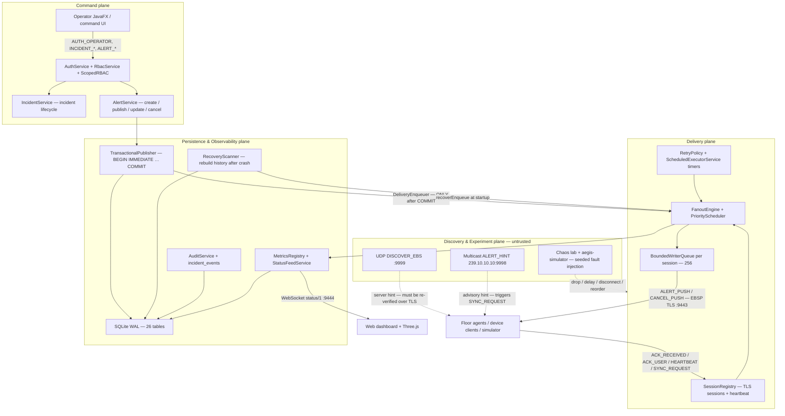
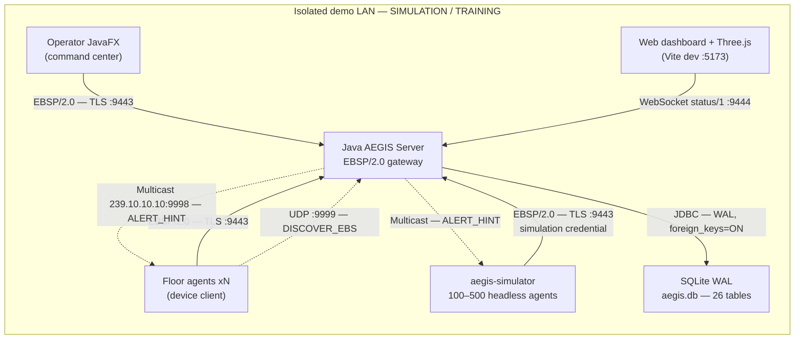
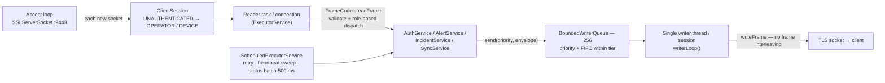
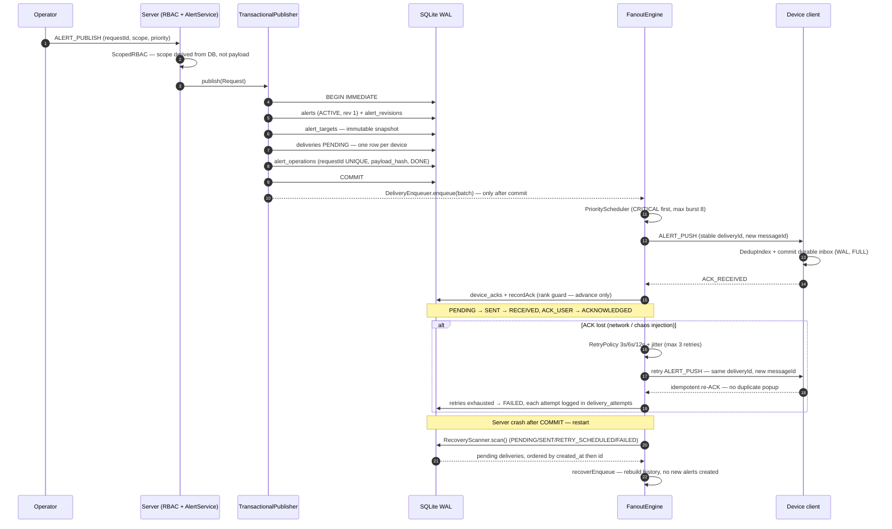

Language: English | Vietnamese original: docs/ARCHITECTURE.md

# AEGIS-EBS System Architecture

**Document type:** Software Architecture Description — CMP180 capstone project.

**Status:** This document describes the design approved in the blueprint and maps it to the repository's current source code. The system serves academic research, simulation and training (**SIMULATION / TRAINING**); it does not replace fire alarm, evacuation or life-safety warning systems.

**Primary sources:**

- `Plan/AEGIS_MASTER_BLUEPRINT.md` — §5 (state machines and invariants), §6 (physical / logical / deployment architecture), §7 (EBSP/2.0 protocol), §8 (data architecture).
- Source code of the modules: `aegis-protocol`, `aegis-core`, `aegis-persistence`, `aegis-server`, `aegis-client`, `aegis-network-lab`, `aegis-simulator`, `aegis-dashboard`.
- Actual SQLite schema: `aegis-persistence/src/main/resources/db/001_base_schema.sql` (12 tables) and `002_showcase_expansion.sql` (14 tables) — **26 tables** in total, specified in detail in [`docs/ERD.md`](ERD.md).
- Related documents: [`docs/PROTOCOL.md`](PROTOCOL.md) (EBSP/2.0 wire contract), `aegis-dashboard/docs/status-contract.md` (status feed contract `status/1`).

---

## 1. Overview and architectural principles

AEGIS-EBS is a platform combining **incident command + reliable alert distribution + digital twin + an observable network fault lab**, built as a Java **modular monolith**. The CMP180 assessment focus is **self-building an application-layer protocol over TCP/UDP** (Socket/ServerSocket, DatagramSocket, MulticastSocket); the system does not use cloud push or a message broker as its primary transport.

Cross-cutting architectural principles:

1. **Separation of four planes:** command, delivery, persistence–observability, discovery–experiment (§2). Each plane has its own responsibility, trust boundary and protection mechanisms.
2. **A single server node in the LAN.** The single point of failure is acknowledged explicitly; crash recovery on the node is not equivalent to high availability. Cluster / floor relays are optional research only (P3).
3. **Durable-first (transactional outbox):** every alert / target / delivery state must be committed to SQLite **before** being enqueued for network dispatch; the durable dispatch queue is the `deliveries` table (§6).
4. **TCP/TLS is the only authenticated channel.** UDP discovery and multicast hints are **untrusted** sources, advisory only; the client displays an alert only after verification over an authenticated TLS session.
5. **Bounded resources at every layer:** 64 KiB max frame, 256-element writer queue per session, bounded thread pools, short DB transactions, limited retention — no unbounded memory allocation from malformed data.
6. **Immutable shared contracts:** `aegis-protocol` (EBSP/2.0) and the 26-table schema are common ground for every module; changing the wire contract requires a version bump, changing the schema requires an additive migration.

### 1.1 Current module map

Blueprint §6.3 proposes a reference package tree; the repository merges several proposed modules into `aegis-core` (pure logic) and `aegis-server` (application services), and implements the dashboard as a web + Three.js application instead of pure JavaFX:

| Module | Technology | Main responsibility |
|---|---|---|
| `aegis-protocol` | Java, Jackson | EBSP/2.0 wire contract: `FrameCodec`, `Envelope`, `MessageType`, `Priority`, `Role`; length-prefix framing, validation. |
| `aegis-core` | Java (pure, no I/O) | Logic shared by server/client: `ScopedRBAC`, `TargetResolver`, `PriorityScheduler`, `RetryPolicy`, `DedupIndex`, `AckLedger`, `Grants`. |
| `aegis-persistence` | Java, sqlite-jdbc | `Db` (WAL + pragmas), `MigrationRunner` (001 + 002), repositories, `TransactionalPublisher`, `RecoveryScanner`, `DeliveryEnqueuer`. |
| `aegis-server` | Java, SLF4J/Logback, Argon2-jvm | TLS gateway, `ClientSession`, `SessionRegistry`, `BoundedWriterQueue`, `FanoutEngine`, `AuthService`/`RbacService`, `AlertService`, `IncidentService`, `SyncService`, `AuditService`, `MetricsRegistry`, `StatusNotifier`, `ServerStore`. |
| `aegis-client` | Java, JavaFX, sqlite-jdbc | Device client / operator UI: `AlertClientEngine` (headless engine), `InboxStore` (durable inbox), `ClientApp` (JavaFX), `TlsSupport`, reconnect + ACK. |
| `aegis-simulator` | Java | Large numbers of headless device agents (mandatory target 100 clients, 200–500 extended) + fault injection, running in explicit simulation mode. |
| `aegis-network-lab` | Java | UDP discovery (`DiscoveryServer`/`DiscoveryClient`), multicast/unicast hints (`MulticastHintPublisher`/`Subscriber`, `UnicastHintPublisher`/`Subscriber`), TLS lab (`LabTlsServer`/`LabTlsClient`), benchmark (`FanoutBenchmark`). |
| `aegis-dashboard` | Node, Vite, Three.js | 2D/3D web digital twin; reference client of the `status/1` feed (`src/data.js`, `src/ws.js`); not a second backend. |

Maven dependency relations: `protocol ← core ← {persistence, server, client, simulator}`; `server ← {protocol, core, persistence}`; `network-lab ← protocol`. The dashboard is independent (Node), communicating only via WebSocket `status/1`.

---

## 2. Four-plane model (blueprint §6.1)

### 2.1 Command plane

Responsible for **authorized control**: operator login, identity and scope verification, incident creation / transition, alert creation / publish / update / cancel. Every command travels over EBSP/2.0 on TLS (`AUTH_OPERATOR`, `INCIDENT_CREATE`, `INCIDENT_TRANSITION`, `ALERT_CREATE`, `ALERT_PUBLISH`, `ALERT_UPDATE`, `ALERT_CANCEL`) and is answered with `COMMAND_RESULT` carrying a typed error code.

Implementation: `AuthService` + `RbacService` (server) call `ScopedRBAC` (core); `IncidentService` manages the incident lifecycle; `AlertService` coordinates publish/update/cancel through `TransactionalPublisher`. **RBAC is enforced before alert services run**; the target scope is derived from the DB (`TargetResolver`), never from client-supplied role/floor metadata. Out-of-scope commands are denied (`ACCESS_DENIED` / `INVALID_SCOPE`) and audited.

### 2.2 Delivery plane

Responsible for **reliable delivery** to authenticated device sessions: session management (`SessionRegistry`), priority fanout (`FanoutEngine` + `PriorityScheduler`), bounded per-session writer queue (`BoundedWriterQueue`), backoff retry (`RetryPolicy`), ACK intake and resync after reconnect (`SyncService`). Each target device has exactly one `deliveries` record for each `(alertId, revision, deviceId)` tuple; each transport attempt uses a new `messageId` but keeps the same logical `deliveryId`.

### 2.3 Persistence & Observability plane

Responsible for the **durable source of truth and measurement**: SQLite WAL (26 tables), atomic publish (`TransactionalPublisher`), crash recovery (`RecoveryScanner`), append-only audit (`AuditService`), incident event log (`incident_events`) for read-only replay, metrics (`MetricsRegistry`) and the bridge to the dashboard status feed (`StatusNotifier` → `StatusFeedService`, WebSocket `status/1`). SQLite's single-writer bottleneck is acknowledged and mitigated with short transactions, `busy_timeout` and a bounded worker pool (§5.5).

### 2.4 Discovery & Experiment plane

Responsible for **server discovery and controlled network experimentation** on the isolated demo LAN: UDP `DISCOVER_EBS` on port 9999 (nonce, protocolVersion, clientType; response contains serverId, host, tlsPort, nonce echo) and multicast `ALERT_HINT` to group `239.10.10.10:9998` (administratively-scoped group). Both are **untrusted**: a hint only triggers `SYNC_REQUEST` over TLS; the client always verifies server identity via the truststore before authenticating. The chaos lab (drop/delay ACK, duplicate, forced disconnect, reorder at the simulated message layer, server restart) runs through the simulator and gateway adapters, with seeds for deterministic reproduction.

### 2.5 Combined four-plane diagram

---

## 3. Deployment model (blueprint §6.2)

### 3.1 Deployment diagram

### 3.2 Port and channel table

| Port | Transport | Purpose | Trust level |
|---|---|---|---|
| 9443 | TCP + TLS | EBSP/2.0: handshake, operator commands, ALERT_PUSH/CANCEL_PUSH, ACK, SYNC, HEARTBEAT, STATUS_SUBSCRIBE | Mutual verification via truststore + credential; the only primary channel |
| 9444 | TCP + WebSocket | `status/1` feed for the dashboard: `STATUS_SNAPSHOT` / `STATUS_DELTA` | Read-only; bridge from the server's EBSP state |
| 9999 | UDP | `DISCOVER_EBS` / discovery response (serverId, host, tlsPort, nonce echo) | Untrusted; only a hint for finding the server |
| 9998 | UDP multicast, group `239.10.10.10` | `ALERT_HINT {alertId, revision, serverId}` | Untrusted; advisory, never displayed directly |
| 5173 | TCP + HTTP | dashboard's Vite dev server (development environment only) | Not a business channel |

Default server configuration (`ServerConfig`): `tlsPort=9443`, `wsPort=9444`, `buildingId="AEGIS-BLD-A"`, heartbeat 10 s / suspect after 3 misses, base retry 3 s with at most 3 retries, writer queue 256, status batching 500 ms, Argon2id (iterations=2, memory=16 MiB, parallelism=1). Ports can be set to 0 (ephemeral) in tests.

### 3.3 Deployment notes

- **One server, one DB file.** All durable state lives in `aegis.db` (SQLite WAL) on the same host as the server; there is no second backend for the dashboard.
- **The simulator must run in explicit simulation mode**, with non-production credentials and test-only identities; UI and content always show the SIMULATION / TRAINING marker. The `simulation` flag in the payload is **not a security boundary** — the server's demo mode and a separate device allowlist are the actual controls.
- **Multicast needs a real LAN that supports multicast** (set TTL/interface, rate limit, disabled by default outside the controlled lab); multicast over a Tailscale-like tunnel usually fails. On a single macOS host, use the unicast fallback (`UnicastHintPublisher` / `UnicastHintSubscriber`) to demo the hint bus.
- **Dashboard** is a web application (Vite + Three.js) rendering the digital twin from the `status/1` feed; it opens no private backend. The dashboard client has reconnect backoff 1 s → 15 s + jitter and a MOCK mode after 3 connection failures (`MOCK FEED` badge), automatically returning to LIVE when the server is reachable.
- No real physical devices are controlled (sirens, elevators, doors, locks); scenarios only affect authorized demo clients.

---

## 4. Module contracts (blueprint §6.4)

### 4.1 Contract table

Mapping the blueprint's internal contract table to the current modules:

| Module / component | Input | Output / Contract | Dependencies |
|---|---|---|---|
| Protocol (`aegis-protocol`) | bytes, envelope | Validated frame + typed message; framing `uint32 BE length + UTF-8 JSON`, L ∈ [1, 65536]; reject oversize frames **before** allocation | Jackson, Java I/O |
| Gateway (`ClientSession`, accept loop) | TLS socket | AuthenticatedSession events; one reader + one writer per session | Protocol, Auth |
| Identity (`AuthService`, `RbacService`, `ScopedRBAC`) | credential / session | principal + scope (grants derived from DB) | Persistence, Argon2id |
| Incident (`IncidentService`) | create / transition | Durable event stream (`incident_events`) | Persistence, Policy |
| Alert (`AlertService`, `TransactionalPublisher`) | create / publish / cancel | Immutable revision + immutable target snapshot; idempotency record `alert_operations` | Auth, Persistence |
| Fanout (`FanoutEngine`, `TargetResolver`, `PriorityScheduler`) | target snapshot | Bounded queue entries per device; priority order with fairness | Persistence, SessionRegistry |
| Delivery (`FanoutEngine`, `RetryPolicy`, `DeliveryRepo`) | ACK / timeout | Advance-only state updates (rank guard), retry tasks, `delivery_attempts` | Persistence, Fanout |
| Presence (`SessionRegistry`) | heartbeat / connect | online / suspect / offline state + sync trigger | SessionRegistry |
| Client (`AlertClientEngine`, `InboxStore`) | frames | Local DB commit **before** ACK + UI events + ACK; dedup, reconnect | Protocol, Core, ClientStore |
| Dashboard (`aegis-dashboard`) | `status/1` status events | Charts, number map, operator commands | Auth/TLS (commands), WS (feed) |
| Chaos Lab (`aegis-simulator`, `aegis-network-lab`) | scenario + seed | Fault events + reproducible results | Simulator / Gateway adapters |

### 4.2 Mandatory contract rules

1. **One `SessionWriter` owns all writes to one stream.** Executor tasks must never interleave bytes of different frames on the same Socket; implementation: each `ClientSession` has exactly one writer thread running `writerLoop()`, taking frames from `BoundedWriterQueue`.
2. **No network I/O inside a DB transaction.** Transactions contain only short SQLite operations; network enqueue happens after COMMIT.
3. **Every queue is bounded** to prevent unbounded memory growth; each writer queue has an explicit slow-client policy (§5.2).
4. **`DeliveryEnqueuer` may only be called after the publish transaction commits** (or by `RecoveryScanner` rebuilding history after restart). This is the key transactional-outbox contract.
5. **Wire contracts and schema are shared invariants**: no module changes framing, enums, or columns on its own; changes require a version bump / additive migration.

---

## 5. Concurrency model

### 5.1 Accept loop + reader per connection + writer per session

The server's threading model follows blueprint §6.4 and the `ClientSession` implementation:

- **Accept loop:** one thread accepts connections on `SSLServerSocket` (TLS :9443). Each accepted socket becomes a `ClientSession` (initially `UNAUTHENTICATED`), registered in `SessionRegistry` and assigned its own read task.
- **Reader per connection:** a task in `ExecutorService` reads frames sequentially with `FrameCodec` (`readFully` 4 length bytes then payload), validates UTF-8 / JSON / version / enum / role authorization, then dispatches to the corresponding service (Auth, Alert, Incident, Sync, Heartbeat). One connection has only one reader, so inbound frame order is preserved.
- **Writer per session:** on session creation, `writerExecutor.execute(this::writerLoop)` runs **a single write thread** for that session: `queue.take()` (blocking until a frame is available or the queue closes), then `codec.writeFrame(out, next)`. Frame bytes never interleave, and a broken pipe / codec error closes only that connection.
- **Timers:** `ScheduledExecutorService` (`timers` in `FanoutEngine`) schedules retries by `next_retry_at`, sweeps suspect heartbeats, and batches the status feed (default 500 ms). Pure time logic receives an injectable `Clock` for deterministic tests.

### 5.2 Bounded writer queue and slow-client policy

`BoundedWriterQueue` (default 256 elements / session) implements a deterministic policy:

| `offer` result | Condition | Behavior |
|---|---|---|
| `ACCEPTED` | Queue not full | Accept frame; FIFO within the same priority tier |
| `EVICTED_LOWER` | Full, and the new frame outranks the lowest-priority queued frame | Evict lowest frame, accept new one — CRITICAL traffic is never blocked by an INFO flood |
| `REJECTED_SLOW` | Full, no eviction possible | Call `onSlowClient` → **disconnect the slow client** (it is not draining the socket); one slow client must not stall others |

Priority order is **application-level** (`Priority` enum), not Java thread priority. The blueprint reserves a few slots for cancel/critical control messages; under saturation, critical jobs are never silently dropped — mark `QUEUE_BLOCKED` and escalate to monitoring/retry; INFO may only be deferred/coalesced under an explicitly documented policy.

### 5.3 Global priority scheduling with fairness

`PriorityScheduler` (core) dispatches in order `CRITICAL > EMERGENCY > WARNING > INFO`, FIFO within a tier. Fairness rule: at most `MAX_BURST = 8` consecutive dispatches from the highest non-empty tier, then one from a lower tier, rotating through lower tiers in descending order — lower tiers do not starve. `FanoutEngine` applies this global scheduler **before** placing frames into each session's writer queue.

### 5.4 Client-side concurrency

The client uses a headless engine (`AlertClientEngine`) with the same separated reader/writer model; the local SQLite WAL inbox (`synchronous=FULL`) commits **before** sending `ACK_RECEIVED` (durable-first). Reconnect uses exponential backoff + jitter (`RetryPolicy`, target NFR-007: ≤ 15 s after network recovery), then `SYNC_REQUEST` to obtain authoritative state. The JavaFX UI updates via `Platform.runLater`, separated from I/O threads.

### 5.5 SQLite WAL concurrency

SQLite WAL allows reads in parallel with writes, but **only one writer commits at a time** — an acknowledged bottleneck (blueprint §8.1). Discipline implemented in `Db`:

- Every opened connection applies `PRAGMA foreign_keys=ON` (setting it inside a transaction is ineffective), `journal_mode=WAL` (verified, throws if refused), `busy_timeout=5000`.
- Short-lived connections with try-with-resources; write transactions use manual `BEGIN IMMEDIATE` / `COMMIT` / `ROLLBACK` (autoCommit=true) to acquire the write lock early and avoid mid-transaction escalation.
- Short transactions with no network I/O inside; bounded worker pool; each repo has `static insertOn(Connection, row)` so composite writes share one transaction.

### 5.6 Heartbeat and presence

Heartbeat every 10 s; a session is marked **suspect** after 3 consecutive missed intervals (`SessionRegistry`, pure logic on an injectable `Clock`). The caller audits and closes suspect sessions; a reconnecting device creates a new session, with `deviceOnline` replacing the old connection (closing the stale session). online / suspect / offline states are reflected in the dashboard feed via `connectivityChanged`.

---

## 6. Flow: publish → fanout → ACK → retry → recovery

### 6.1 Atomic publish (transactional outbox)

Sequence of `TransactionalPublisher.publish(Request)` — corresponds to UC-01 and blueprint §8.3:

1. **Validate permissions** (RBAC + scope derived from DB) and `requestId`; an empty target set → explicit error.
2. `BEGIN IMMEDIATE`.
3. Write in **one transaction**: `alerts` (ACTIVE, revision 1) + `alert_revisions` (content immutable per revision) + `alert_targets` (immutable target snapshot) + `deliveries` (PENDING, one row per target device) + `alert_operations` (idempotency record: `request_id` UNIQUE, `payload_hash` SHA-256, state DONE).
4. `COMMIT`.
5. **Only after commit**, call `DeliveryEnqueuer.enqueue(batch)` to hand the batch to `FanoutEngine`.

Any failure → `ROLLBACK`, nothing is enqueued. Duplicate `requestId` → no new alert (duplicate result returned; different payload → `CONFLICT`). If the enqueuer fails **after** commit, the rows are still durable and `RecoveryScanner` rebuilds history at restart — no lost alerts, no duplicate dispatch beyond dedup.

### 6.2 Fanout

`FanoutEngine` takes a PENDING batch, orders it through the global `PriorityScheduler`, then calls `ClientSession.send(priority, envelope)` into each target device's writer queue. `DedupIndex` blocks the **first dispatch** of a stale delivery: if a revision equal to or older than one already dispatched to the same device arrives, the stale push is suppressed (e.g. a late retry of revision 1 after revision 2 was published). Retries and recovery deliveries **bypass** this gate because they continue an already-owned lifecycle. Each `ALERT_PUSH` frame carries a stable `deliveryId` and a new `messageId`; a `pushWritten` event is reported to `StatusNotifier`.

### 6.3 ACK and state semantics

- The client validates the payload, checks `(alertId, revision)` with `DedupIndex` (seeded from the durable inbox), **commits the local inbox and only then sends `ACK_RECEIVED`**; a duplicate message is re-ACKed idempotently but shows no second popup.
- The server verifies the ACK comes from the correct authenticated device for the correct alert / revision / deliveryId; writes `device_acks` and updates `deliveries` in **one transaction** (`DeliveryRepo.recordAck`). State only advances under the SQL rank guard: `PENDING(0) < SENT/RETRY_SCHEDULED(1) < RECEIVED(2) < ACKNOWLEDGED/FAILED(3) < EXPIRED/CANCELLED(4)` — never RECEIVED → SENT after a retry.
- `ACK_RECEIVED` (confirmation of local storage) **differs from** `ACK_USER` (a user action, requiring an authenticated user identity if responsibility is attributed); `ACK_USER` is never inferred from `ACK_RECEIVED`. `ACK_CANCEL` acknowledges the cancellation semantics.

### 6.4 Bounded retry

When an ACK is missing, `RetryPolicy` schedules exponential backoff: **3 s / 6 s / 12 s + jitter** (jitter uniform in `[0, baseDelay)`), at most **3 retries after the initial send**, then `FAILED`. Each attempt has a new `messageId`, an unchanged `deliveryId`, and a new `delivery_attempts` row; the delivery moves to `RETRY_SCHEDULED` with `next_retry_at`. A FAILED record of a still-active alert can be rescheduled by an explicit recovery event after reconnect; expired/cancelled alerts are never enqueued as new active alerts.

### 6.5 Crash / restart recovery

At startup, `RecoveryScanner.scan()` (read-only) queries deliveries still owned by the scheduler — `PENDING / SENT / RETRY_SCHEDULED / FAILED` — ordered by `created_at, id`; `FanoutEngine.recoverEnqueue(...)` rebuilds the queue from durable state. State transitions still belong to the scheduler; the scanner never changes state itself. This is the **transactional outbox pattern**: the `deliveries` table is the durable dispatch queue, with no separate outbox table.

### 6.6 Cancellation and resync

Cancellation is a **separate semantic operation** (`ALERT_CANCEL` → tombstone + `CANCEL_PUSH` + `ACK_CANCEL`, new operationId/revision, receipt tracked separately in `operation_receipts`); retries of an old `ALERT_PUSH` must not resurrect a cancelled revision. After reconnect, the client sends `SYNC_REQUEST {knownLatestRevisionByAlert}` and receives `SYNC_RESULT` with authoritative active work + cancellation tombstones; expired/cancelled/superseded alerts never reappear as new alerts. Closing an incident is not equivalent to force-ACKing devices; timeline replay reads `incident_events` only, it does not re-publish alerts.

### 6.7 Combined sequence diagram

### 6.8 Key invariants (blueprint §5)

- Each device in the activation snapshot has **at most one** `deliveries` row for `(alertId, revision, deviceId)`.
- Each send has its own `messageId`, reusing the stable `deliveryId`.
- ACKs are accepted only from the correct authenticated device + alert + revision + deliveryId; ACK only advances state.
- `ACK_USER` is never inferred from `ACK_RECEIVED`.
- The `requestId` of CREATE_ALERT is globally unique per authorized operation; a payload fingerprint blocks conflicting reuse.
- The client never trusts multicast/UDP as an operator command.
- Expired/cancelled/superseded alerts are not redisplayed as new active alerts after sync.
- Every bounded writer queue has a slow-client policy; one slow client does not stall the others.
- Alert priority and CAP `severity`/`urgency`/`certainty` are separate semantics.

---

## 7. Observability and the dashboard status feed

- **`MetricsRegistry`** measures server-side: connection count, p50/p95/p99 percentile latency (monotonic clock for local RTT/ACK), retry count, queue depth, resources (CPU, RSS, threads, WAL size) per NFR-014.
- **`StatusNotifier`** is the hook interface called by `FanoutEngine` to keep the feed current: `pushWritten`, `ackReceived` (first time, monotonic), `deliveryFailed`, `alertsChanged`, `connectivityChanged`. `StatusFeedService` batches (default 500 ms) and publishes over WebSocket :9444.
- **`status/1` contract** (see `aegis-dashboard/docs/status-contract.md`): envelope `{version:1, type, buildingId, ts}`; `STATUS_SNAPSHOT` is sent immediately on connect (and after resync), `STATUS_DELTA` contains only changes; `activeAlerts` replaces the whole list when present; deltas before a snapshot are discarded. Zone severity is derived by a canonical rule (offline / critical / warning / online) from real delivery counters — **the online client count is never used as the ACK denominator**.
- **Append-only audit** (`audit_events`): actor, action, scope, outcome, correlationId; denied publishes still appear in the audit view. **Incident replay** reads `incident_events` only, it does not re-publish alerts.
- The dashboard's funnel counts targeted / written / received / user-ack from real delivery records, with no double-counting after retries (FR-025).

---

## 8. Security boundaries (summary)

1. **TLS truststore** verifies server identity (never trust-all in the default production/demo setup); never send passwords / device secrets to an unverified server; authenticate the session after TLS.
2. **Argon2id** for operator passwords and device credentials (`Argon2idHasher`); disabled devices cannot authenticate; rotate/revoke as required.
3. **Scoped RBAC** (`role_grants`): SYSTEM_ADMIN everywhere; SECURITY_OPERATOR in the granted building; FLOOR_MANAGER only on the granted floor; scope derived from the DB, not from client payload.
4. **Untrusted UDP/multicast**: a discovery response is not trusted merely because it came from the LAN; a hint only triggers sync over verified TLS.
5. **Simulation marking** is mandatory in UI/content; the `simulation` flag is not a security boundary — demo mode + device allowlist are the controls.
6. No secrets in logs; control-plane errors use typed error codes + correlationId + sanitized details (NFR-016/017).

---

## References

1. `Plan/AEGIS_MASTER_BLUEPRINT.md` — AEGIS EBS Command Center / Showcase Edition, CMP180 Capstone Blueprint v2.0 (§5–§8).
2. `docs/PROTOCOL.md` — EBSP/2.0 wire contract (framing, envelope, idempotency, retry, message catalog).
3. `aegis-dashboard/docs/status-contract.md` — status feed contract `status/1` (WebSocket :9444).
4. `aegis-persistence/src/main/resources/db/001_base_schema.sql`, `002_showcase_expansion.sql` — 26-table schema; relationships specified in [`docs/ERD.md`](ERD.md).
5. Reference source code: `ClientSession`, `BoundedWriterQueue`, `FanoutEngine`, `SessionRegistry`, `ServerConfig` (aegis-server); `PriorityScheduler`, `RetryPolicy`, `TargetResolver`, `ScopedRBAC`, `DedupIndex` (aegis-core); `TransactionalPublisher`, `RecoveryScanner`, `DeliveryRepo`, `Db`, `MigrationRunner` (aegis-persistence); `AlertClientEngine`, `InboxStore` (aegis-client); `LabDefaults`, `DiscoveryServer`, `MulticastHintPublisher` (aegis-network-lab).
