Language: English | Vietnamese original: docs/ERD.md

# Entity-Relationship Diagram (ERD) — AEGIS-EBS

**Document type:** Relational data model specification (Entity-Relationship Diagram) — CMP180 capstone project.

**Source of truth:** The actual SQLite schema in `aegis-persistence/src/main/resources/db/`:

- `001_base_schema.sql` — base v1 schema, **12 tables**.
- `002_showcase_expansion.sql` — additive v2 migration, **14 tables**.
- Total **26 tables**, applied sequentially by `MigrationRunner.migrate()`.

This document reflects the **actual schema exactly** (table names, columns, keys, constraints); `Plan/AEGIS_MASTER_BLUEPRINT.md` §8 is only a design reference. Note: blueprint §8.1 writes `alert_templates_locales`, but the real schema names the table **`alert_template_locales`** — this document uses the real name.

**General schema conventions:**

- Primary keys and foreign keys are `TEXT`, with UUID values as strings; timestamps are `TEXT` in UTC ISO-8601 format (`DateTimeFormatter.ISO_INSTANT`, with a `Z` suffix).
- Boolean flags use `INTEGER` with `CHECK (x IN (0,1))`, default 1.
- `PRAGMA foreign_keys=ON` on **every** connection (`Db.open()`); `journal_mode=WAL`, `busy_timeout=5000`.
- Migrations are idempotent thanks to sentinel tables (`buildings`, `demo_scenarios`) — there is no bookkeeping table, so the table count stays exactly 26; each script runs in one `BEGIN IMMEDIATE` transaction.
- Cross-building/zone invariants and temporal ordering are enforced by the application layer (SQLite cannot express them with plain FKs).

---

## 1. Entity grouping (26 tables)

| Group | Tables | Count |
|---|---|---:|
| **Building / Zone** (physical topology) | `buildings`, `floors`, `zones`, `zone_devices` | 4 |
| **Identity / RBAC** (identity and permissions) | `users`, `role_grants`, `devices` | 3 |
| **Incident** (incidents and event streams) | `incidents`, `incident_events`, `incident_alerts` | 3 |
| **Alert / Delivery** (alerts and delivery) | `alerts`, `alert_revisions`, `alert_targets`, `deliveries`, `delivery_attempts`, `device_acks`, `alert_templates`, `alert_template_locales` | 8 |
| **Operation / Audit** (operations and traces) | `alert_operations`, `operation_receipts`, `alert_approvals`, `audit_events` | 4 |
| **Chaos / Metrics** (experiments and measurements) | `network_fault_runs`, `network_fault_events`, `metrics_samples`, `demo_scenarios` | 4 |
| **Total** | | **26** |

Topology chain: `Building → Floor → Zone → ZoneDevice → Device` (blueprint §8.2). `devices` belongs to the Identity group because it carries `credential_hash` / `enrolled_at` (device identity), while also referencing `floors` and being assigned to zones via the junction table `zone_devices`.

---

## 2. Full ERD (mermaid `erDiagram`)

Notation: `PK` primary key, `FK` foreign key, `UK` single-column unique key; composite unique keys are noted in comments. `||--o{` is a NOT NULL FK (one-to-many), `|o--o{` is a nullable FK (zero-or-one-to-many), `||--o|` is a one-to-zero-or-one relationship (UNIQUE FK).

```mermaid
erDiagram
  %% ===== Group Building / Zone =====
  buildings {
    TEXT id PK "UUID"
    TEXT code UK "NOT NULL UNIQUE"
    TEXT name "NOT NULL"
  }
  floors {
    TEXT id PK "UUID"
    TEXT building_id FK "NOT NULL - buildings.id"
    INTEGER floor_number "NOT NULL - UK(building_id, floor_number)"
    TEXT label "nullable"
  }
  zones {
    TEXT id PK "UUID"
    TEXT floor_id FK "NOT NULL - floors.id"
    TEXT zone_code "NOT NULL - UK(floor_id, zone_code)"
    TEXT label "NOT NULL"
    REAL display_x "nullable - digital twin coordinate"
    REAL display_y "nullable - digital twin coordinate"
  }
  zone_devices {
    TEXT zone_id PK, FK "PK(zone_id, device_id) - zones.id"
    TEXT device_id PK, FK "PK(zone_id, device_id) - devices.id"
    TEXT assigned_at "NOT NULL"
  }

  %% ===== Group Identity / RBAC =====
  users {
    TEXT id PK "UUID"
    TEXT username UK "NOT NULL UNIQUE"
    TEXT password_hash "NOT NULL - Argon2id"
    TEXT role "CHECK: SYSTEM_ADMIN, SECURITY_OPERATOR, FLOOR_MANAGER, EMPLOYEE, DEVICE"
    INTEGER enabled "CHECK 0/1 - default 1"
    TEXT created_at "NOT NULL - UTC ISO-8601"
  }
  role_grants {
    TEXT id PK "UUID"
    TEXT user_id FK "NOT NULL - users.id"
    TEXT building_id FK "nullable - buildings.id"
    TEXT floor_id FK "nullable - floors.id"
    TEXT scope "NOT NULL"
    TEXT granted_at "NOT NULL"
  }
  devices {
    TEXT id PK "UUID"
    TEXT floor_id FK "NOT NULL - floors.id"
    TEXT device_code UK "NOT NULL UNIQUE"
    TEXT credential_hash "NOT NULL"
    INTEGER enabled "CHECK 0/1 - default 1"
    TEXT enrolled_at "NOT NULL"
  }

  %% ===== Group Incident =====
  incidents {
    TEXT id PK "UUID"
    TEXT building_id FK "NOT NULL - buildings.id"
    TEXT opened_by FK "NOT NULL - users.id"
    TEXT kind "NOT NULL"
    TEXT summary "NOT NULL"
    INTEGER simulation "CHECK 0/1 - default 1"
    TEXT state "CHECK: DRAFT, OPEN, INVESTIGATING, CONTAINED, RESOLVED, CLOSED, ABORTED"
    TEXT opened_at "NOT NULL"
    TEXT closed_at "nullable"
  }
  incident_events {
    TEXT id PK "UUID"
    TEXT incident_id FK "NOT NULL - incidents.id"
    TEXT occurred_at "NOT NULL"
    TEXT event_kind "NOT NULL"
    TEXT actor_id "nullable - logical users.id, no FK"
    TEXT correlation_id "nullable"
    TEXT payload_json "NOT NULL"
  }
  incident_alerts {
    TEXT incident_id PK, FK "PK(incident_id, alert_id) - incidents.id"
    TEXT alert_id PK, FK, UK "UNIQUE - each alert belongs to at most 1 incident"
  }

  %% ===== Group Alert / Delivery =====
  alerts {
    TEXT id PK "UUID"
    TEXT building_id FK "NOT NULL - buildings.id"
    TEXT created_by FK "NOT NULL - users.id"
    TEXT category "NOT NULL"
    TEXT priority "CHECK: INFO, WARNING, EMERGENCY, CRITICAL"
    TEXT state "CHECK: DRAFT, ACTIVE, CANCELLED, EXPIRED, SUPERSEDED"
    INTEGER current_revision "NOT NULL - default 1"
    TEXT created_at "NOT NULL"
    TEXT expires_at "nullable"
  }
  alert_revisions {
    TEXT alert_id PK, FK "PK(alert_id, revision) - alerts.id"
    INTEGER revision PK "CHECK revision >= 1"
    TEXT title "NOT NULL - content immutable per revision"
    TEXT body "NOT NULL"
    TEXT metadata_json "NOT NULL"
    TEXT created_at "NOT NULL"
    TEXT created_by FK "nullable - users.id"
  }
  alert_targets {
    TEXT id PK "UUID"
    TEXT alert_id FK "NOT NULL - UK(alert_id, revision, device_id)"
    INTEGER revision "NOT NULL"
    TEXT device_id FK "NOT NULL - devices.id"
  }
  deliveries {
    TEXT id PK "UUID - stable deliveryId"
    TEXT alert_id FK "NOT NULL - UK(alert_id, revision, device_id)"
    INTEGER revision "NOT NULL"
    TEXT device_id FK "NOT NULL - devices.id"
    TEXT state "CHECK: PENDING, SENT, RECEIVED, ACKNOWLEDGED, RETRY_SCHEDULED, FAILED, EXPIRED, CANCELLED"
    TEXT next_retry_at "nullable"
    INTEGER attempt_count "CHECK >= 0 - default 0"
    TEXT created_at "NOT NULL"
  }
  delivery_attempts {
    TEXT id PK "UUID"
    TEXT delivery_id FK "NOT NULL - deliveries.id"
    TEXT message_id "NOT NULL - a new messageId on every attempt"
    TEXT attempted_at "NOT NULL"
    TEXT outcome "nullable"
  }
  device_acks {
    TEXT id PK "UUID"
    TEXT device_id FK "NOT NULL - UK(device_id, alert_id, revision, ack_kind)"
    TEXT alert_id FK "NOT NULL - alerts.id"
    INTEGER revision "NOT NULL"
    TEXT delivery_id FK "NOT NULL - deliveries.id"
    TEXT ack_kind "CHECK: RECEIVED, USER, CANCEL"
    TEXT acked_at "NOT NULL"
    TEXT user_id "nullable - logical users.id, no FK"
  }
  alert_templates {
    TEXT id PK "UUID"
    TEXT code UK "NOT NULL UNIQUE"
    TEXT category "NOT NULL"
    TEXT priority "CHECK: INFO, WARNING, EMERGENCY, CRITICAL"
    INTEGER enabled "CHECK 0/1 - default 1"
  }
  alert_template_locales {
    TEXT template_id PK, FK "PK(template_id, locale) - alert_templates.id"
    TEXT locale PK "vi / en"
    TEXT title "NOT NULL"
    TEXT body "NOT NULL"
  }

  %% ===== Group Operation / Audit =====
  alert_operations {
    TEXT id PK "UUID - operationId"
    TEXT alert_id FK "NOT NULL - alerts.id"
    INTEGER revision "NOT NULL"
    TEXT operation_kind "CHECK: PUBLISH, UPDATE, CANCEL"
    TEXT requested_by FK "NOT NULL - users.id"
    TEXT requested_at "NOT NULL"
    TEXT request_id UK "NOT NULL UNIQUE - idempotency key"
    TEXT payload_hash "NOT NULL - SHA-256 fingerprint"
    TEXT state "CHECK: PENDING, IN_PROGRESS, DONE, FAILED"
  }
  operation_receipts {
    TEXT operation_id PK, FK "PK(operation_id, device_id) - alert_operations.id"
    TEXT device_id PK, FK "PK(operation_id, device_id) - devices.id"
    TEXT acknowledged_at "nullable"
    INTEGER attempt_count "CHECK >= 0 - default 0"
    TEXT last_error "nullable"
  }
  alert_approvals {
    TEXT id PK "UUID"
    TEXT alert_id FK "NOT NULL - alerts.id"
    TEXT approver_id FK "NOT NULL - users.id"
    TEXT decision "NOT NULL"
    TEXT decided_at "NOT NULL"
  }
  audit_events {
    TEXT id PK "UUID - append-only"
    TEXT occurred_at "NOT NULL"
    TEXT actor_id "nullable - logical users.id, no FK"
    TEXT action "NOT NULL"
    TEXT scope "nullable"
    TEXT outcome "NOT NULL"
    TEXT correlation_id "nullable"
    TEXT payload_json "nullable"
  }

  %% ===== Group Chaos / Metrics =====
  network_fault_runs {
    TEXT id PK "UUID - run id"
    TEXT scenario_name "NOT NULL"
    INTEGER random_seed "NOT NULL - deterministic reproduction"
    TEXT began_at "NOT NULL"
    TEXT ended_at "nullable"
    TEXT git_commit "nullable - commit SHA"
    TEXT environment_json "NOT NULL - machine profile"
    TEXT result_json "nullable"
  }
  network_fault_events {
    TEXT id PK "UUID"
    TEXT run_id FK "NOT NULL - network_fault_runs.id"
    TEXT occurred_at "NOT NULL"
    TEXT fault_kind "NOT NULL"
    TEXT device_id FK "nullable - devices.id"
    TEXT params_json "NOT NULL"
    TEXT outcome "nullable"
  }
  metrics_samples {
    TEXT id PK "UUID"
    TEXT recorded_at "NOT NULL"
    TEXT run_id FK "nullable - network_fault_runs.id"
    TEXT incident_id FK "nullable - incidents.id"
    TEXT metric_name "NOT NULL"
    REAL metric_value "NOT NULL"
    TEXT unit "nullable"
    TEXT tags_json "nullable"
  }
  demo_scenarios {
    TEXT id PK "UUID - sentinel table of migration 002"
    TEXT scenario_key UK "NOT NULL UNIQUE"
    TEXT label "NOT NULL"
    INTEGER enabled "CHECK 0/1 - default 1"
    TEXT definition_json "NOT NULL"
  }

  %% ===== Building / Zone relationships =====
  buildings ||--o{ floors : "building_id"
  floors ||--o{ zones : "floor_id"
  zones ||--o{ zone_devices : "zone_id"
  devices ||--o{ zone_devices : "device_id"
  floors ||--o{ devices : "floor_id"

  %% ===== Identity / RBAC relationships =====
  users ||--o{ role_grants : "user_id"
  buildings |o--o{ role_grants : "building_id (nullable)"
  floors |o--o{ role_grants : "floor_id (nullable)"

  %% ===== Incident relationships =====
  buildings ||--o{ incidents : "building_id"
  users ||--o{ incidents : "opened_by"
  incidents ||--o{ incident_events : "incident_id"
  incidents ||--o{ incident_alerts : "incident_id"
  alerts ||--o| incident_alerts : "alert_id (UNIQUE)"

  %% ===== Alert / Delivery relationships =====
  buildings ||--o{ alerts : "building_id"
  users ||--o{ alerts : "created_by"
  alerts ||--o{ alert_revisions : "alert_id"
  users |o--o{ alert_revisions : "created_by (nullable)"
  alerts ||--o{ alert_targets : "alert_id"
  devices ||--o{ alert_targets : "device_id"
  alerts ||--o{ deliveries : "alert_id"
  devices ||--o{ deliveries : "device_id"
  deliveries ||--o{ delivery_attempts : "delivery_id"
  devices ||--o{ device_acks : "device_id"
  alerts ||--o{ device_acks : "alert_id"
  deliveries ||--o{ device_acks : "delivery_id"
  alert_templates ||--o{ alert_template_locales : "template_id"

  %% ===== Operation / Audit relationships =====
  alerts ||--o{ alert_operations : "alert_id"
  users ||--o{ alert_operations : "requested_by"
  alert_operations ||--o{ operation_receipts : "operation_id"
  devices ||--o{ operation_receipts : "device_id"
  alerts ||--o{ alert_approvals : "alert_id"
  users ||--o{ alert_approvals : "approver_id"

  %% ===== Chaos / Metrics relationships =====
  network_fault_runs ||--o{ network_fault_events : "run_id"
  devices |o--o{ network_fault_events : "device_id (nullable)"
  network_fault_runs |o--o{ metrics_samples : "run_id (nullable)"
  incidents |o--o{ metrics_samples : "incident_id (nullable)"
```

---

## 3. Foreign key specification (36 FK relationships)

Complete list of `REFERENCES` constraints in the actual schema, by group:

### 3.1 Building / Zone

| # | Child table | FK column | Parent table | Constraint |
|---|---|---|---|---|
| 1 | `floors` | `building_id` | `buildings(id)` | NOT NULL |
| 2 | `zones` | `floor_id` | `floors(id)` | NOT NULL |
| 3 | `zone_devices` | `zone_id` | `zones(id)` | NOT NULL, part of PK |
| 4 | `zone_devices` | `device_id` | `devices(id)` | NOT NULL, part of PK |
| 5 | `devices` | `floor_id` | `floors(id)` | NOT NULL |

### 3.2 Identity / RBAC

| # | Child table | FK column | Parent table | Constraint |
|---|---|---|---|---|
| 6 | `role_grants` | `user_id` | `users(id)` | NOT NULL |
| 7 | `role_grants` | `building_id` | `buildings(id)` | nullable (global grant needs no building) |
| 8 | `role_grants` | `floor_id` | `floors(id)` | nullable (building-level grant needs no floor) |

### 3.3 Incident

| # | Child table | FK column | Parent table | Constraint |
|---|---|---|---|---|
| 9 | `incidents` | `building_id` | `buildings(id)` | NOT NULL |
| 10 | `incidents` | `opened_by` | `users(id)` | NOT NULL |
| 11 | `incident_events` | `incident_id` | `incidents(id)` | NOT NULL |
| 12 | `incident_alerts` | `incident_id` | `incidents(id)` | NOT NULL, part of PK |
| 13 | `incident_alerts` | `alert_id` | `alerts(id)` | NOT NULL, **UNIQUE** — each alert belongs to at most one incident |

### 3.4 Alert / Delivery

| # | Child table | FK column | Parent table | Constraint |
|---|---|---|---|---|
| 14 | `alerts` | `building_id` | `buildings(id)` | NOT NULL |
| 15 | `alerts` | `created_by` | `users(id)` | NOT NULL |
| 16 | `alert_revisions` | `alert_id` | `alerts(id)` | NOT NULL, part of PK |
| 17 | `alert_revisions` | `created_by` | `users(id)` | nullable |
| 18 | `alert_targets` | `alert_id` | `alerts(id)` | NOT NULL |
| 19 | `alert_targets` | `device_id` | `devices(id)` | NOT NULL |
| 20 | `deliveries` | `alert_id` | `alerts(id)` | NOT NULL |
| 21 | `deliveries` | `device_id` | `devices(id)` | NOT NULL |
| 22 | `delivery_attempts` | `delivery_id` | `deliveries(id)` | NOT NULL |
| 23 | `device_acks` | `device_id` | `devices(id)` | NOT NULL |
| 24 | `device_acks` | `alert_id` | `alerts(id)` | NOT NULL |
| 25 | `device_acks` | `delivery_id` | `deliveries(id)` | NOT NULL |
| 26 | `alert_template_locales` | `template_id` | `alert_templates(id)` | NOT NULL, part of PK |

### 3.5 Operation / Audit

| # | Child table | FK column | Parent table | Constraint |
|---|---|---|---|---|
| 27 | `alert_operations` | `alert_id` | `alerts(id)` | NOT NULL |
| 28 | `alert_operations` | `requested_by` | `users(id)` | NOT NULL |
| 29 | `operation_receipts` | `operation_id` | `alert_operations(id)` | NOT NULL, part of PK |
| 30 | `operation_receipts` | `device_id` | `devices(id)` | NOT NULL, part of PK |
| 31 | `alert_approvals` | `alert_id` | `alerts(id)` | NOT NULL |
| 32 | `alert_approvals` | `approver_id` | `users(id)` | NOT NULL |

### 3.6 Chaos / Metrics

| # | Child table | FK column | Parent table | Constraint |
|---|---|---|---|---|
| 33 | `network_fault_events` | `run_id` | `network_fault_runs(id)` | NOT NULL |
| 34 | `network_fault_events` | `device_id` | `devices(id)` | nullable (server-level faults have no device) |
| 35 | `metrics_samples` | `run_id` | `network_fault_runs(id)` | nullable (metric outside a fault-run context) |
| 36 | `metrics_samples` | `incident_id` | `incidents(id)` | nullable (metric outside an incident context) |

---

## 4. Logical relationships without a FOREIGN KEY constraint

The references below are **not** declared as `REFERENCES` in the schema (note: audit/event logs are not blocked by a user's lifecycle; consistency is ensured by the application layer):

| Table | Column | Logical reference | Notes |
|---|---|---|---|
| `audit_events` | `actor_id` | `users(id)` | nullable; actor may be the system / a device |
| `incident_events` | `actor_id` | `users(id)` | nullable |
| `device_acks` | `user_id` | `users(id)` | nullable; required only when ACK_USER attributes responsibility to a person |
| `alert_targets`, `deliveries`, `device_acks` | `(alert_id, revision)` | `alert_revisions(alert_id, revision)` | revision must exist and match immutable content |
| `alert_operations` | `(alert_id, revision)` | `alert_revisions(alert_id, revision)` | operation bound to the exact revision being operated on |
| `alert_targets` ↔ `deliveries` | `(alert_id, revision, device_id)` | each other | each device in the snapshot has exactly one matching delivery |

Cross-region invariants (cross-building/zone consistency) and temporal ordering — e.g. `role_grants.floor_id` must belong to `role_grants.building_id`, `zones.floor_id` must be in the same building as the alert target — are enforced by the application (see the note at the top of `002_showcase_expansion.sql`).

---

## 5. CHECK constraints and enum values

| Table | Column | Valid value set |
|---|---|---|
| `users` | `role` | `SYSTEM_ADMIN`, `SECURITY_OPERATOR`, `FLOOR_MANAGER`, `EMPLOYEE`, `DEVICE` |
| `users`, `devices`, `alert_templates`, `demo_scenarios`, `incidents` | `enabled` / `simulation` | `0` or `1` (default 1) |
| `alerts`, `alert_templates` | `priority` | `INFO`, `WARNING`, `EMERGENCY`, `CRITICAL` |
| `alerts` | `state` | `DRAFT`, `ACTIVE`, `CANCELLED`, `EXPIRED`, `SUPERSEDED` |
| `deliveries` | `state` | `PENDING`, `SENT`, `RECEIVED`, `ACKNOWLEDGED`, `RETRY_SCHEDULED`, `FAILED`, `EXPIRED`, `CANCELLED` |
| `deliveries`, `operation_receipts` | `attempt_count` | `>= 0` (default 0) |
| `device_acks` | `ack_kind` | `RECEIVED`, `USER`, `CANCEL` |
| `incidents` | `state` | `DRAFT`, `OPEN`, `INVESTIGATING`, `CONTAINED`, `RESOLVED`, `CLOSED`, `ABORTED` |
| `alert_revisions` | `revision` | `>= 1` |
| `alert_operations` | `operation_kind` | `PUBLISH`, `UPDATE`, `CANCEL` |
| `alert_operations` | `state` | `PENDING`, `IN_PROGRESS`, `DONE`, `FAILED` |

State machines (blueprint §5): Incident `DRAFT → OPEN → INVESTIGATING → CONTAINED → RESOLVED → CLOSED` (may be `ABORTED` in SIMULATION); Alert `DRAFT → ACTIVE → (CANCELLED | EXPIRED | SUPERSEDED)`, with strictly increasing revisions; Delivery `PENDING → SENT → RECEIVED → ACKNOWLEDGED` with branches to `RETRY_SCHEDULED / FAILED / EXPIRED / CANCELLED` — ACK only advances, never regresses (rank guard in `DeliveryRepo.recordAck`).

---

## 6. Unique keys and indexes

### 6.1 Unique keys (UNIQUE)

| Table | UNIQUE | Meaning |
|---|---|---|
| `buildings` | `code` | unique building code |
| `users` | `username` | unique login name |
| `devices` | `device_code` | unique device code |
| `floors` | `(building_id, floor_number)` | unique floor number within a building |
| `zones` | `(floor_id, zone_code)` | unique zone code within a floor |
| `alert_targets` | `(alert_id, revision, device_id)` | snapshot has no duplicate devices |
| `deliveries` | `(alert_id, revision, device_id)` | **core invariant**: at most one delivery / device / revision |
| `device_acks` | `(device_id, alert_id, revision, ack_kind)` | idempotent ACK per kind |
| `incident_alerts` | `alert_id` | each alert belongs to at most one incident |
| `alert_operations` | `request_id` | global idempotency key of an operation |
| `alert_templates` | `code` | unique template code |
| `demo_scenarios` | `scenario_key` | unique demo scenario key |

Composite primary keys: `zone_devices(zone_id, device_id)`, `incident_alerts(incident_id, alert_id)`, `alert_revisions(alert_id, revision)`, `alert_template_locales(template_id, locale)`, `operation_receipts(operation_id, device_id)`. All other tables use a single `id TEXT` PK.

### 6.2 Indexes (9 indexes)

| Index | Table(column) | Query purpose |
|---|---|---|
| `ix_deliveries_state_retry` | `deliveries(state, next_retry_at)` | retry / recovery scan by state |
| `ix_deliveries_device_state` | `deliveries(device_id, state)` | sync by device, dashboard funnel |
| `ix_audit_time` | `audit_events(occurred_at)` | time-range audit queries |
| `ix_zone_devices_device` | `zone_devices(device_id)` | look up a device's zones (reverse of PK) |
| `ix_incidents_state` | `incidents(state, opened_at)` | list open incidents |
| `ix_incident_events_timeline` | `incident_events(incident_id, occurred_at)` | ordered timeline / replay |
| `ix_operation_receipts_pending` | `operation_receipts(operation_id, acknowledged_at)` | unacknowledged receipts of an operation |
| `ix_fault_events_run` | `network_fault_events(run_id, occurred_at)` | event stream of a fault run |
| `ix_metrics_name_time` | `metrics_samples(metric_name, recorded_at)` | per-metric time series |

---

## 7. Design notes

1. **Transactional outbox without a separate table:** `deliveries` IS the durable dispatch queue; `TransactionalPublisher` writes alert + revision + snapshot + deliveries + operation in one `BEGIN IMMEDIATE`, enqueues to the network only after COMMIT; `RecoveryScanner` rebuilds history from `PENDING / SENT / RETRY_SCHEDULED / FAILED` states after restart (see `docs/ARCHITECTURE.md` §6).
2. **Immutable snapshot:** `alert_targets` is fixed at activation time; the `zone_devices` mapping may change later but does not retroactively change the target of an issued alert. Aggregate screens use the snapshot, not the number of currently online clients as the ACK denominator.
3. **Content immutable per revision:** `alert_revisions` stores title/body/metadata for each revision; `alerts.current_revision` is only a pointer. An update creates a new revision; it never edits an old row.
4. **Append-only audit and event log:** `audit_events`, `incident_events` are never modified/deleted in business flows; replay is read-only.
5. **Separated priority semantics:** `alerts.priority` (network scheduling) differs from CAP `severity`/`urgency`/`certainty` (metadata in `metadata_json` / payload).
6. **Additive, idempotent migration:** 002 only adds tables/columns and does not break 001; the `buildings` / `demo_scenarios` sentinels decide which scripts need to run; the table count after migration is always exactly **26** (verified by `aegis-persistence` tests).

---

## References

1. `aegis-persistence/src/main/resources/db/001_base_schema.sql` — 12 base v1 tables.
2. `aegis-persistence/src/main/resources/db/002_showcase_expansion.sql` — 14 v2 extension tables.
3. `Plan/AEGIS_MASTER_BLUEPRINT.md` §8 — Database architecture v2 (design source; table names in this document follow the real schema).
4. `docs/ARCHITECTURE.md` — four-plane architecture, concurrency and the publish → fanout → ACK → retry → recovery flow.
5. Reference source code: `Db`, `MigrationRunner`, `TransactionalPublisher`, `RecoveryScanner`, `DeliveryRepo` (package `aegis.persistence`).
